<div align="center">

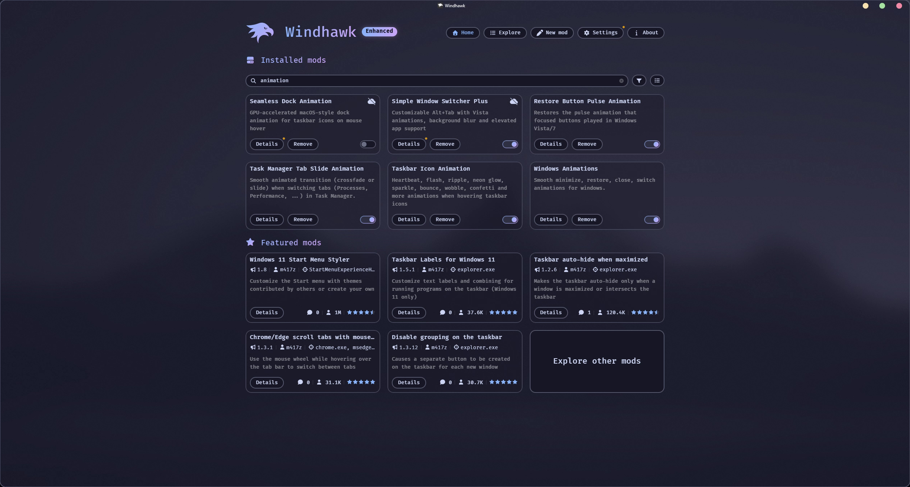

# David's Windhawk mods

**My [Windhawk](https://windhawk.net) mods for Windows 11, plus a full snapshot of the setup they run in.**

Taskbar, window and Start menu mods, every catalog mod and setting I use, and scripts to copy it all onto another PC.

<a href="https://github.com/DavidHiFi/davids-windhawk-mods/releases/latest">

</a>

<br><br>


</div>

---

## Installation

### One mod

1. Install [Windhawk](https://windhawk.net).
2. Open the mod's folder below and copy its `.wh.cpp` file.
3. In Windhawk, choose **Create a new mod**, paste the file and click **Compile**.
4. If the mod is a "Plus" version of a catalog mod, disable the original first.

Each release on the Releases page carries one mod, so the latest release is the most recently updated mod.

### The whole setup

1. Install [Windhawk](https://windhawk.net). Windhawk Enhanced Styler needs the 2.0 interface; its [legacy edition](mods/local/windhawk-enhanced-styler/legacy) covers the older one.
2. Install the catalog mods listed in [mods/catalog/README.md](mods/catalog/README.md) from Windhawk's Explore tab, and my mods from their folders.
3. From an elevated PowerShell in the repo root, preview and then apply the settings:

   ```powershell
   powershell -ExecutionPolicy Bypass -File tools\Apply-WindhawkSettings.ps1 -Audit
   powershell -ExecutionPolicy Bypass -File tools\Apply-WindhawkSettings.ps1
   ```

   Add `-IncludeAppSettings` to import the app and engine settings too, then reopen the Windhawk window.
4. Copy `mod-storage/` to `C:\ProgramData\Windhawk\Engine\ModsWritable\mod-storage\`, and `editor/settings.json` to `C:\ProgramData\Windhawk\UIData\user-data\User\settings.json`.

An AI agent can do all of this on its own: [AGENTS.md](AGENTS.md) is the runbook it should follow.

## Features

### Taskbar and tray

| | Mod | What it does |
| --- | --- | --- |
| 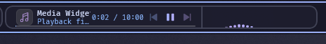 | [Seamless Media Player](mods/local/seamless-media-player) | A media player with a live audio visualizer beside it, right on the taskbar. |
| 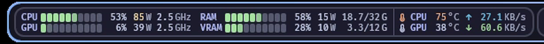 | [Taskbar System Info Plus](mods/local/taskbar-system-info-weather) | CPU, GPU, RAM, VRAM, temperatures and network speed on the taskbar, with optional graphs. |
| 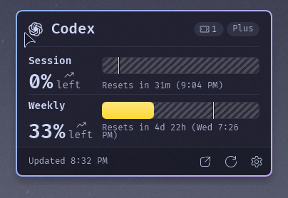 | [Taskbar AI Usage Plus](mods/local/taskbar-ai-usage-plus) | Claude, Codex, Antigravity and Copilot limits as ring tiles, with a Fluent flyout for the details. |
| 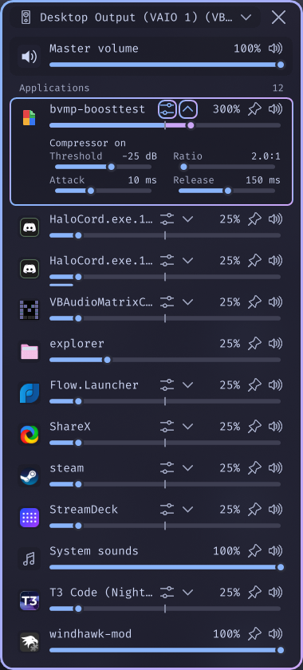 | [Seamless Volume Mixer](mods/local/better-volume-mixer-plus) | A tray volume mixer with per-app volume up to 1000%, a per-app compressor, and per-app output and input devices. |
| 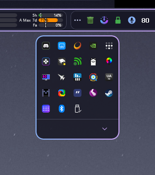 | [Seamless Tray Drawer](mods/local/seamless-tray-drawer) | A second drawer for rarely used tray icons, with your own colors, border and blur. |
| 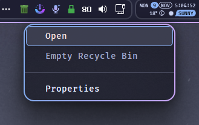 | [Recycle Bin Tray Plus](mods/local/recycle-bin-tray-plus) | A Recycle Bin icon in the tray, with drag and drop and themed menus. |
|  | [Taskbar Collapse to Running Plus](mods/local/taskbar-collapse-to-running-plus) | Hides pinned apps that are not running, and reveals them on hover. |
| | [Micrographics Taskbar Clock Plus](mods/local/micrographics-taskbar-clock-plus) | A Nothing OS style Micrographics clock for the taskbar, with pill badges and a weather line. |
| | [Seamless Taskbar Utilities](mods/local/seamless-taskbar-utilities) | Quick system tools in the taskbar right-click menu, with Catppuccin result cards. |

### Windows, borders and Alt+Tab

| | Mod | What it does |
| --- | --- | --- |
| | [Seamless Borders](mods/local/seamless-borders) | Colored borders around windows, menus and notification banners. |
| 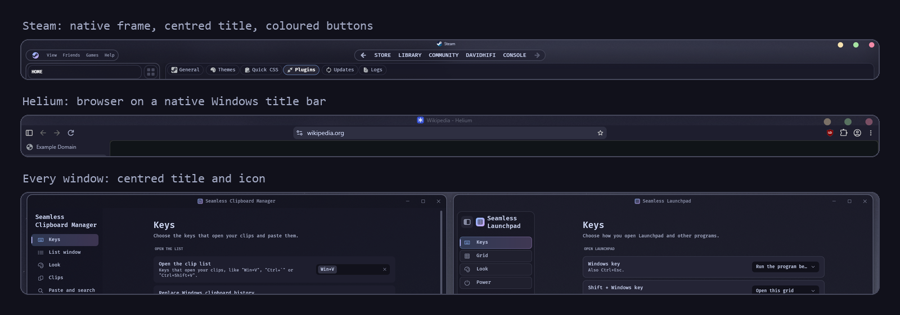 | [Seamless Title Bars](mods/local/seamless-title-bars) | One title bar look everywhere: colors, caption buttons and native frames in every kind of app. |
| 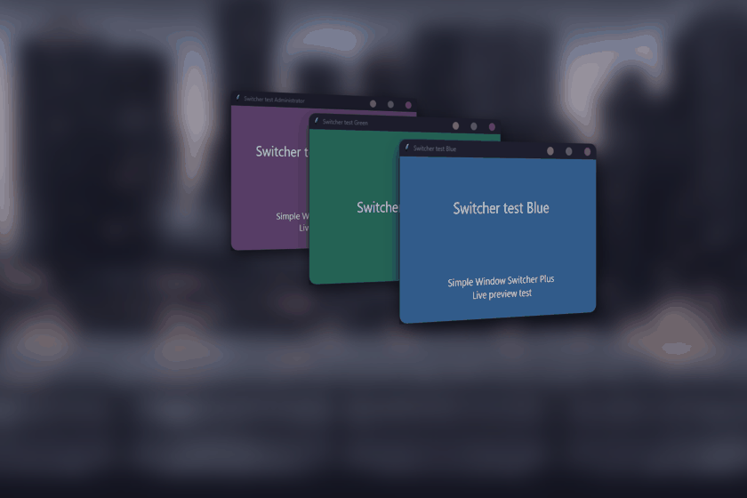 | [Simple Window Switcher Plus](mods/local/simple-window-switcher-plus) | Alt+Tab with Vista animations, background blur and elevated app support. |
| 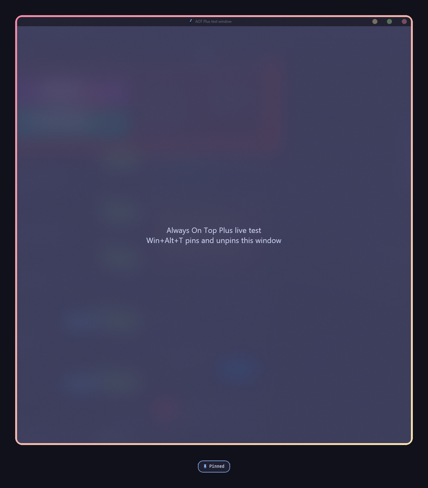 | [Always On Top Windows Plus](mods/local/always-on-top-plus) | Pin any window on top with a hotkey, marked by a Mocha red to yellow ring. |
| | [Seamless Window Manager](mods/local/seamless-window-manager) | Move, resize, snap and focus windows with the mouse or keyboard, with app rules and a pause key. |
| 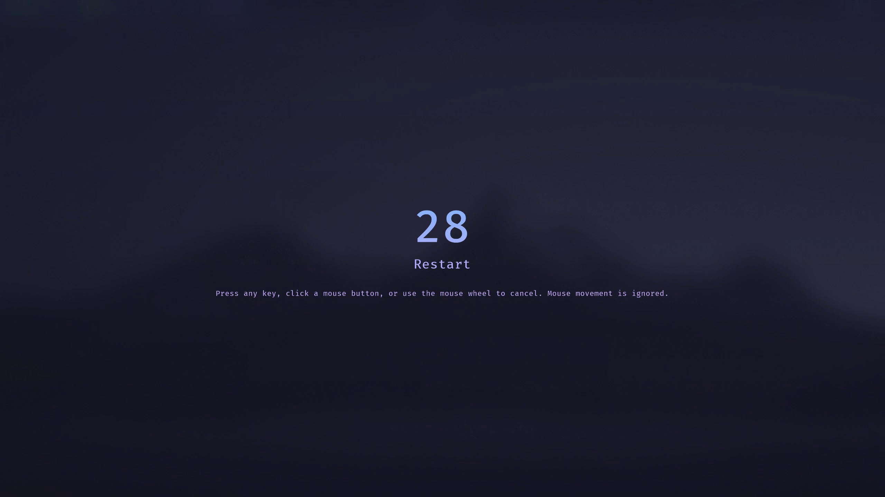 | [Seamless Power Action Countdown](mods/local/seamless-power-action-countdown) | A glassy countdown before shutdown, restart, sleep or hibernation that any key or click cancels. |
| 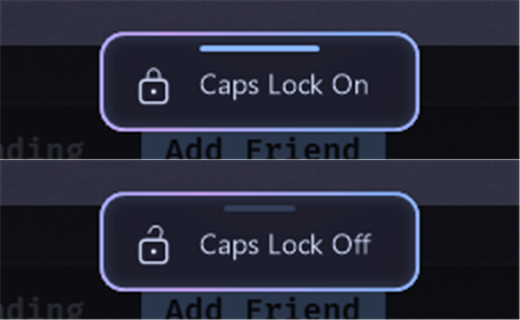 | [WinTips OSD Plus](mods/local/wintips-osd-plus) | The Windows tips OSD rebuilt in Capuchin Mocha: gradient-border cards for lock keys and clipboard actions. |

### Start menu and launchers

| | Mod | What it does |
| --- | --- | --- |
| 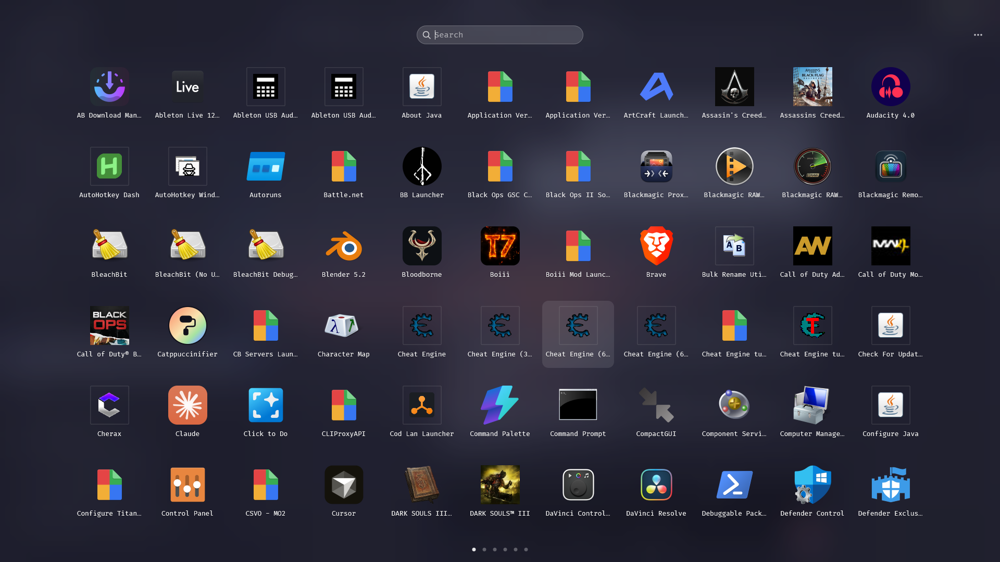 | [Seamless Launchpad](mods/local/seamless-launchpad) | A fullscreen, Launchpad-style grid of all your apps in place of Start, with instant search and blur. |
| | [Seamless Clipboard Manager](mods/local/seamless-clipboard-manager) | Everything you copy, text and images, in a searchable list you open with Win+V. |
| | [Theme Tool Plus](mods/local/theme-tool-plus) | Switch Windows themes from the settings tab, custom themes included. Comes with the Main 01 Catppuccin theme, cursors and sounds. |

### Explorer and files

| | Mod | What it does |
| --- | --- | --- |
| 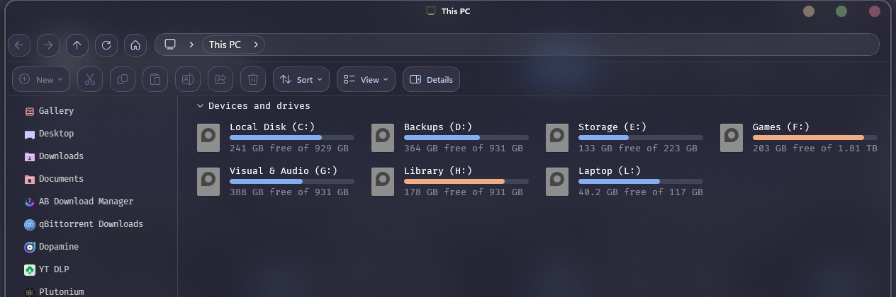 | [File Explorer Styler Plus](mods/local/windows-11-file-explorer-styler-plus) | Themes for File Explorer, plus a rounded Catppuccin dock for the status bar with Mocha view buttons. |
| 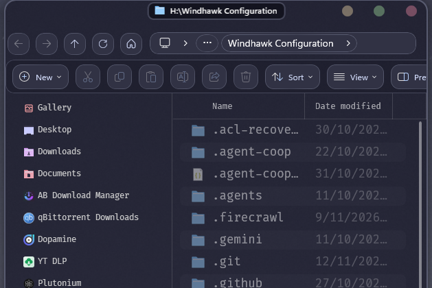 | [Seamless Explorer View](mods/local/seamless-explorer-view) | GPU-rendered file lists and icon grids, populated submenus, page animations and navigation pane styling. |
| | [Explorer Tags Plus](mods/local/explorer-tags-plus) | Colored tags in Explorer's navigation pane and a Tags submenu on files. |
| | [File Operation Styler Plus](mods/local/file-operation-styler-plus) | A modern copy, move, delete and recycle window for Explorer, drawn on the GPU. |
| 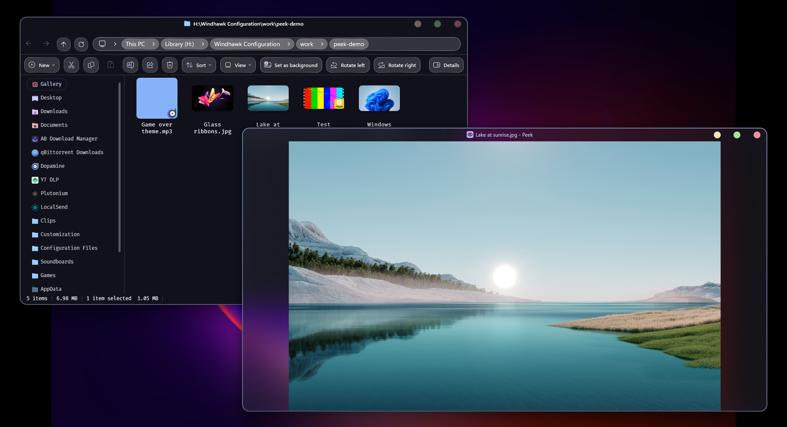 | [Peek](mods/local/peek) | Select a file in Explorer and press Space to preview it, with media playback for audio and video. |
| 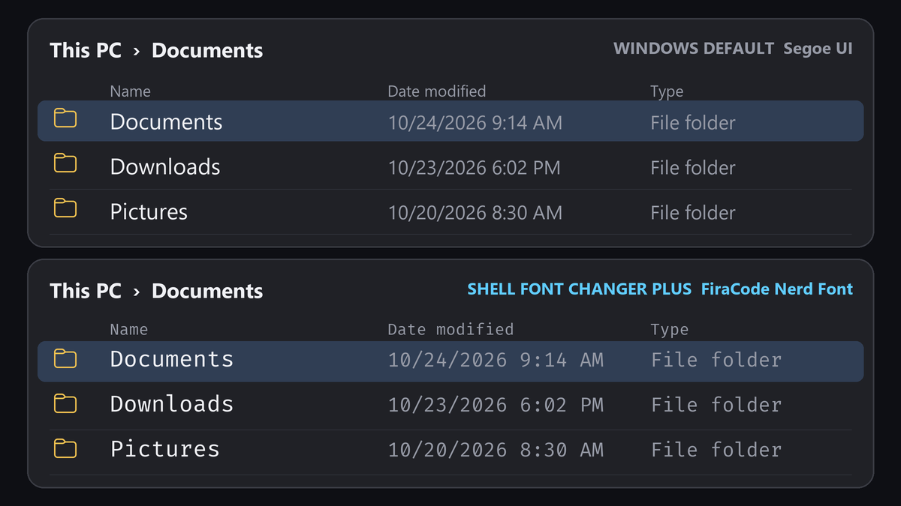 | [Shell Font Changer Plus](mods/local/shell-font-changer-plus) | Any installed font in Explorer, Start, Search and Settings, with icons and emoji left intact. |
| 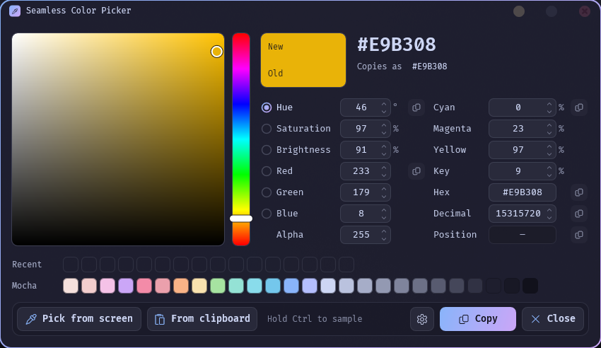 | [Seamless Color Picker](mods/local/seamless-color-picker) | A full color picker on a hotkey, with a screen magnifier, recent colors and one-click copy. |
| | [ZoomIt](mods/local/zoomit) | Zoom into any part of the screen and draw on it with a hotkey, like Sysinternals ZoomIt. |

### Menus, flyouts and apps

| | Mod | What it does |
| --- | --- | --- |
| 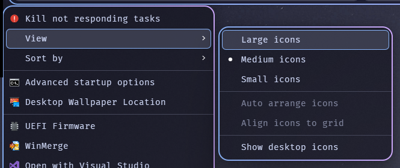 | [Seamless Flyouts](mods/local/seamless-flyouts) | Blurred, rounded Catppuccin menus and flyouts that match the taskbar, plus acrylic and Mica for Windows 11 apps. |
| 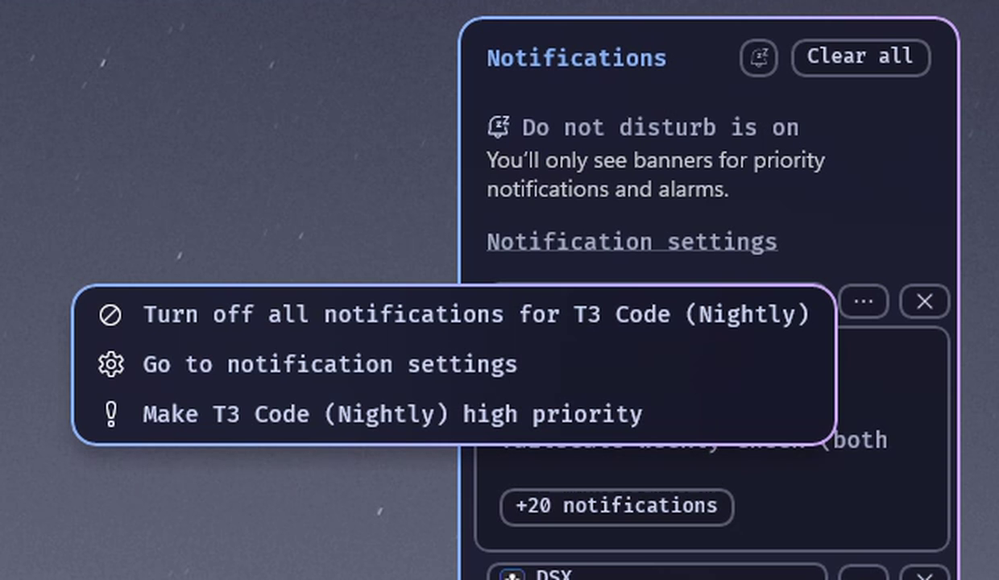 | [Notification Center Styler Plus](mods/local/notification-center-styler-plus) | Themes for the notification panel, with gradient hover borders and a group options menu that stays fully in view. |
| 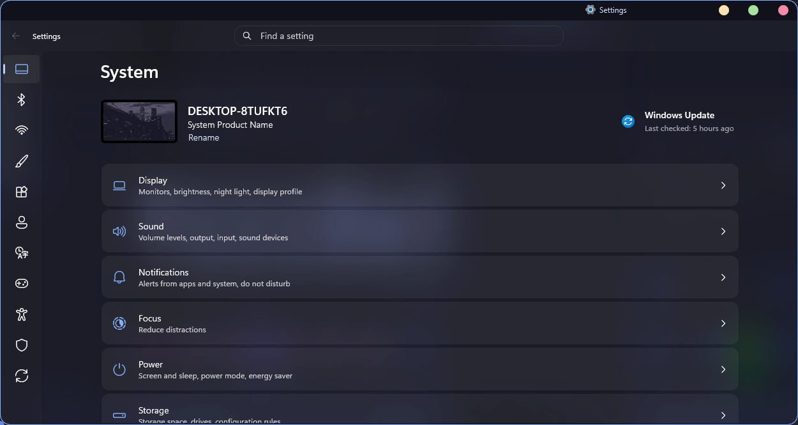 | [Settings Styler Plus](mods/local/settings-styler-plus) | Themes for the Settings app, with the normal title bar and a blur that stays when unfocused. |
| | [Helium Acrylic](mods/local/helium-acrylic) | Keeps Helium's acrylic surface, Catppuccin colors and system-drawn frame working after browser updates. |

### Input

| | Mod | What it does |
| --- | --- | --- |
| 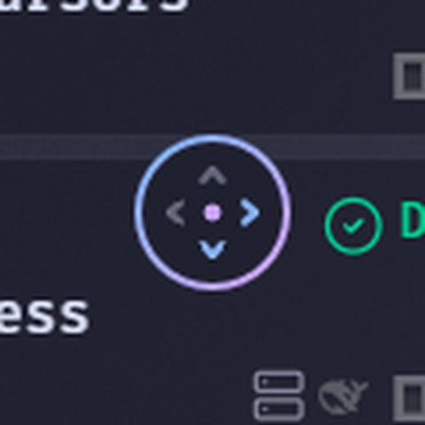 | [Seamless Autoscroll](mods/local/seamless-autoscroll) | Hold the middle mouse button and move to scroll, like in a browser, with a frosted glass indicator. |
| 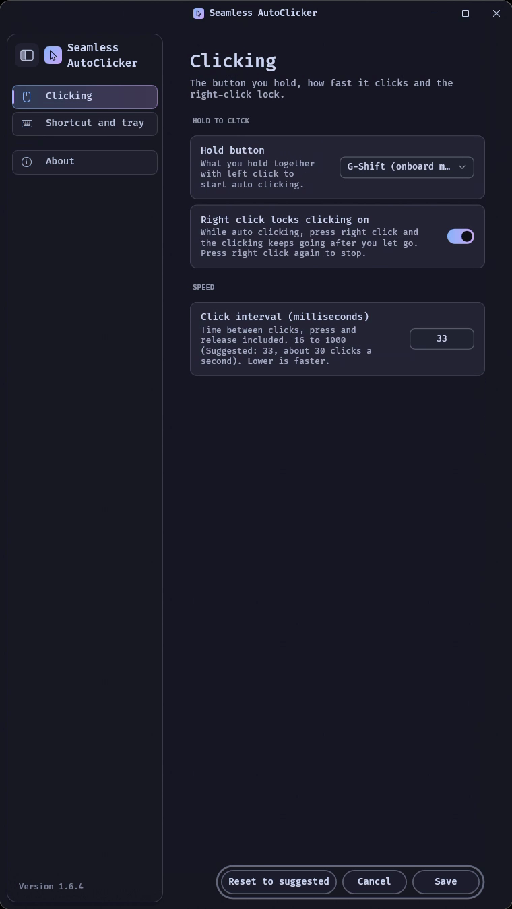 | [Seamless AutoClicker](mods/local/seamless-autoclicker) | Hold a side mouse button and left click keeps clicking, with a right-click lock, a tray switch and its own settings window. |
| 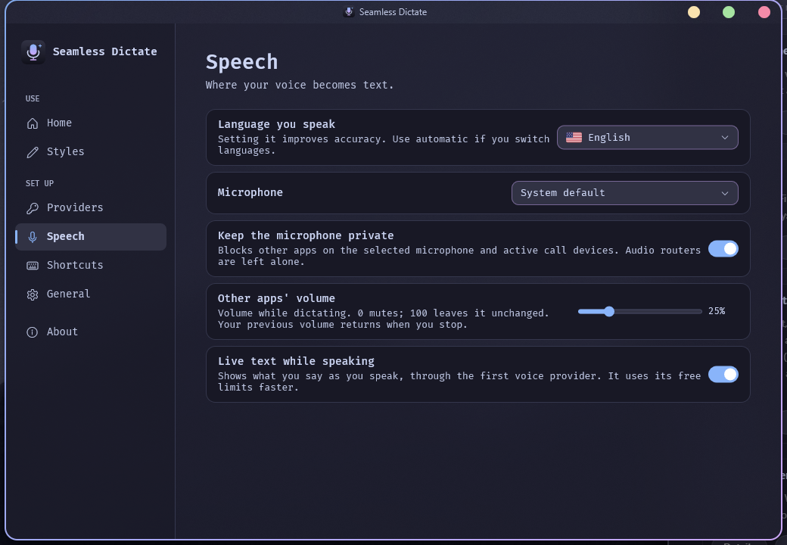 | [Seamless Dictate](mods/local/seamless-dictate) | Hold a shortcut and speak to type in any app, with AI cleanup and mic privacy while you talk. |
| | [Magic Pointer Plus](mods/local/magic-pointer-plus) | Shake the pointer, then point at anything and ask an AI about it, with matching menus. |
| | [Pointer Afterimage Plus](mods/local/pointer-afterimage-plus) | A real motion blur for the mouse pointer, drawn on the GPU. |
| | [Keyboard Shortcut Actions Plus](mods/local/keyboard-shortcut-actions-plus) | Global shortcuts for apps and Windows actions, with a download offer when an app is missing. |

### Windhawk and app fixes

| | Mod | What it does |
| --- | --- | --- |
|  | [Windhawk Enhanced Styler](mods/local/windhawk-enhanced-styler) | Your own colors, gradients, font, transparency and blur for the Windhawk window. |
| 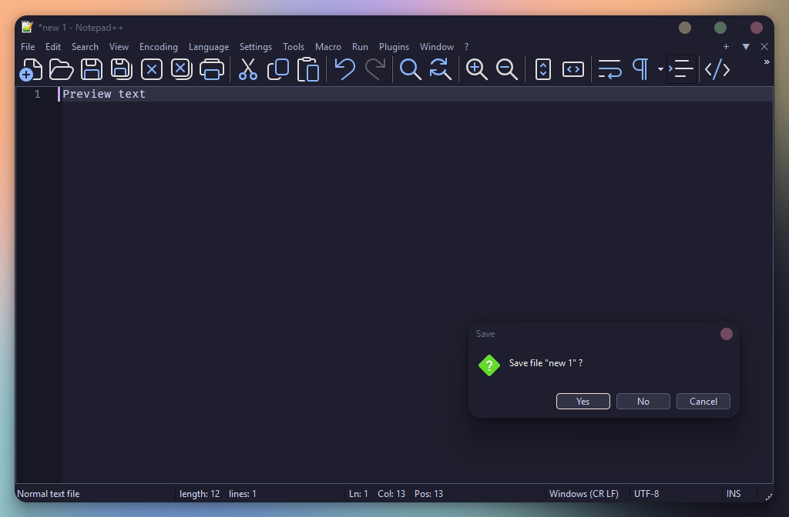 | [Notepad++ Dark Dialog Fix](mods/local/npp-taskdlg-textcolor) | Readable text in Notepad++ Save and confirm dialogs in dark mode. |

### Themes

- **[OnlySearch Mocha](themes/start-menu-onlysearch-mocha):** the Start menu cut down to the search box and a power row, in Catppuccin Mocha. Paste [onlysearch-mocha.yaml](themes/start-menu-onlysearch-mocha/onlysearch-mocha.yaml) into the Start Menu Styler's Textual mode.
- **[Chromium Cursors Mocha](themes/chromium-cursors-mocha):** Catppuccin Mocha art for the ten cursors Chrome and Electron draw themselves, for the [Chromium Cursor Remap](https://windhawk.net/mods/chromium-cursor-remap) mod.

## Notes

> [!NOTE]
> **Windhawk compiles every mod on your PC.** The repo has no mod DLLs, only sources and settings.

> [!IMPORTANT]
> **Disable the original before a "Plus" mod.** Each Plus mod replaces the catalog mod it is based on, so turn the original off before you enable it.

<details>
<summary><b>What each folder holds</b></summary>

<br>

| Path | What it is |
| --- | --- |
| `mods/local/` | My mods, each with its source, a readme and install steps. |
| `mods/catalog/` | Copies of the [catalog mods](https://windhawk.net/mods) in this setup, as installed. Authors, versions and licenses are in [mods/catalog/README.md](mods/catalog/README.md). |
| `settings/` | Per-mod settings, app and engine preferences. See [settings/README.md](settings/README.md). |
| `themes/` | Styler themes, ready to paste into Textual mode, and cursor art for mods. |
| `mod-storage/` | Files mods wrote, currently the Taskbar Styler images. |
| `editor/` | The Windhawk mod editor's settings. |
| `manifest.json` | Every mod with version, author, license, origin and enabled state. |
| `tools/` | Scripts to apply this snapshot, rebuild it from a live install, or from another machine's export. |
| `media/` | Screenshots and previews. |

`settings/` holds configuration values only. The quota mods keep account credentials encrypted in their own storage, and those are not included.

</details>

<details>
<summary><b>Building and refreshing the snapshot</b></summary>

<br>

To build a mod outside the Windhawk editor, run the `Build.ps1` in its folder where there is one. [mods/README.md](mods/README.md) has the full compiler command for Windhawk's bundled clang and three things that trip up a build.

After changing mods or settings on a live install, refresh the snapshot from the repo root:

```powershell
powershell -ExecutionPolicy Bypass -File tools\Build-Repo.ps1
```

Add `-SkipSources` to refresh settings and metadata only. The rebuild is a mirror: mods that are no longer installed are removed from the sources, the manifest, the settings and the catalog table.

To refresh from a different machine, dump that machine's state first and rebuild from the export:

```powershell
powershell -ExecutionPolicy Bypass -File tools\Dump-WindhawkState.ps1 -OutPath H:\tmp\wh-export
powershell -ExecutionPolicy Bypass -File tools\Build-Repo.ps1 -FromExport H:\tmp\wh-export
```

</details>

<details>
<summary><b>Licenses</b></summary>

<br>

My own work here is MIT, see [LICENSE](LICENSE), except where a mod inherits its original's license:

- **GPL-3.0:** Seamless Window Manager, Seamless Borders, Seamless Clipboard Manager, Seamless Tray Drawer, File Operation Styler Plus, Seamless AutoClicker, Recycle Bin Tray Plus, Taskbar System Info Plus.
- **GPL-2.0:** Simple Window Switcher Plus, Theme Tool Plus, Seamless Explorer View, Chromium Cursors Mocha.

Catalog mods in `mods/catalog/` keep their authors' licenses.

</details>

## Contributing

Reports of mods that break after a Windows or Windhawk update help the most, along with compile fixes and pull requests.

<a href="CONTRIBUTING.md">

</a>

## Star history

Thanks to everyone running these mods and reporting what breaks.

<a href="https://www.star-history.com/?repos=DavidHiFi%2Fdavids-windhawk-mods&amp;type=date">
  <picture>
    <source media="(prefers-color-scheme: dark)" srcset="https://api.star-history.com/chart?repos=DavidHiFi/davids-windhawk-mods&amp;type=date&amp;theme=dark&amp;legend=top-left" />
    <source media="(prefers-color-scheme: light)" srcset="https://api.star-history.com/chart?repos=DavidHiFi/davids-windhawk-mods&amp;type=date" />
    
  </picture>
</a>

## Credits

- **Author:** Myself, [DavidHiFi](https://github.com/DavidHiFi)

Most of my mods build on someone else's mod. Each mod's source names its sources too.

| Who | What |
| --- | --- |
| **m417z** ([GitHub](https://github.com/m417z)) | AltDrag, the base of Seamless Window Manager. His [Multirow taskbar](https://windhawk.net/mods/taskbar-multirow) and [Taskbar Clock Customization](https://windhawk.net/mods/taskbar-clock-customization) code lives on in Taskbar System Info Plus. Windows 11 Notification Center Styler, Windows 11 File Explorer Styler, Windows 11 Settings Styler and [Keyboard Shortcut Actions](https://windhawk.net/mods/keyboard-shortcut-actions) are the bases of their Plus versions. |
| **RamonUnch** ([AltSnap](https://github.com/RamonUnch/AltSnap)) | The shortcuts and gestures in Seamless Window Manager. |
| **Stefan Sundin** ([AltDrag](https://stefansundin.github.io/altdrag/)) | The original AltDrag that Seamless Window Manager traces back to. |
| **Asteski** ([Snap Commander](https://windhawk.net/mods/snap-commander)) | Keyboard snapping in Window Manager. |
| **TomberWolf** ([Move Window to Monitor](https://windhawk.net/mods/move-window-to-monitor)) | Moving windows between monitors in Window Manager. |
| **Lone** ([Simple Window Switcher](https://windhawk.net/mods/simple-window-switcher)) | Simple Window Switcher 2.1, the base of Simple Window Switcher Plus. |
| **bropines** ([GitHub](https://github.com/bropines)) | Improvements to Simple Window Switcher. |
| **valinet** ([Simple Window Switcher](https://github.com/valinet/sws)) | The original Simple Window Switcher. |
| **caliberda** ([Alt+Tab Flip 3D](https://windhawk.net/mods/alt-tab-flip-3d)) | The Vista rendering in Simple Window Switcher Plus (MIT). |
| **caliberda** ([AI Voice Typing](https://windhawk.net/mods/ai-voice-typing)) | The base of Seamless Dictate (MIT). |
| **crazyboyybs** ([AutoScroll Win32](https://windhawk.net/mods/autoscroll-win32)) | The scrolling engine in Seamless Autoscroll. |
| **0Allu** ([Better Volume Mixer](https://windhawk.net/mods/better-volume-mixer)) | The base of Seamless Volume Mixer. |
| **shubho** ([App Volume Booster](https://windhawk.net/mods/app-volume-booster)) | The per-app boost and compressor in Seamless Volume Mixer. |
| **Gabriela Cristei** ([Explorer Font Changer](https://windhawk.net/mods/explorer-font-changer)) | The base of Shell Font Changer Plus. |
| **Rafael Mendes** ([Fullscreen Start](https://windhawk.net/mods/fullscreen-start)) | The base of Seamless Launchpad, and its preview image. |
| **AhmedAwad7** ([Always On Top Windows](https://windhawk.net/mods/always-on-top)) | The base of Always On Top Windows Plus. |
| **buedgik** ([Explorer Tags](https://github.com/buedgik/explorer-tags)) | The base of Explorer Tags Plus. |
| **digART** ([File Operation Styler](https://windhawk.net/mods/file-operation-styler)) | The base of File Operation Styler Plus. |
| **Rono** (Magic Pointer) | The base of Magic Pointer Plus. |
| **SAM2WOW** ([Micrographics Taskbar Clock](https://windhawk.net/mods/micrographics-taskbar-clock)) | The base of Micrographics Taskbar Clock Plus (MIT). |
| **Sof2245** ([Taskbar AI Usage](https://windhawk.net/mods/taskbar-ai-usage)) | The base of Taskbar AI Usage Plus. |
| **Wildstyle23** ([Recycle Bin Tray](https://windhawk.net/mods/recycle-bin-tray)) | The base of Recycle Bin Tray Plus. |
| **Marco Petrucci** ([Taskbar System Utilities](https://windhawk.net/mods/taskbar-system-utilities)) | The base of Seamless Taskbar Utilities, which adapts the menu hooks from his Taskbar Restart Explorer. |
| **Scott Brogden and the Ditto contributors** ([Ditto](https://github.com/sabrogden/Ditto)) | The clipboard engine Seamless Clipboard Manager is based on (GPL-3.0). |
| **ShareX** ([ShareX](https://github.com/ShareX/ShareX)) | The color picker in Seamless Color Picker is based on theirs. |
| **Mark Russinovich** ([ZoomIt](https://learn.microsoft.com/sysinternals/downloads/zoomit)) | The zoom and draw behavior the ZoomIt mod recreates. |
| **sidlikesgrapess** (Pointer Afterimage Motion Blur) | The base of Pointer Afterimage Plus. |
| **Salyts** ([Taskbar Fluent Media Player](https://windhawk.net/mods/taskbar-fluent-media-player)) | The base of Seamless Media Player (MIT), and the second-taskbar support in Taskbar System Info Plus. |
| **uMk0** ([Taskbar Media Widget](https://windhawk.net/mods/taskbar-media-widget)) | The behind-widget bars, progress bar and time display in Seamless Media Player (MIT). |
| **Yevhenii Starychenko** ([Taskbar System Info](https://windhawk.net/mods/taskbar-system-info)) | The base of Taskbar System Info Plus. |
| **Narayan** ([Taskbar Network Speed Indicator](https://windhawk.net/mods/net-speed-taskbar)) | The idea behind the network readouts in Taskbar System Info Plus. |
| **MEI** ([Nested Tray Drawer](https://windhawk.net/mods/nested-tray-drawer)) | The base of Seamless Tray Drawer. |
| **rounk-ctrl** ([UXTheme hook](https://windhawk.net/mods/uxtheme-hook)) | The base of Theme Tool Plus. |
| **namazso** ([SecureUxTheme](https://github.com/namazso/SecureUxTheme), [ThemeToolSharp](https://github.com/namazso/ThemeToolSharp)) | The theme engine research in Theme Tool Plus. |
| **niivu** ([DeviantArt](https://www.deviantart.com/niivu)) | The Catppuccin Windows themes and cursors that come with Theme Tool Plus. |
| **Ingan121** ([Titlebar For Everyone](https://windhawk.net/mods/titlebar-for-everyone)) | The window frame code in Windhawk Enhanced Styler (MIT), and the native frames and Spotify parts of Seamless Title Bars, with [CEF/Spotify Tweaks](https://windhawk.net/mods/cef-titlebar-enabler-universal). |
| **Th3Fanbus** ([Windows 11 Custom Title Bar Colours](https://windhawk.net/mods/win11-custom-title-bar-colours)) | The colours part of Seamless Title Bars. |
| **grn15RenS** ([Caption Buttons Customizer](https://windhawk.net/mods/caption-buttons-customizer)) | The caption buttons part of Seamless Title Bars (MIT). |
| **aubymori** ([Fix Basic Caption Text](https://windhawk.net/mods/fix-basic-caption-text)) | The basic frames part of Seamless Title Bars. |
| **Anixx** (Remove UWP Title Bars) | The base of the Store apps part of Seamless Title Bars. |
| **Ramen Software** ([Start menu styling guide](https://github.com/ramensoftware/windows-11-start-menu-styling-guide)) | The OnlySearch and RosePine themes merged into OnlySearch Mocha. |
| **Catppuccin** ([catppuccin](https://github.com/catppuccin/catppuccin)) | The Mocha palette in OnlySearch Mocha and the mod defaults. |
| **Catppuccin** ([cursors](https://github.com/catppuccin/cursors)) | The cursor art in Chromium Cursors Mocha (GPL-2.0). |
| **Catalog mod authors** ([full list](mods/catalog/README.md)) | Every catalog mod in `mods/catalog/`, copied as installed. Each one is its author's work. |

Built on [Windhawk](https://github.com/ramensoftware/windhawk) by m417z, with its bundled [LLVM clang](https://llvm.org/) compiler and [PowerShell](https://github.com/PowerShell/PowerShell) for the snapshot scripts.

> Missing or wrong credit? [Open an issue](https://github.com/DavidHiFi/davids-windhawk-mods/issues/new) and I'll fix it.

## Disclaimers

Most of the code in my own mods was developed with AI coding agents, including Claude Code, Codex and OpenCode. No single AI agent made the project. The catalog mods in `mods/catalog/` are other people's work, copied unchanged.

The mods hook into Windows processes such as Explorer. Windhawk lets you disable any mod in one click if something misbehaves after a Windows update.

<div align="center">
<br>
<sub>Not affiliated with Ramen Software or Microsoft. Requires Windows 11 and <a href="https://windhawk.net">Windhawk</a>.</sub>
</div>
