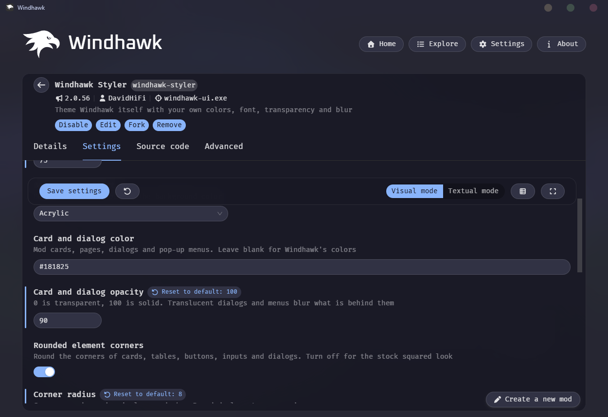

<div align="center">



# Windhawk mods

**Windows 11 taskbar, Explorer, Start and window mods for [Windhawk](https://windhawk.net), plus the full setup they run in.**

Install one mod, or copy the whole setup to another PC.

<a href="https://github.com/DavidHiFi/davids-windhawk-mods/releases/latest">

</a>

<br><br>


</div>

---

## Installation

1. Install [Windhawk](https://windhawk.net). Windhawk Styler needs the Windhawk 2.0 interface. Its [legacy edition](mods/local/windhawk-styler/legacy) supports the older one.
2. Install a mod: open Windhawk, choose **Create a new mod**, paste the mod's `.wh.cpp` file and click **Compile**. Each mod folder has its own readme with the details.
3. To copy the whole setup to another PC, follow the steps in **The full setup** below.

<details>
<summary><b>The full setup</b></summary>

<br>

| Path | What it is |
| --- | --- |
| `mods/local/` | The mods listed under [Features](#features). |
| `mods/catalog/` | Copies of the [catalog mods](https://windhawk.net/mods) in this setup, as installed. Authors, versions and licenses are in [mods/catalog/README.md](mods/catalog/README.md). |
| `settings/` | Per-mod settings, app and engine preferences. See [settings/README.md](settings/README.md). |
| `themes/` | Styler themes, ready to paste into Textual mode. |
| `mod-storage/` | Files mods wrote, currently the Taskbar Styler images. |
| `editor/` | The Windhawk mod editor's settings. |
| `manifest.json` | Every mod with version, author, license, origin and enabled state. |
| `tools/` | Scripts to apply this snapshot or rebuild it from a live install. |
| `media/` | Screenshots and previews. |

1. Install [Windhawk](https://windhawk.net), then the catalog mods listed in [mods/catalog/README.md](mods/catalog/README.md) from Windhawk's Explore tab. Install the mods in this repo from their folders.
2. From an elevated shell in the repo root, preview the settings and then apply them:

   ```powershell
   powershell -ExecutionPolicy Bypass -File tools\Apply-WindhawkSettings.ps1 -Audit
   powershell -ExecutionPolicy Bypass -File tools\Apply-WindhawkSettings.ps1
   ```

   Add `-IncludeAppSettings` to import the app and engine settings too. Reopen the Windhawk interface after applying Styler settings.
3. Copy `mod-storage/` to `C:\ProgramData\Windhawk\Engine\ModsWritable\mod-storage\`, and `editor/settings.json` to `C:\ProgramData\Windhawk\UIData\user-data\User\settings.json`.

</details>

## Features

### Taskbar

- **Taskbar Audio Visualizer:** a live audio spectrum with media controls, right on the taskbar.
- **Taskbar Weather:** current weather on the taskbar with a details card on hover. No Widgets needed.
- **Taskbar System Info Plus:** CPU, GPU, RAM, VRAM, temperatures and network speed on the taskbar.
- **Taskbar AI Quota Bars Plus:** Claude, Codex, Antigravity and OpenCode Go usage limits as taskbar bars.

### Windows

- **Window Manager:** move, resize, snap and send windows to other monitors with Alt+drag and keyboard shortcuts.
- **AltSnap:** Alt+drag to move and resize any window, plus AltSnap's window shortcuts.
- **Simple Window Switcher Plus:** Vista Alt+Tab animations and blur, customizable layouts, and elevated app support.
- **Translucent Flyouts:** Acrylic, Mica and blur backgrounds for menus, dropdowns and tooltips in every app.

### Start menu and Explorer

- **Everything & Power Tools in the Start Menu Plus:** compact Start menu search with Everything, preview, apps, settings and power tools.
- **Shell Font Changer:** any font in Explorer, Start, Search and Settings, without breaking icons or emoji.
- **Drag to Delete Plus:** drag files onto a floating trash target with themes, shapes and colors.

### Appearance and audio

- **Windhawk Styler:** theme Windhawk itself with your own colors, font, transparency and blur.
- **Theme Tool Plus:** apply and switch custom Windows themes from a hotkey picker, no separate theme tool needed.
- **Notepad++ Dark Dialog Fix:** readable text in Notepad++ Save and confirm dialogs when dark mode is on.
- **Better Volume Mixer Plus:** a tray volume mixer with per-app volume and per-app output and input devices.

### Themes

- **OnlySearch Mocha:** cuts the Windows 11 Start menu down to the search box and a power row, in Catppuccin Mocha with a blue accent. Paste [onlysearch-mocha.yaml](themes/start-menu-onlysearch-mocha/onlysearch-mocha.yaml) into the Start Menu Styler's Textual mode. See the [theme folder](themes/start-menu-onlysearch-mocha).

## Notes

> [!NOTE]
> **Center Titlebar Fork is not installed.** It is an unfinished prototype, kept here for reference.

> [!IMPORTANT]
> This repo has the mod sources, settings and themes, but no compiled DLLs. Windhawk compiles each mod on your PC.

> [!WARNING]
> Some mods run inside Explorer, the taskbar or other system processes. A broken mod can freeze or crash the process it runs in. Turn a mod off in Windhawk to undo it.

<details>
<summary><b>Rebuilding the snapshot</b></summary>

<br>

After you change mods or settings, run `tools\Build-Repo.ps1` to refresh the snapshot. Add `-SkipSources` to refresh only the settings and metadata.

</details>

---

## Support development

Everything here is free. If a mod saves you time, a coffee helps me keep building them.

[](https://ko-fi.com/davidhifi)

## Contributing

Bug reports with your Windows build and the mod's version help most. Fixes for mods you use are welcome too.

<a href="CONTRIBUTING.md">

</a>

## Star history

Thanks for every star.

<a href="https://www.star-history.com/?repos=DavidHiFi%2Fdavids-windhawk-mods&amp;type=date">
  <picture>
    <source media="(prefers-color-scheme: dark)" srcset="https://api.star-history.com/chart?repos=DavidHiFi/davids-windhawk-mods&amp;type=date&amp;theme=dark&amp;legend=top-left" />
    <source media="(prefers-color-scheme: light)" srcset="https://api.star-history.com/chart?repos=DavidHiFi/davids-windhawk-mods&amp;type=date" />
    
  </picture>
</a>

## Credits

- **Author:** Myself, [DavidHiFi](https://github.com/DavidHiFi)

| Who | What |
|---|---|
| **m417z** ([AltDrag](https://windhawk.net/mods/alt-drag), [Taskbar Multirow](https://windhawk.net/mods/taskbar-multirow)) | AltDrag is the base of AltSnap and Window Manager. Multirow taskbar discovery and GPU temperature code are used in Taskbar System Info Plus. |
| **RamonUnch** ([AltSnap](https://github.com/RamonUnch/AltSnap)) | Shortcuts and gestures in AltSnap, and an influence on Window Manager. |
| **Stefan Sundin** ([AltDrag](https://stefansundin.github.io/altdrag/)) | The original AltDrag that m417z's mod came from. |
| **Asteski** ([Snap Commander](https://windhawk.net/mods/snap-commander)) | Combined into Window Manager, and improvements in Simple Window Switcher Plus. |
| **TomberWolf** ([Move Window to Monitor](https://windhawk.net/mods/move-window-to-monitor)) | Combined into Window Manager. |
| **Lone**, **bropines** and **valinet** | Simple Window Switcher 2.1, its improvements, and the original Simple Window Switcher, the base of Simple Window Switcher Plus. |
| **caliberda** ([Alt+Tab Flip 3D](https://github.com/cesarkali)) | Vista Alt+Tab rendering in Simple Window Switcher Plus. |
| **rounk-ctrl** ([UXTheme hook](https://windhawk.net/mods/uxtheme-hook), [GitHub](https://github.com/rounk-ctrl)) | The base of Theme Tool Plus, and the base of Center Titlebar Fork. |
| **namazso** ([SecureUxTheme](https://github.com/namazso/SecureUxTheme), [ThemeToolSharp](https://github.com/namazso/ThemeToolSharp)) | Theme engine research used by Theme Tool Plus. |
| **iMAboud** ([Drag to Delete](https://github.com/iMAboud)) | The base of Drag to Delete Plus. |
| **Ingan121** ([Titlebar For Everyone](https://windhawk.net/mods/titlebar-for-everyone)) | The window frame work adapted into Windhawk Styler. |
| **ALTaleX531** ([TranslucentFlyouts](https://github.com/ALTaleX531/TranslucentFlyouts)) | The project that Translucent Flyouts ports. Its settings follow its configuration schema. |
| **Cleroth** ([Taskbar AI Quota Bars](https://windhawk.net/mods/taskbar-ai-quota), [GitHub](https://github.com/Cleroth)) | The base of Taskbar AI Quota Bars Plus. |
| **Yevhenii Starychenko** ([Taskbar System Info](https://windhawk.net/mods/taskbar-system-info)) | The base of Taskbar System Info Plus. |
| **Narayan** | Taskbar Network Speed Indicator, which inspired the network readouts in Taskbar System Info Plus. |
| **Salyts** ([Desktop Audio Visualizer](https://windhawk.net/mods/desktop-audio-visualizer), [Taskbar Fluent Media Player](https://github.com/Salyts/Taskbar-Fluent-Media-Player)) | The base of Taskbar Audio Visualizer, and the secondary-taskbar code adapted in Taskbar System Info Plus. |
| **USER-TOURNE** ([Tourne'Table](https://windhawk.net/mods/tourne-table-desktop-audio-visualizer)) | The other base of Taskbar Audio Visualizer. |
| **0Allu** ([Better Volume Mixer](https://windhawk.net/mods/better-volume-mixer), [GitHub](https://github.com/0Allu)) | The base of Better Volume Mixer Plus. |
| **Gabriela Cristei** ([Explorer Font Changer](https://windhawk.net/mods/explorer-font-changer)) | The base of Shell Font Changer. |
| **bardelyne** ([Everything & Power Tools in the Start Menu](https://windhawk.net/mods/start-everything), [GitHub](https://github.com/bardelyne)) | The base of Everything & Power Tools in the Start Menu Plus. |
| **Open-Meteo** ([open-meteo.com](https://open-meteo.com/)) | Weather data for Taskbar Weather, under CC BY 4.0. |
| **voidtools** ([Everything](https://www.voidtools.com/)) | The file search that Everything & Power Tools in the Start Menu Plus needs installed. |
| **Catalog mod authors** ([mods/catalog](mods/catalog/README.md)) | The catalog mods copied into this setup. Each keeps its author's license. |

Built on [Windhawk](https://windhawk.net), with C++ and WinRT for the mod code and PowerShell for the setup scripts.

> Missing or wrong credit? [Open an issue](https://github.com/DavidHiFi/davids-windhawk-mods/issues/new) and I'll fix it.

**Licenses:** my own work is MIT, see [LICENSE](LICENSE). Mods that inherit a copyleft license keep it. AltSnap, Window Manager, Taskbar System Info Plus and Everything & Power Tools in the Start Menu Plus are GPL-3.0. Simple Window Switcher Plus is GPL-2.0. Translucent Flyouts is LGPL-3.0. Catalog mods keep their authors' licenses.

## Disclaimers

Most of the code here was written with AI coding agents, mainly Claude Code with Claude models, and some with OpenCode. I run these mods on my own PC, but I can't promise they work on yours.

The quota mods use your own provider accounts. Account credentials stay in each mod's own storage, and the settings snapshot does not include them.

<div align="center">
<br>
<sub>Not affiliated with Windhawk or its developers. Requires Windows 11 and Windhawk.</sub>
</div>
