<div align="center">

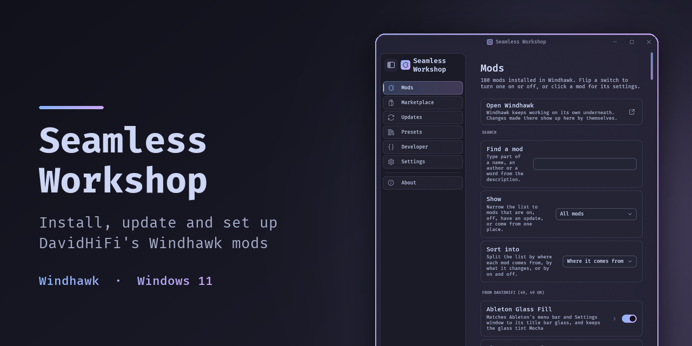

# Seamless Workshop

**Every DavidHiFi [Windhawk](https://windhawk.net) mod for Windows 11, and the one window that installs, updates and removes them.**

One command sets it up. From then on it keeps itself, the mods and their presets up to date.

<a href="https://github.com/DavidHiFi/seamless-workshop/releases/latest">

</a>

<br><br>


</div>

---

## Installation

> [!IMPORTANT]
> **Seamless Workshop needs the Windhawk 2.0.0-alpha.8 preview or newer.** It does not run on the normal 1.x release. The install line below gets the preview for you.

1. **Install Seamless Workshop.** Paste this into PowerShell and press Enter. Windows asks for admin rights once.

   ```powershell
   irm https://raw.githubusercontent.com/DavidHiFi/seamless-workshop/main/Install-SeamlessWorkshop.ps1 | iex
   ```

   It installs Windhawk or updates it to the preview if you need that, and keeps your mods and settings. Then it downloads the Workshop from the latest release, throws it away if it does not match its checksum, and installs it through Windhawk's own command-line tool. Running the line again is safe: if you already have the newest version, it says so and changes nothing.
2. **Pick your mods.** Click the Seamless Workshop icon in the tray. The **Mods** page installs one mod at a time.
3. **Or copy the whole setup.** Open the **Updates** page. In the group **DavidHiFi's whole setup**:
   - Turn **Clean slate first** on or off.
   - Choose **Copy everything, settings included** or **Install everything, default settings**.
   - Each choice asks for a second click to confirm.

What each choice does:

- **Clean slate first** removes every mod you already have, except Seamless Workshop. A backup is saved before anything is removed.
- **Install everything, default settings** installs every mod turned off, with its own default settings. You switch on the ones you want.
- **Copy everything, settings included** installs every mod with DavidHiFi's settings and his on and off choices. Nothing private (keys, tokens, folder paths, names) is ever copied.

Afterwards you can turn any mod on or off and change its settings on the Workshop's **Mods** page or in Windhawk.

> [!NOTE]
> A full install builds around 180 mods (his own and about 130 from the Windhawk library), so it can take roughly 15 to 30 minutes. The window shows progress.

<details>
<summary><b>Only update Windhawk to the preview</b></summary>

<br>

`Update-Windhawk.ps1` takes Windhawk 1.7.8 (or any older version) to the newest 2.0 preview, and installs Windhawk if you do not have it yet. It checks the installer's hash, signature and version before it runs it. Mods and settings are kept.

```powershell
iwr 'https://raw.githubusercontent.com/DavidHiFi/seamless-workshop/main/Update-Windhawk.ps1' -OutFile "$env:TEMP\Update-Windhawk.ps1"; powershell -NoProfile -ExecutionPolicy Bypass -File "$env:TEMP\Update-Windhawk.ps1"
```

Windows asks for administrator permission. Wait for the green line "Windhawk ... is installed", then restart the PC when it suits you.

| Switch | What it does |
|---|---|
| *(none)* | Install or update to the newest pre-release. |
| `-Check` | Show the installed and newest versions. Changes nothing. |
| `-Tag 2.0.0-alpha.8` | Install one specific release instead of the newest. |
| `-Offline` | Use the full offline installer (about 178 MB) instead of the small web setup. |
| `-SelfTest` | Run the script's version-comparison checks and exit. |

</details>

<details>
<summary><b>Install the Workshop by hand</b></summary>

<br>

1. Download `seamless-workshop.wh.cpp` from the [latest release](https://github.com/DavidHiFi/seamless-workshop/releases/latest) and open it in Notepad.
2. In Windhawk, click **Create a new mod**, delete the sample code and paste the file in.
3. Click **Compile and enable**, then **Exit editing mode**.

</details>

<details>
<summary><b>One mod, without the Workshop</b></summary>

<br>

1. Install [Windhawk](https://windhawk.net).
2. Open the mod's folder below and copy its `.wh.cpp` file.
3. In Windhawk, choose **Create a new mod**, paste the file and click **Compile**.
4. If the mod is a "Plus" version of a catalog mod, disable the original first.

The latest release is always Seamless Workshop itself. Single mods live in their folders.

</details>

<details>
<summary><b>The whole setup by script</b></summary>

<br>

1. Install [Windhawk](https://windhawk.net). Windhawk Enhanced Styler needs the 2.0 interface; its [legacy edition](mods/local/windhawk-enhanced-styler/legacy) covers the older one.
2. Install the catalog mods listed in [mods/catalog/README.md](mods/catalog/README.md) from Windhawk's Explore tab, and my mods from their folders.
3. From an elevated PowerShell in the repo root, preview and then apply the settings:

   ```powershell
   powershell -ExecutionPolicy Bypass -File tools\Apply-WindhawkSettings.ps1 -Audit
   powershell -ExecutionPolicy Bypass -File tools\Apply-WindhawkSettings.ps1
   ```

   Add `-IncludeAppSettings` to import the app and engine settings too, then reopen the Windhawk window.
4. Copy `mod-storage/` to `C:\ProgramData\Windhawk\Engine\ModsWritable\mod-storage\`, and `editor/settings.json` to `C:\ProgramData\Windhawk\UIData\user-data\User\settings.json`.

An AI agent can do all of this on its own: [AGENTS.md](AGENTS.md) is the runbook it should follow.

</details>

## Features

### The Workshop

- **Every DavidHiFi mod in one list:** his mods come first in Marketplace, with what each one does. One click installs it.
- **The Windhawk library too:** Marketplace finds and installs any mod from Windhawk's own catalog.
- **On, off or gone:** flip a mod's switch, or remove it with its settings, without opening the Windhawk editor.
- **A clean way out:** "Remove all of DavidHiFi's mods" takes his mods off in one go and saves their settings as a preset first.
- **Daily update check:** once a day the Workshop looks for new versions of the mods and of itself, and tells you in the tray.
- **See what changed first:** each update says what is new in it before you install it.
- **One click:** update one mod, or all of them at once with one backup and one admin prompt.
- **Checked downloads:** every file is checked against a checksum before it installs.
- **Presets:** DavidHiFi's settings for one mod or his whole setup, and your own saved sets. Your current settings are saved first, so you can always go back.

The mods below are grouped by what they change. Retired mods and what replaced them: [mods/retired](mods/retired).

### Taskbar

The taskbar, the tray and what sits on them.

| | Mod | What it does |
| --- | --- | --- |
| 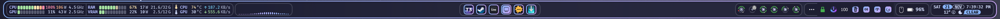 | [Seamless Taskbar](mods/local/seamless-taskbar) | The whole riced taskbar in one mod: system info, media, apps dock, clock, tray, AI usage and right-click tools, each with its own switch |
| 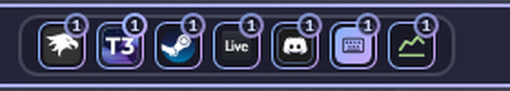 | [Seamless Taskbar Badge Counter](mods/local/seamless-taskbar-badge-counter) | See how many windows each taskbar app has open, on a Catppuccin Mocha badge with a gradient edge. |
| 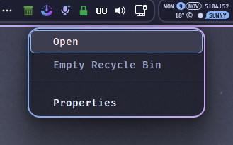 | [Recycle Bin Tray Plus](mods/local/recycle-bin-tray-plus) | A Recycle Bin icon in the tray, with drag and drop and themed menus. |
| 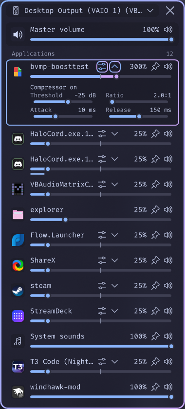 | [Seamless Volume Mixer](mods/local/better-volume-mixer-plus) | A tray volume mixer with per-app volume up to 1000%, a per-app compressor, and per-app output and input devices. |
|  | [Power Options Button Plus](mods/local/power-options-button-plus) | Tray icon to switch between Windows power plans with the mouse wheel. The icon is the house tray badge with a glyph for each plan. |
|  | [Network Speed Test Plus](mods/local/network-speedtest-plus) | Tray speed test button next to the network icon, plus the Windows 11 network menu speed test as a native flyout: ping, jitter, download and upload measured against Cloudflare, live gauge, results chart with copy. Mocha glass, FiraCode, gradient hover. No browser, no separate app. |

### Explorer

File Explorer and working with files.

| | Mod | What it does |
| --- | --- | --- |
| 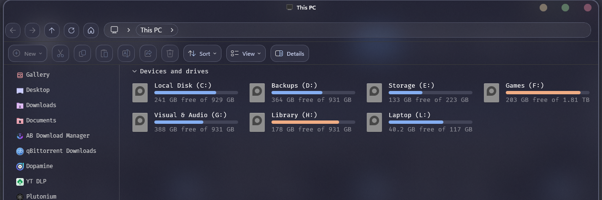 | [File Explorer Styler Plus](mods/local/windows-11-file-explorer-styler-plus) | Themes for File Explorer, plus a rounded Catppuccin dock for the status bar with Mocha view buttons. |
| 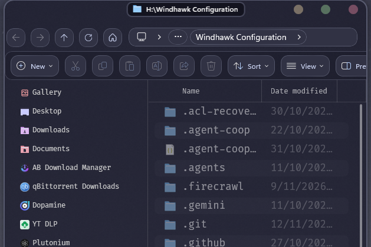 | [Seamless Explorer View](mods/local/seamless-explorer-view) | GPU-rendered file lists and icon grids, populated submenus, page animations and navigation pane styling. |
| | [Seamless Explorer Search](mods/local/seamless-explorer-search) | Start typing in any File Explorer window to search it, and every drive, with Everything. |
| | [Explorer Tags Plus](mods/local/explorer-tags-plus) | Colored tags in Explorer's navigation pane and a Tags submenu on files. |
| | [File Operation Styler Plus](mods/local/file-operation-styler-plus) | A modern copy, move, delete and recycle window for Explorer, drawn on the GPU. |
| 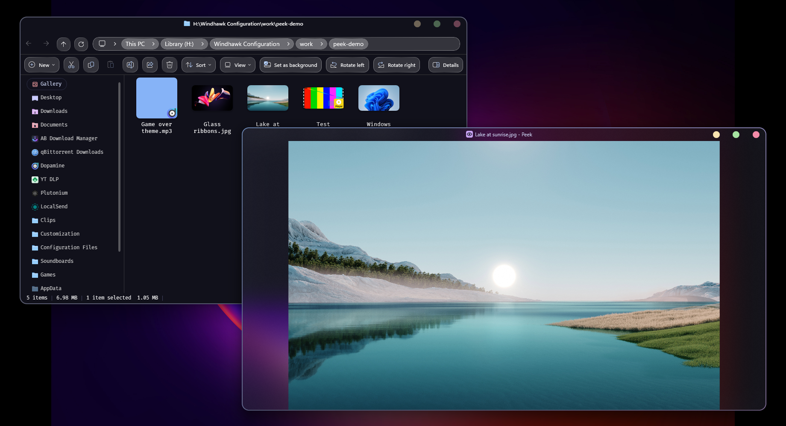 | [Peek](mods/local/peek) | Select a file in Explorer and press Space to preview it, with media playback for audio and video. |
| 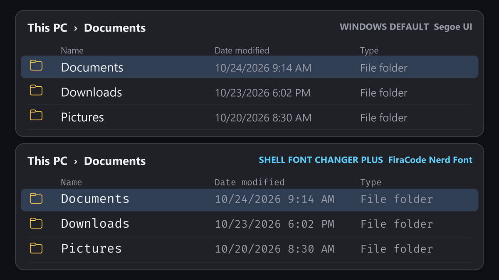 | [Shell Font Changer Plus](mods/local/shell-font-changer-plus) | Any installed font in File Explorer, with icons and emoji left intact. |

### Windows and menus

Window frames, menus, flyouts, Start and the Windows look.

| | Mod | What it does |
| --- | --- | --- |
| 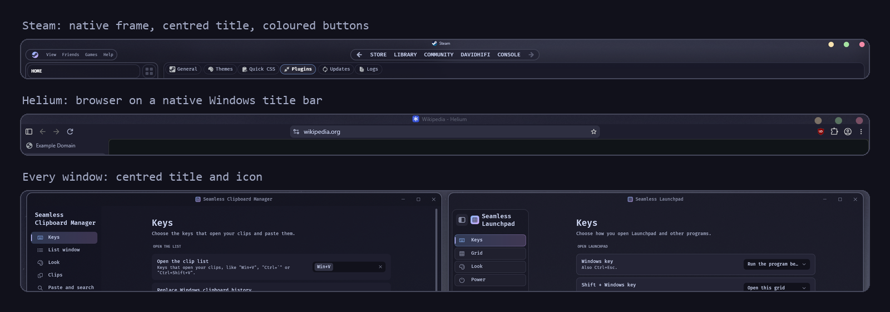 | [Seamless Title Bars](mods/local/seamless-title-bars) | One title bar look everywhere: colors, caption buttons and native frames in every kind of app. |
| | [Seamless Borders](mods/local/seamless-borders) | Colored borders around windows, menus and notification banners. |
| 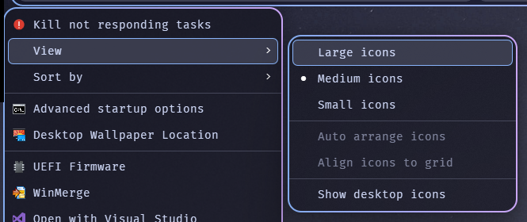 | [Seamless Flyouts](mods/local/seamless-flyouts) | Blurred, rounded Catppuccin menus and flyouts that match the taskbar, plus acrylic and Mica for Windows 11 apps. |
| | [Seamless Window Manager](mods/local/seamless-window-manager) | Move, resize, snap and focus windows with the mouse or keyboard, with app rules and a pause key. |
| 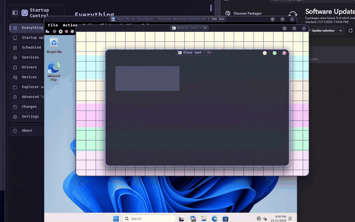 | [Seamless Wobbly Windows](mods/local/seamless-wobbly-windows) | Jelly window dragging that keeps Snap, works with Seamless Window Manager's Alt-drag, wobbles the Seamless Borders ring and can add animated color glows behind see-through windows |
| 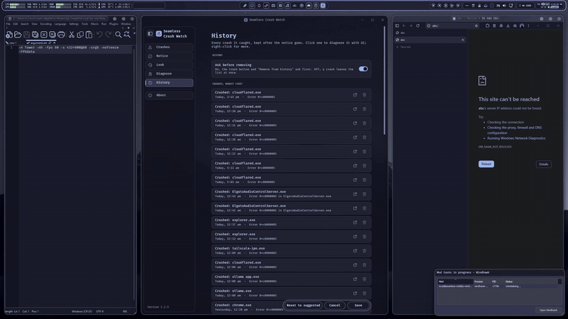 | [Seamless Compiz Cube](mods/local/seamless-compiz-cube) | Rounded 3D desktop cube with Mocha borders, switching desktops through Seamless Window Manager |
| 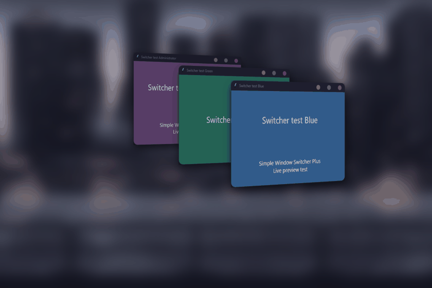 | [Simple Window Switcher Plus](mods/local/simple-window-switcher-plus) | Alt+Tab with Vista animations, background blur and elevated app support. |
| 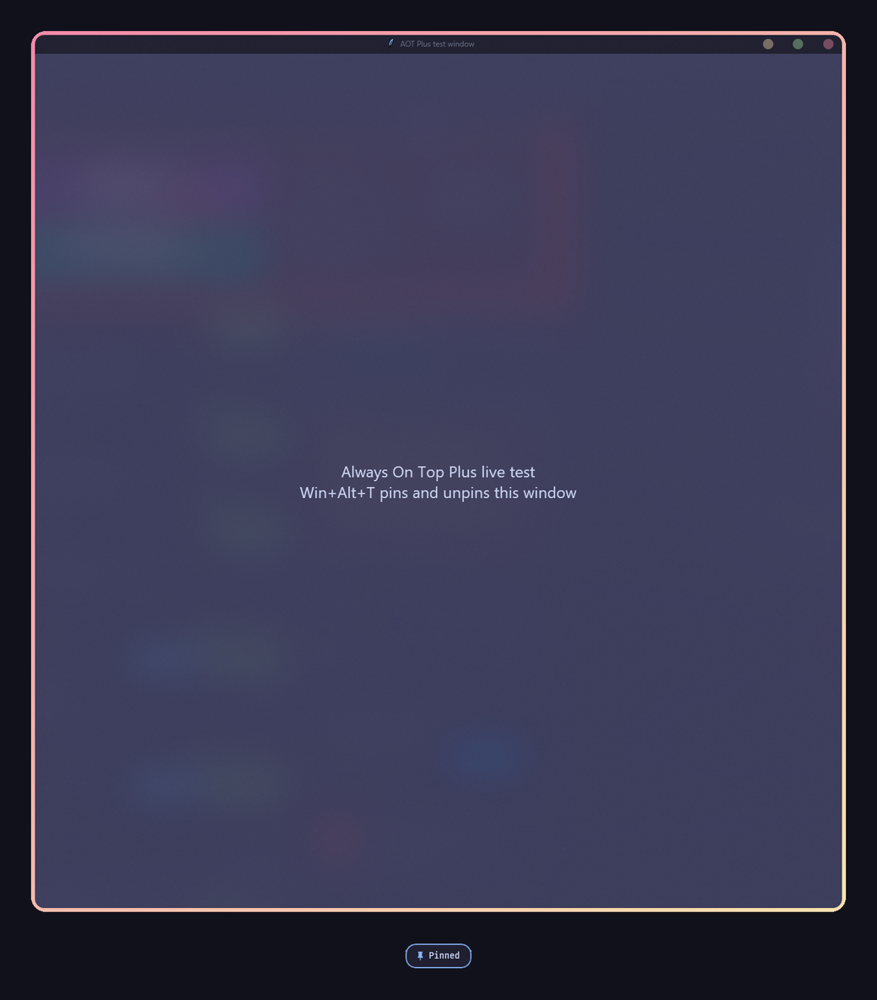 | [Always On Top Windows Plus](mods/local/always-on-top-plus) | Pin any window on top with a hotkey, marked by a Mocha red to yellow ring. |
| 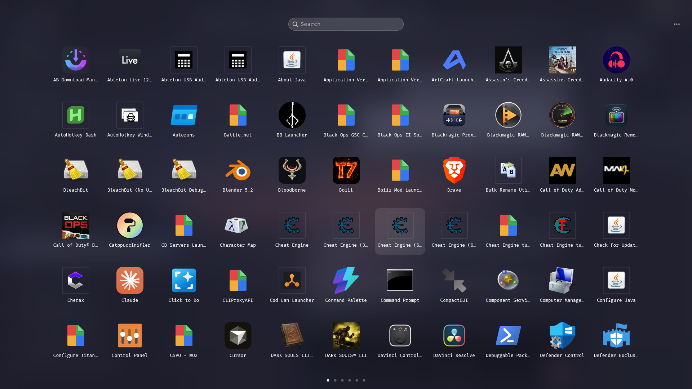 | [Seamless Launchpad](mods/local/seamless-launchpad) | A fullscreen, Launchpad-style grid of all your apps in place of Start, with instant search and blur. |
| | [Halo Launcher](mods/local/halo-launcher) | Press a key, type a few letters, press Enter: apps, files, sums, web searches and every plugin. |
| 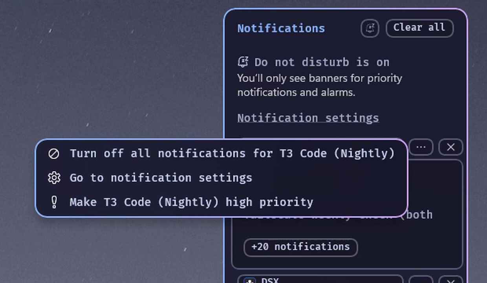 | [Notification Center Styler Plus](mods/local/notification-center-styler-plus) | Themes for the notification panel, with gradient hover borders and a group options menu that stays fully in view. |
| 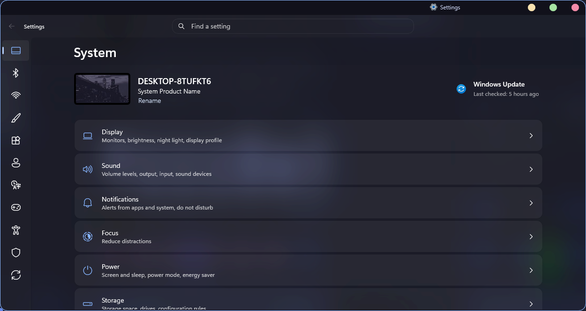 | [Settings Styler Plus](mods/local/settings-styler-plus) | Themes for the Settings app, with the normal title bar and a blur that stays when unfocused. |
| 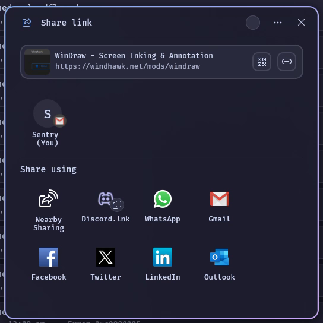 | [Seamless Share](mods/local/seamless-share) | Restyles the Windows 11 share window and its menus: blurred glass, your font, soft gradient hover edges, all adjustable. |
| | [Theme Tool Plus](mods/local/theme-tool-plus) | Switch Windows themes from the settings tab, custom themes included. Comes with the Main 01 Catppuccin theme, cursors and sounds. |
| | [UWP Assets Redirect Plus](mods/local/uwp-assets-redirect-plus) | Swap the icons of Store and system apps, with a built-in Catppuccin icon theme. |
| 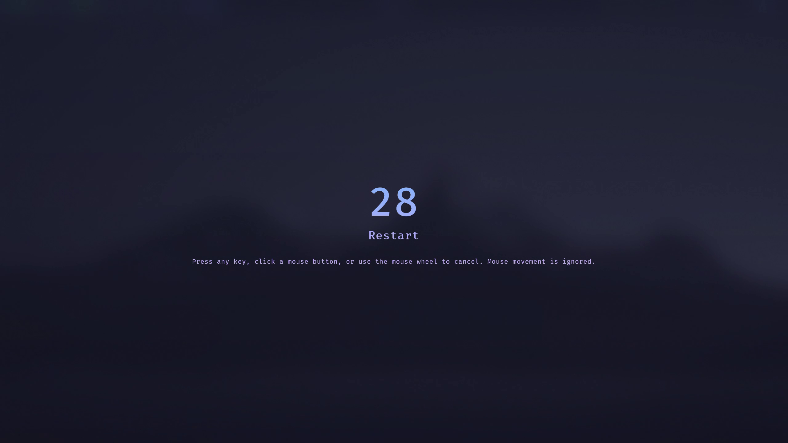 | [Seamless Power Action Countdown](mods/local/seamless-power-action-countdown) | A glassy countdown before shutdown, restart, sleep or hibernation that any key or click cancels. |
| 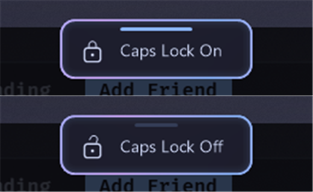 | [WinTips OSD Plus](mods/local/wintips-osd-plus) | The Windows tips OSD rebuilt in Capuchin Mocha: gradient-border cards for lock keys and clipboard actions. |
| 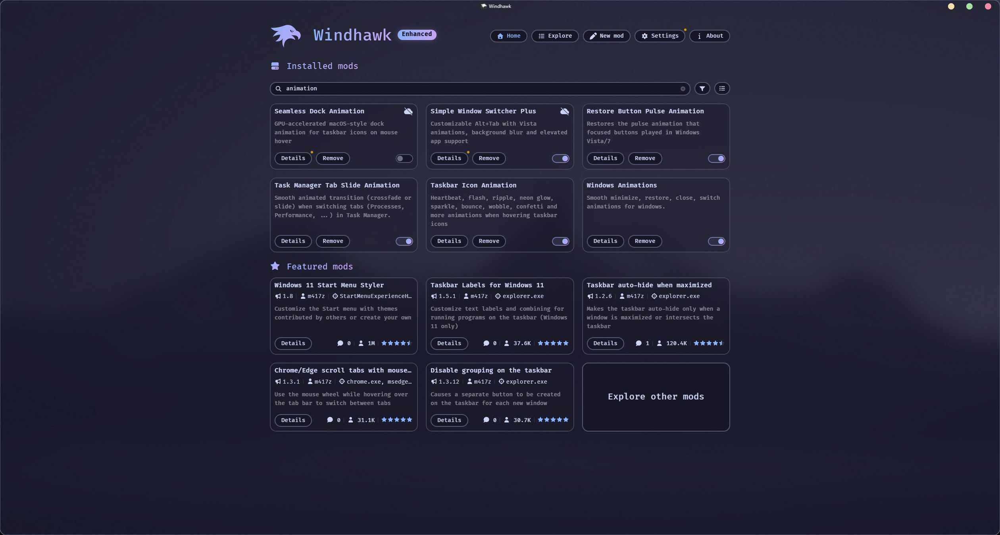 | [Windhawk Enhanced Styler](mods/local/windhawk-enhanced-styler) | Your own colors, gradients, font, transparency and blur for the Windhawk window. |

### Tools

Things you call up with a key, a click or the tray.

| | Mod | What it does |
| --- | --- | --- |
| 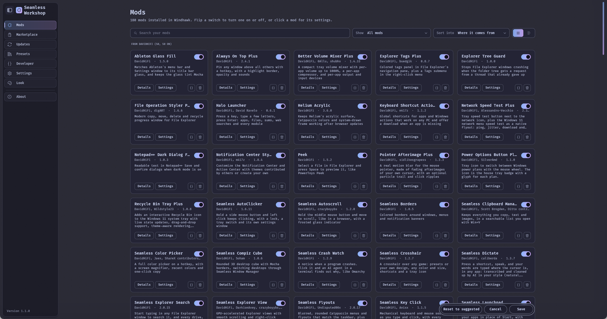 | [Seamless Workshop](mods/local/seamless-workshop) | One window to install, update, turn on and off, and set up DavidHiFi's Windhawk mods |
| | [Seamless Clipboard Manager](mods/local/seamless-clipboard-manager) | Everything you copy, text and images, in a searchable list you open with Win+V. |
| 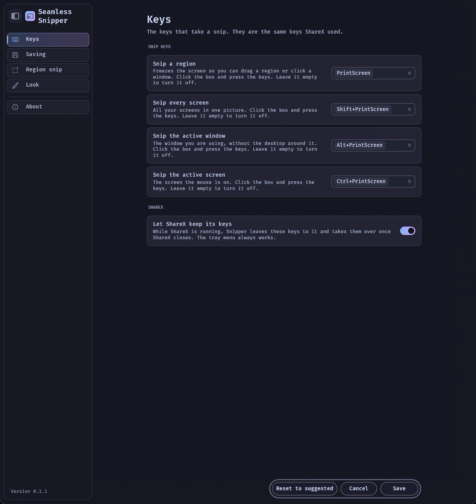 | [Seamless Snipper](mods/local/seamless-snipper) | Snip a region, a window or the whole screen: frozen screen, window snapping, a pixel magnifier, straight to the clipboard and your folder. Plus Magic Pointer: shake the mouse, point at anything and ask AI about it. |
| 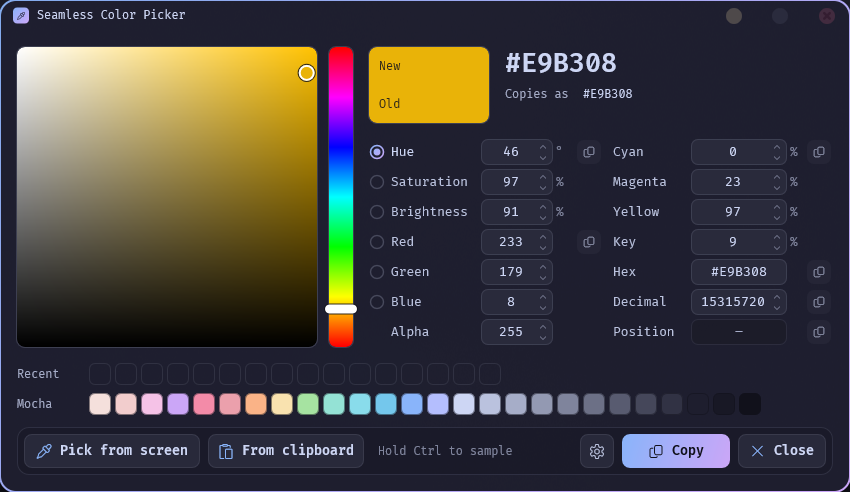 | [Seamless Color Picker](mods/local/seamless-color-picker) | A full color picker on a hotkey, with a screen magnifier, recent colors and one-click copy. |
| 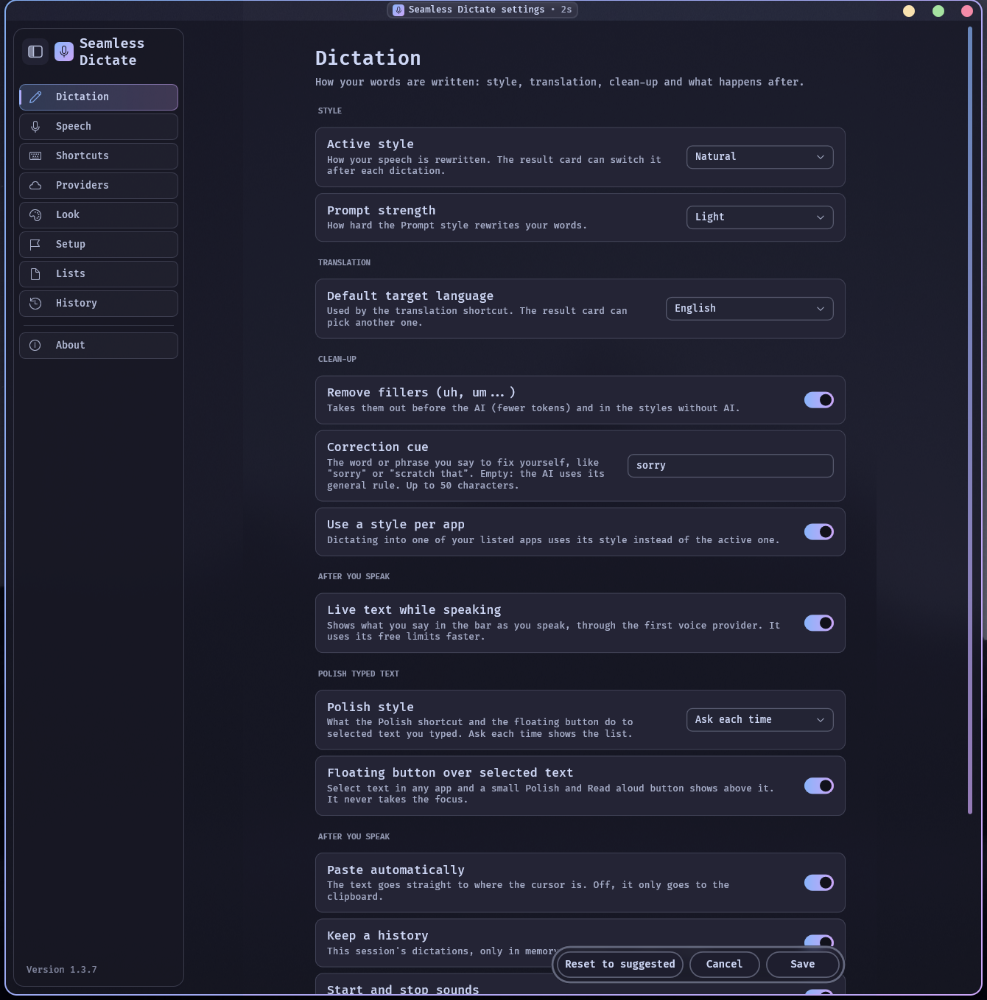 | [Seamless Dictate](mods/local/seamless-dictate) | Hold a shortcut and speak to type in any app, with AI cleanup and mic privacy while you talk. |
| | [ZoomIt](mods/local/zoomit) | Zoom into any part of the screen and draw on it with a hotkey, like Sysinternals ZoomIt. Hold Ctrl to read small text in a big bubble. |
| 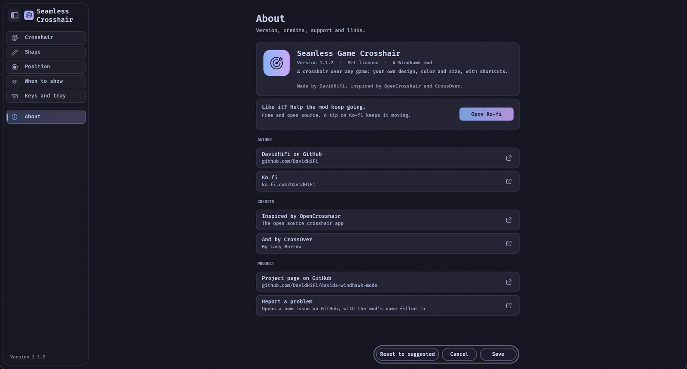 | [Seamless Game Crosshair](mods/local/seamless-crosshair) | A crosshair over any game: presets or your own design, any color and size, shortcuts and a tray icon. |
| 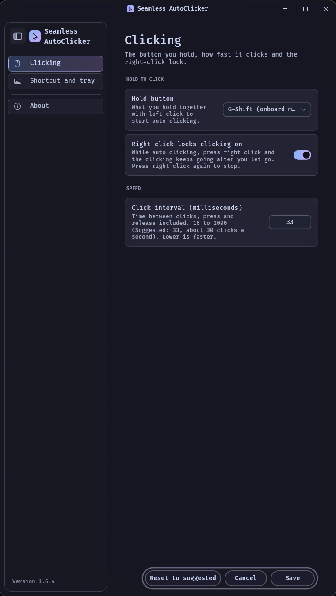 | [Seamless AutoClicker](mods/local/seamless-autoclicker) | Hold a side mouse button and left click keeps clicking, with a right-click lock, a tray switch and its own settings window. |
| 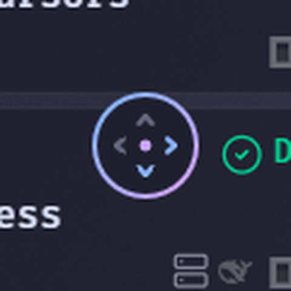 | [Seamless Autoscroll](mods/local/seamless-autoscroll) | Hold the middle mouse button and move to scroll, like in a browser, with a frosted glass indicator. |
|  | [Seamless Autoscroll Global](mods/local/seamless-autoscroll-global) | The frosted autoscroll circle in every app the per-app mod does not cover, with the same look |
| 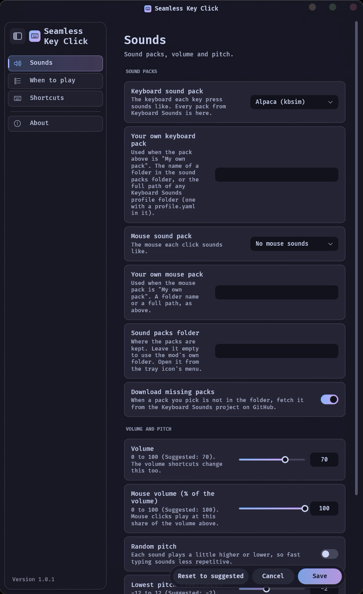 | [Seamless Key Click](mods/local/seamless-key-click) | Mechanical keyboard and mouse sounds as you type and click, with every Keyboard Sounds pack, shortcuts and a tray icon. |
| | [Pointer Afterimage Plus](mods/local/pointer-afterimage-plus) | A real motion blur for the mouse pointer, drawn on the GPU. |
| | [Keyboard Shortcut Actions Plus](mods/local/keyboard-shortcut-actions-plus) | Global shortcuts for apps and Windows actions, with a download offer when an app is missing. |
| 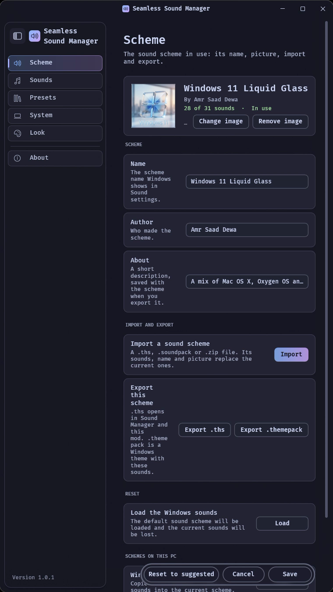 | [Seamless Sound Manager](mods/local/seamless-sound-manager) | Change every Windows sound with a scheme: 161 presets, startup and logon sounds. |
| 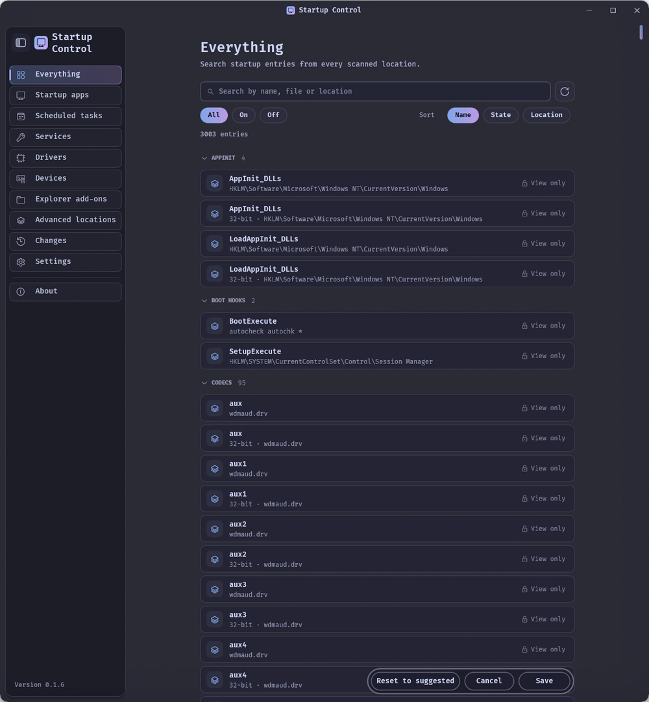 | [Startup Control](mods/local/startup-control) | Manage startup apps, scheduled tasks and Windows startup locations. |
| 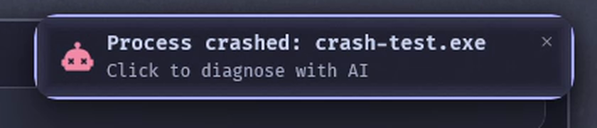 | [Seamless Crash Watch](mods/local/seamless-crash-watch) | A notice when a program crashes. Click it and an AI agent in a terminal finds out why. |

### Fixes

Small fixes for one app or one crash.

| | Mod | What it does |
| --- | --- | --- |
| | [Explorer Tree Guard](mods/local/explorer-tree-guard) | Stops File Explorer windows crashing when the folder tree gets a request from a thread that already gave up. |
| | [Helium Acrylic](mods/local/helium-acrylic) | Keeps Helium's acrylic surface, Catppuccin colors and system-drawn frame working after browser updates. |
| 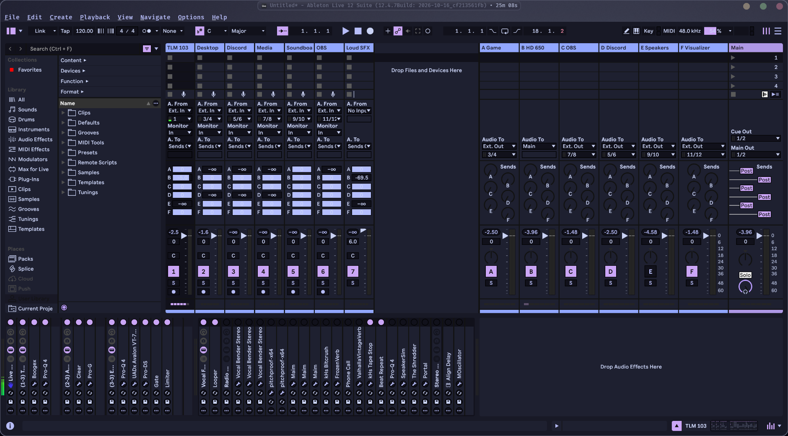 | [Ableton Glass Fill](mods/local/ableton-glass-fill) | Matches Ableton's menu bar and Settings window to its title bar glass, and keeps the glass tint Mocha |

### Themes

- **[OnlySearch Mocha](themes/start-menu-onlysearch-mocha):** the Start menu cut down to the search box and a power row, in Catppuccin Mocha. Paste [onlysearch-mocha.yaml](themes/start-menu-onlysearch-mocha/onlysearch-mocha.yaml) into the Start Menu Styler's Textual mode.
- **[Chromium Cursors Mocha](themes/chromium-cursors-mocha):** Catppuccin Mocha art for the ten cursors Chrome and Electron draw themselves, for the [Chromium Cursor Remap](https://windhawk.net/mods/chromium-cursor-remap) mod.

## Notes

> [!NOTE]
> **Nothing private is shared.** Published presets never hold API keys, tokens, passwords, locations or personal folder paths. The Workshop only downloads. It never uploads your settings.

> [!WARNING]
> **Loading a preset replaces that mod's settings.** The Workshop saves your current ones as a preset first.

> [!NOTE]
> **Windhawk compiles every mod on your PC.** The repo has no mod DLLs, only sources and settings.

> [!IMPORTANT]
> **Disable the original before a "Plus" mod.** Each Plus mod replaces the catalog mod it is based on, so turn the original off before you enable it.

> [!WARNING]
> **The Windhawk preview is a test build.** Expect rough edges. A Windhawk update finishes with a reboot: programs that were open keep the old engine until they restart.

<details>
<summary><b>What each folder holds</b></summary>

<br>

| Path | What it is |
| --- | --- |
| `mods/local/` | My mods, each with its source, a readme and install steps. |
| `mods/catalog/` | Copies of the [catalog mods](https://windhawk.net/mods) in this setup, as installed. Authors, versions and licenses are in [mods/catalog/README.md](mods/catalog/README.md). |
| `settings/` | Per-mod settings, app and engine preferences. See [settings/README.md](settings/README.md). |
| `themes/` | Styler themes, ready to paste into Textual mode, and cursor art for mods. |
| `mod-storage/` | Files mods wrote, currently the Taskbar Styler images. |
| `editor/` | The Windhawk mod editor's settings. |
| `manifest.json` | Every mod with version, author, license, origin and enabled state. |
| `presets/` | My settings for each mod, and the whole setup, with anything private stripped out. |
| `feed.json` | The list Seamless Workshop reads. Rebuilt each time a mod is published, pinned to an exact commit with a SHA-256 checksum for every file. |
| `Install-SeamlessWorkshop.ps1` | The install command above. Run it as a file with `-Check` to see what it would do. |
| `Update-Windhawk.ps1` | Installs Windhawk or updates it to the newest preview. |
| `CHANGELOG.md` | What changed in each Seamless Workshop release. |
| `tools/` | Scripts to apply this snapshot, rebuild it from a live install, or from another machine's export. |
| `media/` | Screenshots and previews. |

`settings/` holds configuration values only. The quota mods keep account credentials encrypted in their own storage, and those are not included.

</details>

<details>
<summary><b>Building and refreshing the snapshot</b></summary>

<br>

To build a mod outside the Windhawk editor, run the `Build.ps1` in its folder where there is one. [mods/README.md](mods/README.md) has the full compiler command for Windhawk's bundled clang and three things that trip up a build.

After changing mods or settings on a live install, refresh the snapshot from the repo root:

```powershell
powershell -ExecutionPolicy Bypass -File tools\Build-Repo.ps1
```

Add `-SkipSources` to refresh settings and metadata only. The rebuild is a mirror: mods that are no longer installed are removed from the sources, the manifest, the settings and the catalog table.

The `presets/` folder and `feed.json` are written by the publisher script that runs after every mod install, not by `Build-Repo.ps1`. It copies my mod sources, saves my settings for each mod as a preset, and strips anything private from every settings file first: API keys, tokens, passwords, locations and personal folder paths.

To refresh from a different machine, dump that machine's state first and rebuild from the export:

```powershell
powershell -ExecutionPolicy Bypass -File tools\Dump-WindhawkState.ps1 -OutPath H:\tmp\wh-export
powershell -ExecutionPolicy Bypass -File tools\Build-Repo.ps1 -FromExport H:\tmp\wh-export
```

</details>

<details>
<summary><b>Licenses</b></summary>

<br>

My own work here is MIT, see [LICENSE](LICENSE), except where a mod inherits its original's license:

- **GPL-3.0:** Seamless Window Manager, Seamless Borders, Seamless Clipboard Manager, Seamless Tray Drawer, File Operation Styler Plus, Seamless AutoClicker, Recycle Bin Tray Plus, Taskbar System Info Plus.
- **GPL-2.0:** Simple Window Switcher Plus, Theme Tool Plus, Seamless Explorer View, Chromium Cursors Mocha.

Catalog mods in `mods/catalog/` keep their authors' licenses.

</details>

## Contributing

Reports of mods that break after a Windows or Windhawk update help the most, along with compile fixes, mod requests and pull requests.

<a href="CONTRIBUTING.md">

</a>

## Star history

Thanks to everyone running these mods and reporting what breaks.

<a href="https://www.star-history.com/?repos=DavidHiFi%2Fseamless-workshop&amp;type=date">
  <picture>
    <source media="(prefers-color-scheme: dark)" srcset="https://api.star-history.com/chart?repos=DavidHiFi/seamless-workshop&amp;type=date&amp;theme=dark&amp;legend=top-left" />
    <source media="(prefers-color-scheme: light)" srcset="https://api.star-history.com/chart?repos=DavidHiFi/seamless-workshop&amp;type=date" />
    
  </picture>
</a>

## Credits

- **Author:** Myself, [DavidHiFi](https://github.com/DavidHiFi)

Most of my mods build on someone else's mod. Each mod's source names its sources too.

| Who | What |
| --- | --- |
| **Michael Maltsev** and **Ramen Software** ([Windhawk](https://github.com/ramensoftware/windhawk)) | The mod platform, its tool-mod support and the command-line tool the installer uses. `Update-Windhawk.ps1` only downloads, checks and runs their official installer. |
| **m417z** ([GitHub](https://github.com/m417z)) | AltDrag, the base of Seamless Window Manager. His [Multirow taskbar](https://windhawk.net/mods/taskbar-multirow) and [Taskbar Clock Customization](https://windhawk.net/mods/taskbar-clock-customization) code lives on in Taskbar System Info Plus. Windows 11 Notification Center Styler, Windows 11 File Explorer Styler, Windows 11 Settings Styler and [Keyboard Shortcut Actions](https://windhawk.net/mods/keyboard-shortcut-actions) are the bases of their Plus versions. |
| **RamonUnch** ([AltSnap](https://github.com/RamonUnch/AltSnap)) | The shortcuts and gestures in Seamless Window Manager. |
| **Stefan Sundin** ([AltDrag](https://stefansundin.github.io/altdrag/)) | The original AltDrag that Seamless Window Manager traces back to. |
| **Asteski** ([Snap Commander](https://windhawk.net/mods/snap-commander)) | Keyboard snapping in Window Manager. |
| **TomberWolf** ([Move Window to Monitor](https://windhawk.net/mods/move-window-to-monitor)) | Moving windows between monitors in Window Manager. |
| **Lone** ([Simple Window Switcher](https://windhawk.net/mods/simple-window-switcher)) | Simple Window Switcher 2.1, the base of Simple Window Switcher Plus. |
| **bropines** ([GitHub](https://github.com/bropines)) | Improvements to Simple Window Switcher. |
| **valinet** ([Simple Window Switcher](https://github.com/valinet/sws)) | The original Simple Window Switcher. |
| **caliberda** ([Alt+Tab Flip 3D](https://windhawk.net/mods/alt-tab-flip-3d)) | The Vista rendering in Simple Window Switcher Plus (MIT). |
| **caliberda** ([AI Voice Typing](https://windhawk.net/mods/ai-voice-typing)) | The base of Seamless Dictate (MIT). |
| **crazyboyybs** ([AutoScroll Win32](https://windhawk.net/mods/autoscroll-win32)) | The scrolling engine in Seamless Autoscroll. |
| **0Allu** ([Better Volume Mixer](https://windhawk.net/mods/better-volume-mixer)) | The base of Seamless Volume Mixer. |
| **shubho** ([App Volume Booster](https://windhawk.net/mods/app-volume-booster)) | The per-app boost and compressor in Seamless Volume Mixer. |
| **Gabriela Cristei** ([Explorer Font Changer](https://windhawk.net/mods/explorer-font-changer)) | The base of Shell Font Changer Plus. |
| **Rafael Mendes** ([Fullscreen Start](https://windhawk.net/mods/fullscreen-start)) | The base of Seamless Launchpad, and its preview image. |
| **AhmedAwad7** ([Always On Top Windows](https://windhawk.net/mods/always-on-top)) | The base of Always On Top Windows Plus. |
| **buedgik** ([Explorer Tags](https://github.com/buedgik/explorer-tags)) | The base of Explorer Tags Plus. |
| **digART** ([File Operation Styler](https://windhawk.net/mods/file-operation-styler)) | The base of File Operation Styler Plus. |
| **Rono** (Magic Pointer) | The base of Magic Pointer Plus. |
| **SAM2WOW** ([Micrographics Taskbar Clock](https://windhawk.net/mods/micrographics-taskbar-clock)) | The base of Micrographics Taskbar Clock Plus (MIT). |
| **Sof2245** ([Taskbar AI Usage](https://windhawk.net/mods/taskbar-ai-usage)) | The base of Taskbar AI Usage Plus. |
| **Wildstyle23** ([Recycle Bin Tray](https://windhawk.net/mods/recycle-bin-tray)) | The base of Recycle Bin Tray Plus. |
| **Marco Petrucci** ([Taskbar System Utilities](https://windhawk.net/mods/taskbar-system-utilities)) | The base of Seamless Taskbar Utilities, which adapts the menu hooks from his Taskbar Restart Explorer. |
| **meteoni** ([Taskbar Icon Separators](https://windhawk.net/mods/taskbar-icon-separators)) | The icon separators in Seamless Taskbar Utilities (GPL-3.0), with custom icon support by phntsm. |
| **oyrslyng** ([Taskbar Auto-Hide in Context](https://windhawk.net/mods/taskbar-autohide-in-context)) | The idea for the auto-hide switch in Seamless Taskbar Utilities. |
| **Scott Brogden and the Ditto contributors** ([Ditto](https://github.com/sabrogden/Ditto)) | The clipboard engine Seamless Clipboard Manager is based on (GPL-3.0). |
| **ShareX** ([ShareX](https://github.com/ShareX/ShareX)) | The color picker in Seamless Color Picker is based on theirs. |
| **Mark Russinovich** ([ZoomIt](https://learn.microsoft.com/sysinternals/downloads/zoomit)) | The zoom and draw behavior the ZoomIt mod recreates. |
| **Math Shamenson** ([Hover Text Magnifier](https://windhawk.net/mods/hover-text-magnifier)) | The base of the hover magnifier in ZoomIt (MIT). |
| **sidlikesgrapess** (Pointer Afterimage Motion Blur) | The base of Pointer Afterimage Plus. |
| **Salyts** ([Taskbar Fluent Media Player](https://windhawk.net/mods/taskbar-fluent-media-player)) | The base of Seamless Media Player (MIT), and the second-taskbar support in Taskbar System Info Plus. |
| **uMk0** ([Taskbar Media Widget](https://windhawk.net/mods/taskbar-media-widget)) | The behind-widget bars, progress bar and time display in Seamless Media Player (MIT). |
| **Yevhenii Starychenko** ([Taskbar System Info](https://windhawk.net/mods/taskbar-system-info)) | The base of Taskbar System Info Plus. |
| **Narayan** ([Taskbar Network Speed Indicator](https://windhawk.net/mods/net-speed-taskbar)) | The idea behind the network readouts in Taskbar System Info Plus. |
| **MEI** ([Nested Tray Drawer](https://windhawk.net/mods/nested-tray-drawer)) | The base of Seamless Tray Drawer. |
| **rounk-ctrl** ([UXTheme hook](https://windhawk.net/mods/uxtheme-hook)) | The base of Theme Tool Plus. |
| **namazso** ([SecureUxTheme](https://github.com/namazso/SecureUxTheme), [ThemeToolSharp](https://github.com/namazso/ThemeToolSharp)) | The theme engine research in Theme Tool Plus. |
| **niivu** ([DeviantArt](https://www.deviantart.com/niivu)) | The Catppuccin Windows themes and cursors that come with Theme Tool Plus. |
| **Ingan121** ([Titlebar For Everyone](https://windhawk.net/mods/titlebar-for-everyone)) | The window frame code in Windhawk Enhanced Styler (MIT), and the native frames and Spotify parts of Seamless Title Bars, with [CEF/Spotify Tweaks](https://windhawk.net/mods/cef-titlebar-enabler-universal). |
| **Th3Fanbus** ([Windows 11 Custom Title Bar Colours](https://windhawk.net/mods/win11-custom-title-bar-colours)) | The colours part of Seamless Title Bars. |
| **grn15RenS** ([Caption Buttons Customizer](https://windhawk.net/mods/caption-buttons-customizer)) | The caption buttons part of Seamless Title Bars (MIT). |
| **aubymori** ([Fix Basic Caption Text](https://windhawk.net/mods/fix-basic-caption-text)) | The basic frames part of Seamless Title Bars. |
| **Anixx** (Remove UWP Title Bars) | The base of the Store apps part of Seamless Title Bars. |
| **Ramen Software** ([Start menu styling guide](https://github.com/ramensoftware/windows-11-start-menu-styling-guide)) | The OnlySearch and RosePine themes merged into OnlySearch Mocha. |
| **Catppuccin** ([catppuccin](https://github.com/catppuccin/catppuccin)) | The Mocha palette in OnlySearch Mocha and the mod defaults. |
| **Catppuccin** ([cursors](https://github.com/catppuccin/cursors)) | The cursor art in Chromium Cursors Mocha (GPL-2.0). |
| **David Ravelo** ([Spotlight Launcher](https://windhawk.net/mods/spotlight-launcher)) | The window Halo Launcher started from (MIT). |
| **Flow Launcher contributors** ([Flow Launcher](https://github.com/Flow-Launcher/Flow.Launcher), [Wox](https://github.com/Wox-launcher/Wox)) | The plugin code Halo Launcher's search runs on (MIT). |
| **Tu2525** ([OpenCrosshair](https://github.com/Tu2525/OpenCrosshair)) and **Lacy Morrow** ([CrossOver](https://github.com/lacymorrow/crossover)) | The ideas behind Seamless Game Crosshair. No code is used. |
| **voidtools** ([Everything](https://www.voidtools.com)) | The search engine Seamless Explorer Search runs on. Listary inspired the idea. |
| **Anixx** ([Key Click](https://windhawk.net/mods/key-click)) | The base of Seamless Key Click, whose tick is kept as the Classic pack. |
| **Nathan Fiscaletti** ([Keyboard Sounds](https://github.com/nathan-fiscaletti/keyboardsounds)) | The sound packs and profile format in Seamless Key Click (GPL-3.0). |
| **m417z** ([Notification Center Styler](https://windhawk.net/mods/windows-11-notification-center-styler)) | The base of Seamless Share. |
| **Jaex and the ShareX contributors** ([ShareX](https://github.com/ShareX/ShareX)) | The base of Seamless Snipper, written again in C++ (GPL-3.0). |
| **digART** ([Taskbar Count Badges](https://windhawk.net/mods/taskbar-count-badges)) | The base of Seamless Taskbar Badge Counter (GPL-3.0). |
| **ferrys** ([UWP Assets Redirect](https://windhawk.net/mods/uwp-assets-redirect)) | The base of UWP Assets Redirect Plus. |
| **Catalog mod authors** ([full list](mods/catalog/README.md)) | Every catalog mod in `mods/catalog/`, copied as installed. Each one is its author's work. |

Built on [Windhawk](https://github.com/ramensoftware/windhawk) by m417z, with its bundled [LLVM clang](https://llvm.org/) compiler, [Direct2D](https://learn.microsoft.com/windows/win32/direct2d/direct2d-portal), [DirectWrite](https://learn.microsoft.com/windows/win32/directwrite/direct-write-portal) and [WinHTTP](https://learn.microsoft.com/windows/win32/winhttp/about-winhttp) for the Workshop window, and [PowerShell](https://github.com/PowerShell/PowerShell) for the install and snapshot scripts.

> Missing or wrong credit? [Open an issue](https://github.com/DavidHiFi/seamless-workshop/issues/new) and I'll fix it.

## Disclaimers

Most of the code in my own mods and scripts was developed with AI coding agents, including Claude Code, Codex and OpenCode. No single AI agent made the project. The catalog mods in `mods/catalog/` are other people's work, copied unchanged.

The mods hook into Windows processes such as Explorer. If something misbehaves after a Windows update, turn the mod off in Windhawk or start Windhawk in safe mode.

`Update-Windhawk.ps1` downloads Windhawk from GitHub over an encrypted connection and checks it before running it. It changes nothing outside the Windhawk install.

<div align="center">
<br>
<sub>Not affiliated with Ramen Software or Microsoft. Requires Windows 11 and <a href="https://windhawk.net">Windhawk</a>.</sub>
</div>
