<div align="center">


# David's Windhawk mods

**My [Windhawk](https://windhawk.net) mods for Windows 11, plus a full snapshot of the setup they run in.**

Taskbar, window and Start menu mods, every catalog mod and setting I use, and scripts to copy it all onto another PC.

<a href="https://github.com/DavidHiFi/davids-windhawk-mods/releases/latest">

</a>

<br><br>


</div>

---

## Installation

### One mod

1. Install [Windhawk](https://windhawk.net).
2. Open the mod's folder below and copy its `.wh.cpp` file.
3. In Windhawk, choose **Create a new mod**, paste the file and click **Compile**.
4. If the mod is a "Plus" version of a catalog mod, disable the original first.

Each release on the Releases page carries one mod, so the latest release is the most recently updated mod.

### The whole setup

1. Install [Windhawk](https://windhawk.net). Windhawk Styler needs the 2.0 interface; its [legacy edition](mods/local/windhawk-styler/legacy) covers the older one.
2. Install the catalog mods listed in [mods/catalog/README.md](mods/catalog/README.md) from Windhawk's Explore tab, and my mods from their folders.
3. From an elevated PowerShell in the repo root, preview and then apply the settings:

   ```powershell
   powershell -ExecutionPolicy Bypass -File tools\Apply-WindhawkSettings.ps1 -Audit
   powershell -ExecutionPolicy Bypass -File tools\Apply-WindhawkSettings.ps1
   ```

   Add `-IncludeAppSettings` to import the app and engine settings too, then reopen the Windhawk window.
4. Copy `mod-storage/` to `C:\ProgramData\Windhawk\Engine\ModsWritable\mod-storage\`, and `editor/settings.json` to `C:\ProgramData\Windhawk\UIData\user-data\User\settings.json`.

## Features

### Taskbar and tray

| | Mod | What it does |
| --- | --- | --- |
| 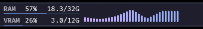 | [Taskbar Audio Visualizer](mods/local/taskbar-audio-visualizer) | A live audio spectrum with media controls, right on the taskbar. |
| 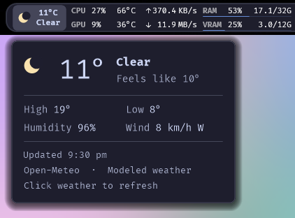 | [Taskbar Weather](mods/local/taskbar-weather) | Current weather on the taskbar with a details card on hover, no Widgets or API key. |
| 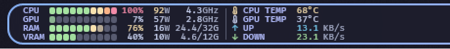 | [Taskbar System Info Plus](mods/local/taskbar-system-info-weather) | CPU, GPU, RAM, VRAM, temperatures and network speed, with optional graphs. |
| 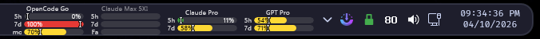 | [Taskbar AI Quota Bars Plus](mods/local/taskbar-ai-quota-opencode) | Claude, Codex, Antigravity and OpenCode Go usage limits as taskbar bars. |
| 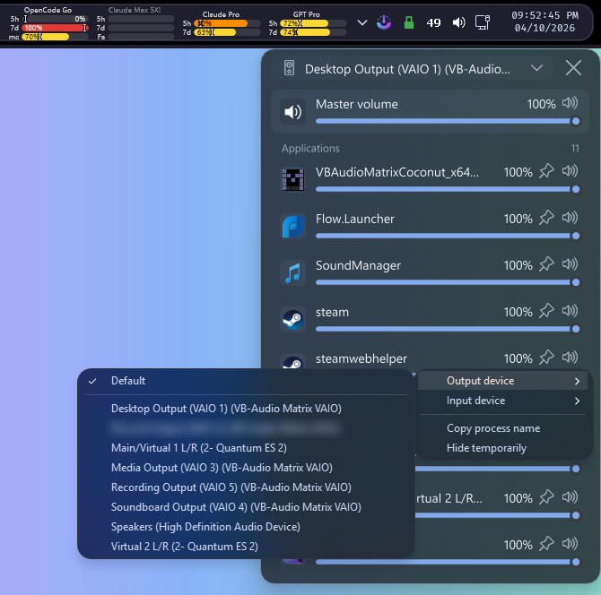 | [Better Volume Mixer Plus](mods/local/better-volume-mixer-plus) | A tray volume mixer with per-app volume and per-app output and input devices. |

### Windows and Alt+Tab

| | Mod | What it does |
| --- | --- | --- |
| 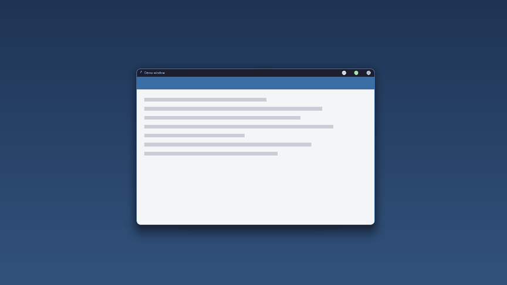 | [Window Manager](mods/local/window-manager) | Move, resize, snap and send windows to other monitors with Alt+drag and shortcuts. |
| 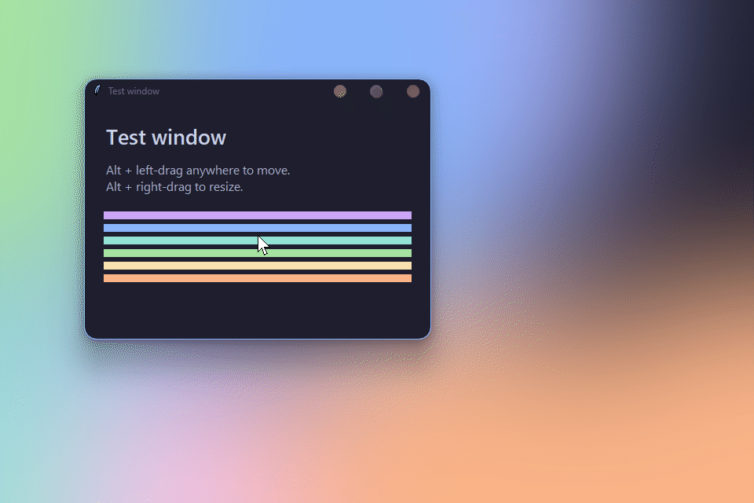 | [AltSnap](mods/local/alt-snap-drag) | Alt+drag to move and resize any window, plus AltSnap's window shortcuts. |
| 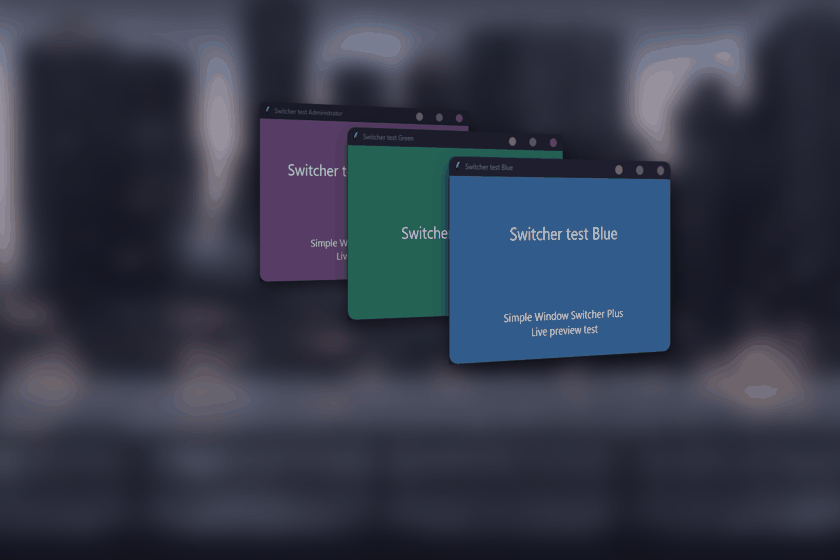 | [Simple Window Switcher Plus](mods/local/simple-window-switcher-plus) | Alt+Tab with Vista animations, background blur and elevated app support. |

### Start menu, Explorer and menus

| | Mod | What it does |
| --- | --- | --- |
| 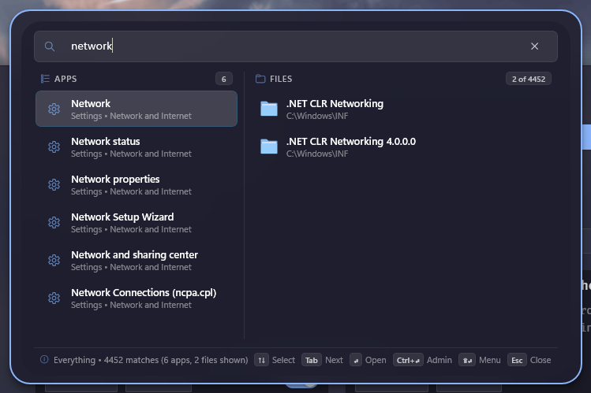 | [Everything & Power Tools in the Start Menu Plus](mods/local/start-everything-plus) | Compact Start menu search with Everything, preview, apps, settings and power tools. |
| 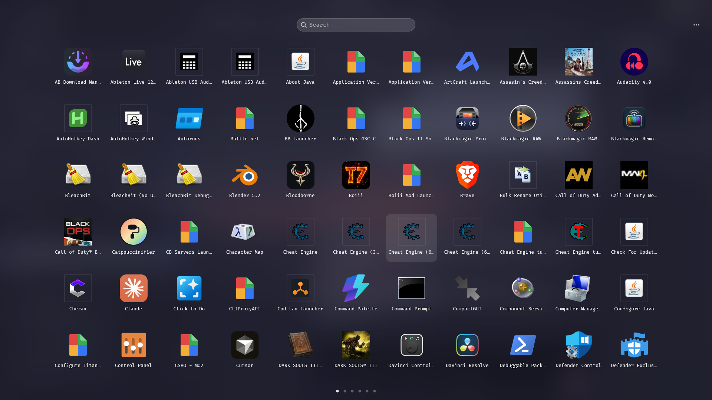 | [Fullscreen Start Plus](mods/local/fullscreen-start-plus) | A fullscreen, Launchpad-style grid of all your apps in place of Start, with instant search and blur. |
| 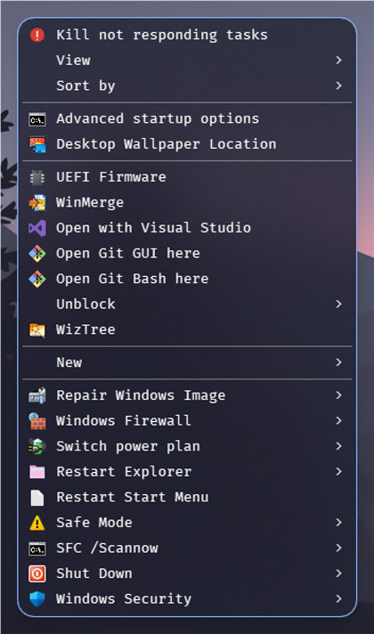 | [Translucent Flyouts](mods/local/translucent-flyouts) | Acrylic, Mica and blur backgrounds for menus, dropdowns and tooltips in every app. |
| 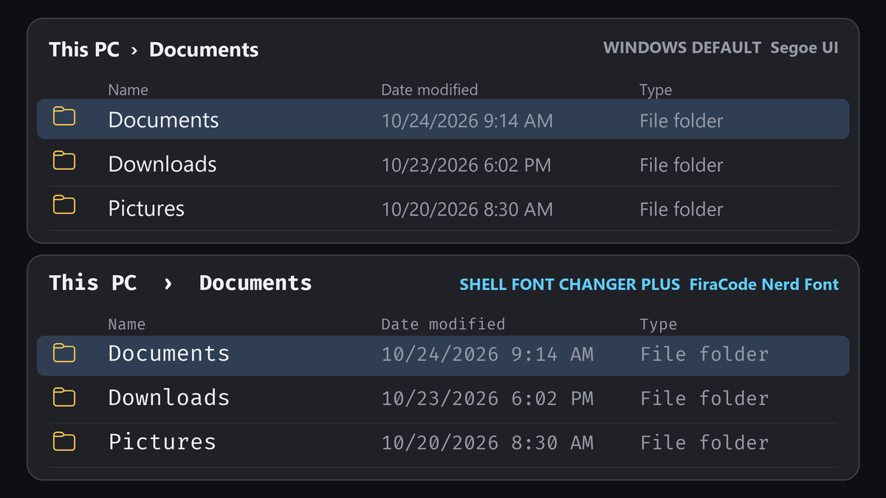 | [Shell Font Changer Plus](mods/local/shell-font-changer-plus) | Any installed font in Explorer, Start, Search and Settings, with icons and emoji left intact. |
|  | [Drag to Delete Plus](mods/local/drag-to-delete-plus) | A floating trash target appears while you drag files, with themes, shapes and colors. |
| | [Theme Tool Plus](mods/local/theme-tool-plus) | Apply and switch custom Windows themes from a Ctrl+Alt+Y picker, unsigned themes included. |

### Windhawk and app fixes

| | Mod | What it does |
| --- | --- | --- |
|  | [Windhawk Styler](mods/local/windhawk-styler) | Your own colors, font, transparency and blur for the Windhawk window. |
| 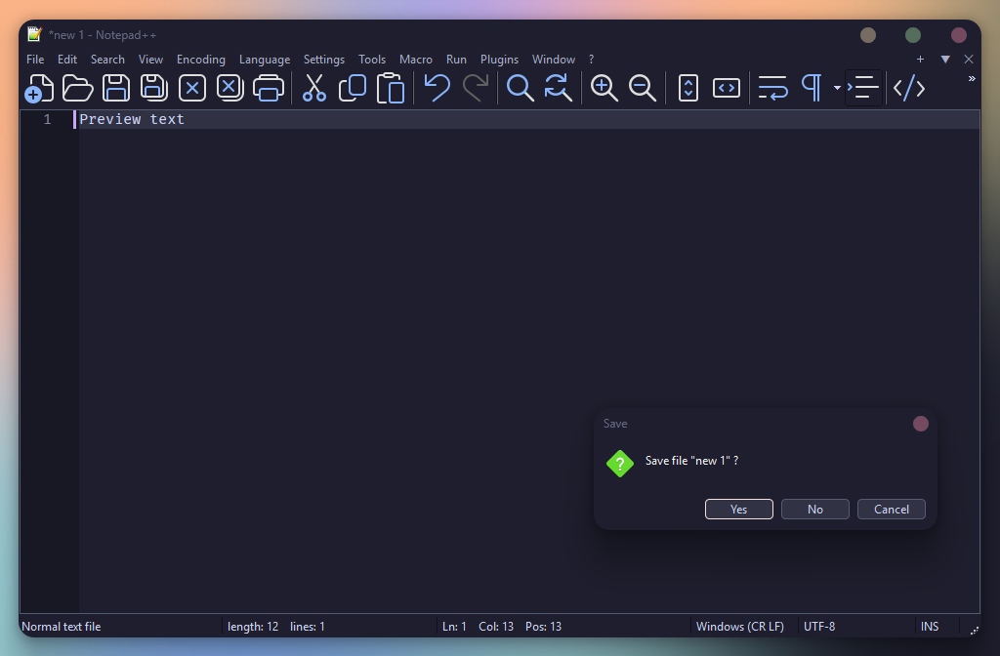 | [Notepad++ Dark Dialog Fix](mods/local/npp-taskdlg-textcolor) | Readable text in Notepad++ Save and confirm dialogs in dark mode. |

### Themes

- **[OnlySearch Mocha](themes/start-menu-onlysearch-mocha):** the Start menu cut down to the search box and a power row, in Catppuccin Mocha. Paste [onlysearch-mocha.yaml](themes/start-menu-onlysearch-mocha/onlysearch-mocha.yaml) into the Start Menu Styler's Textual mode.

## Notes

> [!NOTE]
> **Windhawk compiles every mod on your PC.** The repo has no mod DLLs, only sources and settings.

> [!IMPORTANT]
> **Disable the original before a "Plus" mod.** Each Plus mod replaces the catalog mod it is based on, so turn the original off before you enable it.

> [!WARNING]
> **Center Titlebar Fork is unfinished.** [Its folder](mods/local/center-titlebar-fork) holds a prototype that is not installed in this setup.

<details>
<summary><b>What each folder holds</b></summary>

<br>

| Path | What it is |
| --- | --- |
| `mods/local/` | My mods, each with its source, a readme and install steps. |
| `mods/catalog/` | Copies of the [catalog mods](https://windhawk.net/mods) in this setup, as installed. Authors, versions and licenses are in [mods/catalog/README.md](mods/catalog/README.md). |
| `settings/` | Per-mod settings, app and engine preferences. See [settings/README.md](settings/README.md). |
| `themes/` | Styler themes, ready to paste into Textual mode. |
| `mod-storage/` | Files mods wrote, currently the Taskbar Styler images. |
| `editor/` | The Windhawk mod editor's settings. |
| `manifest.json` | Every mod with version, author, license, origin and enabled state. |
| `tools/` | Scripts to apply this snapshot or rebuild it from a live install. |
| `media/` | Screenshots and previews. |

`settings/` holds configuration values only. The quota mods keep account credentials encrypted in their own storage, and those are not included.

</details>

<details>
<summary><b>Building and refreshing the snapshot</b></summary>

<br>

To build a mod outside the Windhawk editor, run the `Build.ps1` in its folder where there is one. [mods/README.md](mods/README.md) has the full compiler command for Windhawk's bundled clang and three things that trip up a build.

After changing mods or settings on a live install, refresh the snapshot from the repo root:

```powershell
powershell -ExecutionPolicy Bypass -File tools\Build-Repo.ps1
```

Add `-SkipSources` to refresh settings and metadata only.

</details>

<details>
<summary><b>Licenses</b></summary>

<br>

My own work here is MIT, see [LICENSE](LICENSE), except where a mod inherits its original's license:

- **GPL-3.0:** Window Manager, AltSnap, Taskbar System Info Plus, Everything & Power Tools in the Start Menu Plus.
- **GPL-2.0:** Simple Window Switcher Plus, Theme Tool Plus.
- **LGPL-3.0:** Translucent Flyouts.

Catalog mods in `mods/catalog/` keep their authors' licenses.

</details>

## Contributing

Reports of mods that break after a Windows or Windhawk update help the most, along with compile fixes and pull requests.

<a href="CONTRIBUTING.md">

</a>

## Star history

Thanks to everyone running these mods and reporting what breaks.

<a href="https://www.star-history.com/?repos=DavidHiFi%2Fdavids-windhawk-mods&amp;type=date">
  <picture>
    <source media="(prefers-color-scheme: dark)" srcset="https://api.star-history.com/chart?repos=DavidHiFi/davids-windhawk-mods&amp;type=date&amp;theme=dark&amp;legend=top-left" />
    <source media="(prefers-color-scheme: light)" srcset="https://api.star-history.com/chart?repos=DavidHiFi/davids-windhawk-mods&amp;type=date" />
    
  </picture>
</a>

## Credits

- **Author:** Myself, [DavidHiFi](https://github.com/DavidHiFi)

Most of my mods build on someone else's mod. Each folder's readme credits its sources too.

| Who | What |
| --- | --- |
| **m417z** ([AltDrag](https://windhawk.net/mods/alt-drag)) | The base of AltSnap and Window Manager. Taskbar System Info Plus follows his [Multirow taskbar](https://windhawk.net/mods/taskbar-multirow) and Taskbar Clock Customization code. |
| **RamonUnch** ([AltSnap](https://github.com/RamonUnch/AltSnap)) | The shortcuts and gestures in AltSnap. |
| **Stefan Sundin** ([AltDrag](https://stefansundin.github.io/altdrag/)) | The original AltDrag that AltSnap and Window Manager trace back to. |
| **Asteski** ([Snap Commander](https://windhawk.net/mods/snap-commander)) | Keyboard snapping in Window Manager, and improvements to Simple Window Switcher. |
| **TomberWolf** ([Move Window to Monitor](https://windhawk.net/mods/move-window-to-monitor)) | Moving windows between monitors in Window Manager. |
| **Lone** ([Simple Window Switcher](https://windhawk.net/mods/simple-window-switcher)) | Simple Window Switcher 2.1, the base of Simple Window Switcher Plus. |
| **bropines** ([GitHub](https://github.com/bropines)) | Improvements to Simple Window Switcher. |
| **valinet** ([Simple Window Switcher](https://github.com/valinet/sws)) | The original Simple Window Switcher, and [WinCenterTitle](https://github.com/valinet/WinCenterTitle) behind Center Titlebar Fork. |
| **caliberda** ([Alt+Tab Flip 3D](https://windhawk.net/mods/alt-tab-flip-3d)) | The Vista rendering in Simple Window Switcher Plus (MIT). |
| **0Allu** ([Better Volume Mixer](https://windhawk.net/mods/better-volume-mixer)) | The base of Better Volume Mixer Plus. |
| **Gabriela Cristei** ([Explorer Font Changer](https://windhawk.net/mods/explorer-font-changer)) | The base of Shell Font Changer Plus. |
| **bardelyne** ([Everything & Power Tools in the Start Menu](https://windhawk.net/mods/start-everything)) | The base of the Plus version. |
| **Cleroth** ([Taskbar AI Quota Bars](https://windhawk.net/mods/taskbar-ai-quota)) | The base of Taskbar AI Quota Bars Plus. |
| **USER-TOURNE** ([Tourne'Table](https://windhawk.net/mods/tourne-table-desktop-audio-visualizer)) | A base of Taskbar Audio Visualizer. |
| **Salyts** ([Desktop Audio Visualizer](https://windhawk.net/mods/desktop-audio-visualizer)) | A base of Taskbar Audio Visualizer, and the second-taskbar support in Taskbar System Info Plus from [Taskbar Fluent Media Player](https://github.com/Salyts/Taskbar-Fluent-Media-Player). |
| **Yevhenii Starychenko** ([Taskbar System Info](https://windhawk.net/mods/taskbar-system-info)) | The base of Taskbar System Info Plus. |
| **Narayan** ([Taskbar Network Speed Indicator](https://windhawk.net/mods/net-speed-taskbar)) | The idea behind the network readouts in Taskbar System Info Plus. |
| **iMAboud** ([Drag to Delete](https://windhawk.net/mods/drag-to-delete)) | The base of Drag to Delete Plus. |
| **Rafael Mendes** ([Fullscreen Start](https://windhawk.net/mods/fullscreen-start)) | The base of Fullscreen Start Plus, and its preview image. |
| **rounk-ctrl** ([UXTheme hook](https://windhawk.net/mods/uxtheme-hook)) | The base of Theme Tool Plus, and the center-titlebar mod behind Center Titlebar Fork. |
| **namazso** ([SecureUxTheme](https://github.com/namazso/SecureUxTheme), [ThemeToolSharp](https://github.com/namazso/ThemeToolSharp)) | The theme engine research in Theme Tool Plus. |
| **ALTaleX531** ([TranslucentFlyouts](https://github.com/ALTaleX531/TranslucentFlyouts)) | Translucent Flyouts is a port of it and uses its settings layout. |
| **Ingan121** ([Titlebar For Everyone](https://windhawk.net/mods/titlebar-for-everyone)) | The window frame code in Windhawk Styler (MIT). |
| **Ramen Software** ([Start menu styling guide](https://github.com/ramensoftware/windows-11-start-menu-styling-guide)) | The OnlySearch and RosePine themes merged into OnlySearch Mocha. |
| **Catppuccin** ([catppuccin](https://github.com/catppuccin/catppuccin)) | The Mocha palette in OnlySearch Mocha and the mod defaults. |
| **Open-Meteo** ([open-meteo.com](https://open-meteo.com/)) | The weather data in Taskbar Weather (CC BY 4.0). |
| **Catalog mod authors** ([full list](mods/catalog/README.md)) | Every catalog mod in `mods/catalog/`, copied as installed. Each one is its author's work. |

Built on [Windhawk](https://github.com/ramensoftware/windhawk) by m417z, with its bundled [LLVM clang](https://llvm.org/) compiler and [PowerShell](https://github.com/PowerShell/PowerShell) for the snapshot scripts.

> Missing or wrong credit? [Open an issue](https://github.com/DavidHiFi/davids-windhawk-mods/issues/new) and I'll fix it.

## Disclaimers

Most of the code in my own mods was developed with AI coding agents, including Claude Code, Codex and OpenCode. No single AI agent made the project. The catalog mods in `mods/catalog/` are other people's work, copied unchanged.

The mods hook into Windows processes such as Explorer. Windhawk lets you disable any mod in one click if something misbehaves after a Windows update.

<div align="center">
<br>
<sub>Not affiliated with Ramen Software or Microsoft. Requires Windows 11 and <a href="https://windhawk.net">Windhawk</a>.</sub>
</div>
