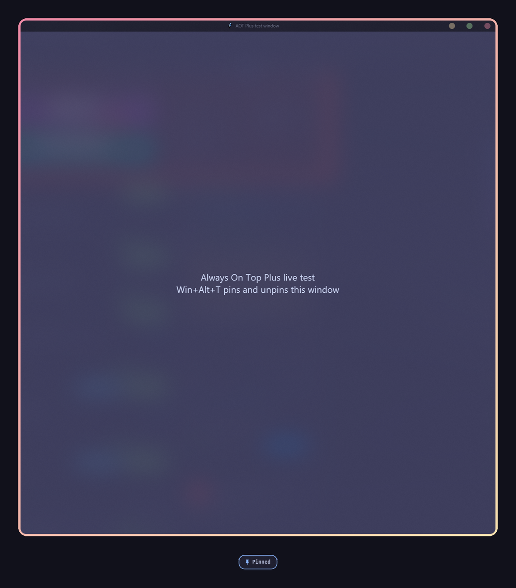

# Always On Top Windows Plus

[☕ Support on Ko-fi](https://ko-fi.com/DavidHiFi)

Pin the window you are working in above everything else with Win+Alt+T, and
unpin it the same way. A thick ring, Catppuccin Mocha red fading to yellow,
shows which windows are pinned.

## Features
- **Pin with one shortcut.** Win+Alt+T pins or unpins the active window. Every
  key in it can be changed.
- **Gradient ring.** Follows the window, matches its rounded corners, and sits
  over thin border lines from other mods. Pick two colors, one color or your
  accent color.
- **See-through windows.** Win+Alt+Plus and Win+Alt+Minus change a pinned
  window's opacity in steps.
- **Sound and a glass status card** confirm each pin and unpin. Both can be
  turned off.
- **Excluded apps** can never be pinned, and pins come back if Windows drops them.

## Install
1. In Windhawk, choose **Create a new mod**.
2. Paste [always-on-top-plus.wh.cpp](always-on-top-plus.wh.cpp) and click
   **Compile**.

## Credits
Made by [DavidHiFi](https://github.com/DavidHiFi). Based on
[Always On Top Windows](https://windhawk.net/mods/always-on-top) by AhmedAwad7,
with the behavior of the Always On Top utility in
[Microsoft PowerToys](https://learn.microsoft.com/windows/powertoys/always-on-top) (MIT).
