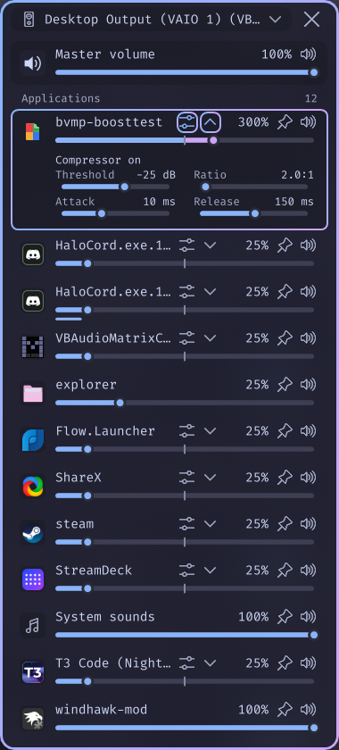

# Seamless Volume Mixer

[☕ Support on Ko-fi](https://ko-fi.com/DavidHiFi)

A compact volume mixer in the system tray, with per-app volume up to 1000%, a
per-app compressor, and per-app audio devices.

## Features

- **Boost any app up to 1000%.** Drag an app's slider past 100% and the fill
  turns mauve. Up to 100% the slider is the normal Windows app volume.
- **A compressor for each app.** The button next to the app name turns it on.
  The arrow beside it opens Threshold, Ratio, Attack and Release. The options
  stay hidden until you open them.
- **Send any app to a different speaker or microphone.** Right-click an app,
  then pick **Output device** or **Input device**. Pick **Default** to undo it.
- **Master and per-app volume** with mute buttons, scroll-wheel control and
  exact values.
- **Quick playback device switching** from the top of the mixer.
- **Pin, rename or hide apps**, and give apps a default volume.
- **Middle-click to mute**, in the mixer or on the tray icon.
- **Light, dark and system themes** with blur, transparency and animations.
- **Compact mode** and full keyboard control.
- **Custom font**, such as a Nerd Font, for all mixer text.

## How to use

Click the speaker icon in the tray to open or close the mixer. If it is hidden,
open the tray overflow and drag it onto the taskbar.

A boost or compressor change applies the next time the app starts playing
sound. Apps that are already playing pick it up on their next stream or after a
restart. Boosting past 100% can clip, and the compressor helps keep it clean.

Per-app devices use the same setting as Windows' own volume mixer, so they
work like EarTrumpet's and survive restarts.

To avoid two volume icons, install
[Taskbar tray system icon tweaks](https://windhawk.net/mods/taskbar-tray-system-icon-tweaks)
and turn on **Hide volume icon**. Disable the original Better Volume Mixer and
App Volume Booster before enabling this mod.

## Credits

Based on [Better Volume Mixer](https://windhawk.net/mods/better-volume-mixer)
by 0Allu. The boost and compressor come from
[App Volume Booster](https://windhawk.net/mods/app-volume-booster) by
[shubho](https://github.com/shubho193). MIT.

## Install

1. Install [Windhawk](https://windhawk.net/).
2. Choose **Create a new mod**, paste [better-volume-mixer-plus.wh.cpp](better-volume-mixer-plus.wh.cpp) and click **Compile**.

License: MIT.
