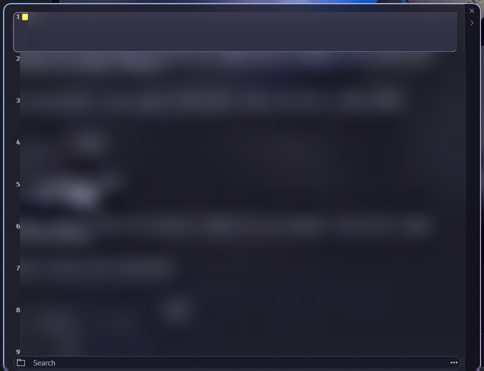

# Ditto Styler

[☕ Support on Ko-fi](https://ko-fi.com/DavidHiFi)

Gives the [Ditto](https://github.com/sabrogden/Ditto) clipboard manager a dark
glass look: a blurred, rounded window with a blue to mauve ring, glass
tooltips, and one rounded dock for the folder button, search box and menu.

## Features
- **Glass window.** A blurred backdrop, 16 px rounded corners and a thin blue
  to mauve ring, with no square corners left over.
- **Bottom dock.** The folder button, search box and menu button share one
  rounded dock. Buttons light up on hover with a soft fill and a blue ring.
- **Glass tooltips.** Rounded, blurred, with FiraCode text.
- **Easier to read.** Bigger row numbers, a darker side strip, and smooth mouse
  wheel scrolling through the clip list.
- **Soft open and close.** The window fades in and out. It follows the Windows
  "Animation effects" setting.
- **Reversible.** Turn the mod off and Ditto looks the way it did.

## Settings
Tooltip glass, tooltip text size and strength, window glass, the dock, the
fade and its length, and the accent color. Each setting lists a suggested
value.

## Install
1. Set Ditto's theme to Catppuccin Mocha (Options, Theme). The colors match it.
2. In Windhawk, choose **Create a new mod**.
3. Paste [ditto-styler.wh.cpp](ditto-styler.wh.cpp) and click **Compile**.

## Changes
- **1.1.10:** fixes a freeze where Ditto stopped responding and Windhawk stayed
  on "Uninitializing" when both scrollbars were showing.

## Credits
Made by [DavidHiFi](https://github.com/DavidHiFi). Styles
[Ditto](https://github.com/sabrogden/Ditto) by Scott Brogden.
