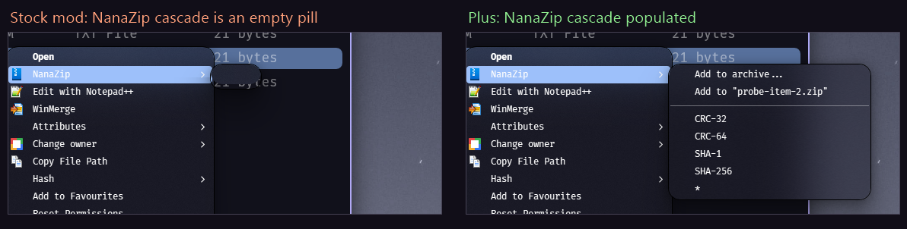

# GPU Accelerated Explorer View Plus

Hardware rendering for Explorer's file lists and icon grids, with right-click
submenus that open fully populated instead of an empty box.

## Features

- **GPU rendering.** Details lists and icon grids draw smoothly, thumbnails included.
- **Smooth scrolling.** Mouse wheel, touchpad gestures and inertia feel natural.
- **Submenus that fill.** Cascades from shell extensions such as NanaZip open with all
  their items, instead of a blank pill.
- **Animated interactions.** Sorting, grouping, selecting and copying all animate.
- **Page animations.** Folders slide and fade in WinUI style when they open, and Back and
  Forward slide sideways.
- **Navigation pane styling.** Rounded hover and selection highlights, state colors, fonts,
  item height and icon size for the folder tree, painted with Direct2D.
- **Switch back anytime.** A toggle button in Explorer, or **Ctrl+Alt+F9**, returns to
  the native view.

## Credits

Based on [GPU-accelerated explorer.exe list and grid views](https://windhawk.net/mods/gpu-accelerated-explorer-view)
by [DarkionAvey](https://github.com/DarkionAvey/windhawk-gpu-accelerated-explorer-view).
GPL-2.0.

## Install

1. Install [Windhawk](https://windhawk.net/).
2. Choose **Create a new mod**, paste [gpu-accelerated-explorer-view-plus.wh.cpp](gpu-accelerated-explorer-view-plus.wh.cpp) and click **Compile**.
3. Disable the original mod before enabling this one. If you run [Explorer TreeItem
   Tweaker Plus](https://github.com/DavidHiFi/davids-windhawk-mods/tree/main/mods/local/explorer-treeitem-tweaker-plus),
   disable it too: its features are built in now.

License: GPL-2.0.
