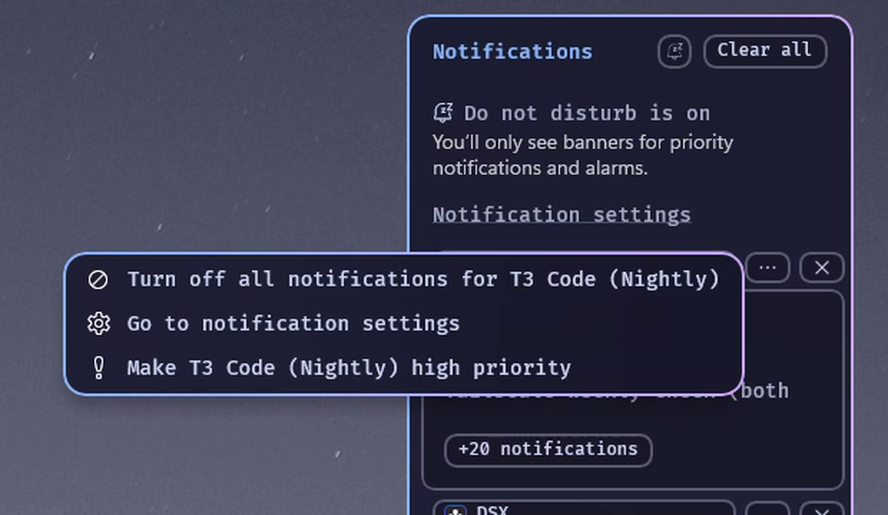

# Notification Center Styler Plus

Themes for the Windows 11 notification panel, based on Windows 11 Notification
Center Styler by m417z. This version adds hover borders that light up on their
own and keeps each group's options menu fully in view.

## Features
- **Every theme and setting from the original.** Pick a theme or write your
  own styles, same as before.
- **Hover borders.** Notification cards, the date row, the bell and each
  group's title, options and close buttons get a blue to mauve gradient border
  while the cursor is over them, one part at a time.
- **Options menu in full view.** The menu behind a group's three dots opens to
  the left of the panel and now stays on top of it, so no option is hidden
  behind the panel. Long entries show in full instead of being cut short.

## How to install
1. Turn off Windows 11 Notification Center Styler if you have it, so the two
   don't fight.
2. In Windhawk, click **Create a new mod**.
3. Replace the code with
   [notification-center-styler-plus.wh.cpp](notification-center-styler-plus.wh.cpp).
4. Click **Compile Mod**, then **Exit Editing Mode**.
5. Open the notification panel.

## Credits
Based on [Windows 11 Notification Center Styler](https://windhawk.net/mods/windows-11-notification-center-styler)
by [m417z](https://github.com/m417z). Plus changes by DavidHiFi. GPL-3.0
license.
