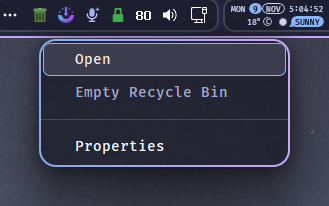

# Recycle Bin Tray Plus

[☕ Support on Ko-fi](https://ko-fi.com/DavidHiFi)



The Plus version gives its menus the same look as the rest of the desktop: a blurred,
rounded Catppuccin menu with roomy rows and one soft hover, matching Seamless Flyouts.
Based on Recycle Bin Tray by Wildstyle23.


A lightweight [Windhawk](https://windhawk.net/) Windows 11 mod that places an interactive Recycle Bin directly into your system tray.

The icon follows the current Recycle Bin state, can optionally disappear when the bin is empty, reacts to Windows Shell notifications, and supports multiple rendering styles, themes, and configurable mouse actions.

The mod is designed to remain lightweight and self-contained while integrating with the native Windows Shell wherever possible.

## Features

> ⚠️ **Drag & Drop is disabled by default. Enable `Enable drag & drop` in the mod settings to use this feature.**

* **Drag & Drop to Recycle Bin** — drag files and folders directly from the Desktop, File Explorer, or other applications that expose dropped files through the standard Windows `CF_HDROP` format. Deletion follows the Windows Recycle Bin policy for each source drive. If the icon is in the `^` notification-area overflow menu, open the menu and drop directly onto the Recycle Bin icon.
* **Live Recycle Bin state** — updates when items are added to or removed from the Recycle Bin.
* **Four icon styles**:
  * `system` — use the native Windows Recycle Bin icon.
  * `vector` — render a lightweight custom vector Windows 11-style icon.
  * `font` — render a glyph from an installed font family.
  * `custom` — load an `.ico`, `.png`, `.bmp`, or `.jpg` file.
* **Three vector variants** — choose between a minimal geometric style with a lifted-lid full state, a Fluent-inspired trapezoidal style, and a compact symbolic style.
* **Separate icons for states and themes** — custom mode uses Empty/Full Light-theme files with optional Empty/Full Dark-theme alternatives.
* **Optional auto-hide** — automatically hides the tray icon while the Recycle Bin is empty.
* **Light / dark theme support** — vector and font rendering adapt to the current Windows system theme; custom icons use Light-theme source files, optional Dark-theme alternatives, and can automatically adapt transparent monochrome image colors to the active theme.
* **Automatic recovery** — a configurable fallback timer periodically checks the Recycle Bin state in case a Shell notification is missed.
* **Taskbar restart recovery** — the tray icon is recreated after Explorer or the Windows taskbar is restarted.
* **DPI-aware rendering** — the render target follows the tray's DPI, while Shell-reported tray geometry is tracked separately for layout changes. Vector icons are rendered at high internal resolution for smoother results.
* **Configurable mouse actions** — independently configure left click, double-click, middle click, and right click.
* **Recycle Bin context menu** — open, empty, or open Properties using Windows Shell-provided localized labels when available.
* **Optional empty confirmation** — keep or disable the confirmation dialog before emptying the Recycle Bin.

## Installation

### From Windhawk

1. Open **Windhawk**.
2. Go to the **Explore** tab and search for **Recycle Bin Tray**.
3. Click **Details**, then click **Install**.
4. Open the mod's settings to customize the icon and mouse actions.

### Manual Installation from Source

1. Install and open [Windhawk](https://windhawk.net/).
2. Click **Create Mod**.
3. Copy the mod source code and paste it over the template code.
4. Click **Compile Mod** and enable the mod.

The mod runs as a dedicated Windhawk tool mod rather than being injected into `explorer.exe`, isolating it from the Windows Shell (see [Mods as tools](https://github.com/ramensoftware/windhawk/wiki/Mods-as-tools:-Running-mods-in-a-dedicated-process)).

No separate installation, executable, or Windows service is required. Windhawk manages the process automatically.

## Using the Tray Icon

The tray icon provides configurable actions for each supported mouse input.

### Mouse actions

| Input        | Available actions                                 |
| ------------ | ------------------------------------------------- |
| Left click   | Open, context menu, empty, Properties, do nothing |
| Double-click | Open, empty, Properties, do nothing               |
| Middle click | Empty, open, context menu, Properties, do nothing |
| Right click  | Context menu, open, empty, Properties, do nothing |

Each action can be configured independently from the Windhawk settings.

### Click / double-click behavior

Windows sends a single-click notification before it can determine whether a second click will arrive.

When a double-click action is enabled, the mod therefore waits for the Windows double-click interval before executing the single-click action.

This small delay is intentional. Removing it while keeping independent single- and double-click actions could cause a physical double-click to execute the configured single-click action as well.

Single-click execution is deferred by the Windows double-click interval so that a physical double-click executes only its configured double-click action. If **Double click action = Do nothing**, a physical double-click therefore performs no action.

## Drag & Drop

Drag & Drop is disabled by default. Enable **Enable drag & drop** in the mod settings before using this feature. When enabled, the feature uses a global low-level mouse hook (`WH_MOUSE_LL`) to detect the start of drag gestures.

The Recycle Bin tray icon can then be used as a normal drag & drop destination for files and folders.

Simply drag one or more items from:

* the Windows Desktop;
* File Explorer;
* other applications that expose file lists through the standard Windows `CF_HDROP` format;

and drop them directly onto the Recycle Bin tray icon.

The mod receives the dropped items through the standard Windows OLE drag & drop mechanism and asks the Windows Shell to process them according to the Recycle Bin policy configured for each source drive.

### Deletion policy and safety

Drag & drop follows the per-drive Recycle Bin policy configured in Windows for each dropped item.

If a drive is configured to **remove files immediately instead of moving them to the Recycle Bin**, items dropped from that drive can be permanently deleted. The Windows delete-confirmation preference is respected.

If Windows cannot recycle a selection, for example because it exceeds the configured Recycle Bin capacity, the Shell may display its native warning or confirmation before allowing permanent deletion. Cancelling that prompt leaves the operation uncompleted.

### Visibility and overflow menu

For drag & drop to remain available, **Hide when empty** must be turned off so the Recycle Bin icon continues to exist as a target.

Windows may place the icon in the `^` notification-area overflow menu when it first appears.

Keeping it visible is recommended for quicker access.

The icon does not need to stay permanently visible in the main system tray.

* If it is visible directly in the tray, drop files and folders onto it normally.
* If it is in the `^` overflow menu, open the menu and drop files and folders directly onto the Recycle Bin icon.

If you want to keep the icon permanently visible, move it out of the overflow menu:

* **Manual placement:** Drag the icon out of the overflow menu and place it directly in the main system tray area. Windows will remember this placement.
* **Windows Settings (if available):** Go to **Settings → Personalization → Taskbar → Other system tray icons** and toggle the icon to **On**.
* **Windhawk alternative:** On modern Windows 11 builds where native toggles may be missing or restricted, you can use the [**Always show all taskbar tray icons**](https://windhawk.net/mods/taskbar-notification-icons-show-all) mod to keep all icons permanently visible.

### Desktop focus behavior

Windows Explorer may occasionally fail to initiate a drag from a Desktop file when another application currently has focus.

For example, clicking a Desktop file and immediately moving the mouse may be interpreted primarily as a focus or selection operation instead of starting the drag.

This happens before the drag operation reaches the mod and is related to normal Explorer Desktop behavior.

### Workarounds

Two simple workarounds are available:

**Option 1 — focus the Desktop first**

Click the file once without dragging, then start the drag operation again.

**Option 2 — hold the mouse button briefly**

Press and hold the left mouse button for approximately 500 ms before moving the file.

Once Explorer has successfully initiated the drag operation, dropping the item onto the Recycle Bin works normally.

The mod does not synthesize or force a Desktop drag when Explorer has not started an OLE drag operation. A low-level mouse hook is used only to arm the tray drop overlay; the actual data transfer still requires the source application to start normal OLE drag & drop.

## Context Menu

The optional Recycle Bin context menu contains:

* **Open**
* **Empty Recycle Bin** — disabled when the bin is already empty
* **Properties**

Menu labels are loaded from localized `shell32.dll` resources when available, so they follow the current Windows display language. The popup itself uses native Win32 menu rendering without custom menu icons.

English fallback strings are used when a corresponding Shell resource cannot be loaded.

## Emptying the Recycle Bin

The **Confirm before emptying** option controls confirmation for actions that empty the Recycle Bin through the mod, independently of the Windows **Display delete confirmation dialog** option in Recycle Bin Properties.

When enabled, the standard Windows confirmation dialog is shown before the Recycle Bin is emptied.

When disabled, the mod requests the silent empty operation directly.

For emptying actions triggered through the mod, this setting takes precedence over the Windows Recycle Bin confirmation preference.

## Icon Styles

> **Choose one icon style:** `System` · `Vector` · `Font` · `Custom Icon`

### System

Uses the Windows Shell's own Recycle Bin icon.

This is the simplest option and generally provides the closest match to the native Windows appearance.

### Vector

The icon is generated at runtime with GDI+ instead of loading an image file.

It is designed for a clean Windows 11-style appearance and is rendered at a **4× internal resolution** before being reduced to the final tray size for smoother edges.

Three variants are available:

* **Style 1** — minimal geometric 24×24 silhouette. The empty state uses a closed lid; the full state lifts the lid and exposes two compact content shapes while keeping the body unchanged.
* **Style 2** — Fluent-inspired trapezoidal body optimized for tray-size rendering. The empty state uses a clean outline, while the full state uses the same silhouette with a filled body.
* **Style 3** — compact symbolic silhouette with a simple lid, handle, and body. The empty state uses an outlined body, while the full state uses the same silhouette with a filled body.

### Font

The icon is drawn from glyphs provided by installed font families.

The empty and full states have separate **font family / typeface**, **glyph**, and **font weight** settings. Font and glyph fields are intentionally blank by default: if Font mode is selected without a usable configuration, the mod falls back to the native Windows Recycle Bin icon.

Font names are matched against GDI font/typeface names exposed by Windows. Leading/trailing whitespace and surrounding quotation marks are ignored when settings are loaded. GDI limits the requested typeface name to **31 characters** (`LF_FACESIZE - 1`); longer names are rejected instead of being silently truncated.

The **Font weight** option is available independently for the Empty and Full states and supports the standard Windows range from **Thin (100)** to **Black (900)**. Use the base family/typeface name with the desired weight when Windows exposes the family through normal weight matching. If Windows exposes a variant as a separate typeface (for example **Font Awesome 7 Free Solid** or **Arial Narrow**), enter that exact Windows typeface name instead. When an exact weight is unavailable, Windows can select the nearest available weight in the requested family.

#### Fallback behavior

Font mode validates both the requested font family and glyph before rendering:

* **Empty state:** if the empty-state font or glyph is unavailable, the full-bin font/glyph configuration is used automatically.
* **Full state:** if the full-bin font or glyph is unavailable, the native Windows Recycle Bin icon is used.
* If the empty state falls back to the full configuration and that configuration is also unavailable, the native Windows Recycle Bin icon is used.

This lets a font with only one suitable trash/delete glyph remain usable without showing a missing-glyph square.

#### Entering a glyph code

Glyph values can be entered as hexadecimal Unicode code points with or without the `0x` prefix.

Examples:

```text
0xF014
F014
```

To find a code point, you can use:

* **Windows Character Map** (`charmap.exe`) to inspect installed fonts.
* The documentation/reference of the font you are using.
* Microsoft's references for **Segoe Fluent Icons** or **Segoe MDL2 Assets** when using those font families.

### Recommended fonts & glyphs

| Font Family                       | State / role | Glyph Code | Notes |
| --------------------------------- | ------------ | ---------- | ----- |
| **Font Awesome 7 Free**           | Empty        | `0xF014`   | Recommended example for the empty state. |
| **Font Awesome 7 Free Solid**     | Full         | `0xF014`   | Recommended example for the full state. |
| **Segoe Fluent Icons** (Built-in, default Windows 11 icon font) | Single state | `0xE74D` | `Delete`; no distinct empty/full Recycle Bin pair. Best used with **Hide when empty** enabled. |
| **Segoe MDL2 Assets** (Built-in, legacy Windows icon font) | Single state | `0xE74D` | `Delete`; no distinct empty/full Recycle Bin pair. Best used with **Hide when empty** enabled. |
| **Material-Design-Iconic-Font**   | Full         | `0xF154`   | Optional third-party example. |

The two built-in Segoe icon fonts are useful when a single `Delete` symbol is sufficient. Because they don't provide distinct empty and full Recycle Bin states, they work best with **Hide when empty** enabled and the `Delete` glyph configured for the full state: the tray icon is then hidden while the Recycle Bin is empty and shown when it contains items. If you want an always-visible icon with visually distinct empty and full states, another font is preferable.

### Custom Icon

Custom mode accepts:

* `.ico`
* `.png`
* `.bmp`
* `.jpg`

Images are automatically resized to match the current system tray icon target size.

For the cleanest raster result, use artwork designed to remain readable at small tray sizes. Ideally, use a source close to the active tray target size or a clean integer multiple of it (for example 16×16, 32×32, 48×48, or 64×64 when appropriate). Avoid oversized raster artwork with hairline details: a stroke that looks clean in the source can become sub-pixel when Windows renders the tray at 16 px (100% scaling), where no resampling method can fully reconstruct the original visual weight. The actual tray target depends on the Windows display scale factor; refer to the **Theme and DPI Handling** table below.

Custom Icon color handling can either preserve the colors stored in the selected source image or **Automatically adapt monochrome image colors to the active theme**. Theme adaptation reads the selected image's alpha channel, downsamples it by exact pixel-area coverage, and recolors the resulting mask in memory for the active Light or Dark theme. At the smallest 16 px Dark-theme target, a small stroke-preservation and coverage adjustment helps thin monochrome artwork retain more visual weight. For best results, still use simple transparent monochrome artwork designed to remain readable at small sizes; very fine raster details can remain softer at 100% display scaling. No source file is modified. Native `.ico` files and images without an alpha channel keep their original colors.

For transparent monochrome images, the **Light theme** Empty and Full files are normally enough. If a Dark-theme field is blank, the corresponding Light-theme file is reused automatically. The optional **Dark theme** section is only needed when you want different source artwork in Dark theme.

| If you want... | Use |
| --- | --- |
| Keep the icon's original colors | **Keep original image colors** |
| Automatically match a transparent monochrome icon to the Light/Dark theme | **Automatically adapt monochrome image colors to theme** |
| Use different artwork in Dark theme | **Configure the optional Dark theme image** |

Looking for ready-made icons? [Icons8](https://icons8.com/) is a useful resource for finding icons suitable for custom `.ico` / `.png` files.

For `.ico` files, a multi-size icon containing a **16×16 px** layer is recommended for a crisp tray result.

You can paste a Windows path copied with **Copy as path** directly into the setting, including the quotation marks added by Windows. The mod automatically removes surrounding quotes and unnecessary whitespace.

Examples:

```text
[Light theme → Empty bin] "C:\Users\YourUsername\Pictures\recycle_empty.png"
[Light theme → Full bin]  D:\CustomIcons\recycle_full.png
[Dark theme → Full bin]   D:\CustomIcons\recycle_full_dark.ico
```

Local paths are strongly recommended for optimal performance and to avoid delays if a network share is unavailable or goes to sleep.

Custom mode uses two Light-theme source files plus optional Dark-theme alternatives:

| Recycle Bin state | Light-theme file          | Optional Dark-theme file |
| ----------------- | ------------------------- | ------------------------ |
| Empty             | `customIcon.light.empty`  | `customIcon.dark.empty`  |
| Full              | `customIcon.light.full`   | `customIcon.dark.full`   |

The Light-theme file is always selected in Light theme. In Dark theme, the matching Dark-theme file is selected when configured; otherwise the Light-theme file is reused automatically. When **Automatically adapt monochrome image colors to the active theme** is selected, the selected transparent monochrome image is recolored in memory for the current theme.

When a custom file cannot be loaded, the mod automatically falls back to the Windows system Recycle Bin icon.

## Recycle Bin State Detection

The mod uses Windows Shell APIs to query the current Recycle Bin state and register for Shell notifications.

The current state and tray icon are initialized immediately. The first Shell notification subscription is established after a short Explorer/taskbar stabilization window and uses Windows' `SHCNRF_NewDelivery` delivery mode.

Shell notifications allow the icon to react quickly when items are added to or removed from the Recycle Bin. A configurable fallback timer periodically checks the actual state in case a notification is missed.

The default fallback interval is **300 seconds** and can be changed in the Windhawk settings. DPI and tray-geometry changes are handled through Windows display/DPI events and the Shell-reported tray rectangle. Bounded startup retries handle cases where the Shell or tray is not yet ready.

## Theme and DPI Handling

The tray icon is regenerated when Windows reports a relevant theme or display configuration change.

The mod derives its icon render target from the tray/display DPI.

| Scale Factor | Icon Size |
| ------------ | --------- |
| 100%         | 16×16 px  |
| 125%         | 20×20 px  |
| 150%         | 24×24 px  |
| 200%         | 32×32 px  |
| 250%         | 40×40 px  |
| 300%         | 48×48 px  |
| 400%         | 64×64 px  |

The target size is obtained from the current tray/display DPI. The rectangle returned by `Shell_NotifyIconGetRect` is tracked separately as a geometry-change signal; its slot bounds are not treated as a documented HICON target size.

Vector icons are rendered internally at **4× the target resolution** before being downsampled with high-quality interpolation to fit the active tray size. This reduces jagged edges while keeping rendering and memory usage low.

## Taskbar / Explorer Restart Recovery

The mod listens for the standard `TaskbarCreated` message.

When Windows Explorer or the taskbar is restarted, the mod recreates the tray icon automatically.

This allows the icon to recover without requiring the Windhawk mod to be manually restarted.

## Technical Notes

* The tray icon is hosted by a hidden top-level tool window owned by the mod's dedicated tray thread.
* Drag & drop uses the standard Windows OLE `IDropTarget` mechanism and accepts dropped file lists exposed through `CF_HDROP`.
* Dropped items are processed asynchronously on a dedicated STA worker through `IFileOperation`, so Shell UI or slow storage does not block the source application's `DoDragDrop` call. The worker is created lazily on the first accepted drop.
* A passive `IFileOperationProgressSink` tracks operation results and logs failures without changing the Shell operation.
* The mod does not create a separate executable or Windows service.
* GDI+ is initialized lazily only when vector rendering or custom raster-image loading requires it; native `.ico` loading can bypass GDI+. Once initialized, it stays available for the lifetime of the tool and is released during final teardown.
* Tray timers are explicitly cancelled during window destruction before icon and Shell resources are released.
* Explorer/taskbar restarts are detected through the standard `TaskbarCreated` broadcast received by the hidden tray host.
* The current icon handle is explicitly destroyed whenever the icon is replaced or the mod unloads.
* The tray thread uses Per-Monitor V2 DPI awareness, follows the rectangle reported by `Shell_NotifyIconGetRect`, and tracks slot geometry changes independently from the DPI-derived render size.
* A transparent top-level helper window provides the physical per-monitor DPI reference and is also used as the OLE drop overlay when drag & drop is enabled.
* Explorer owns notification-area placement. If Windows exposes the tray on multiple taskbars, drag & drop follows the single icon rectangle returned by the Shell API.
* A low-level mouse hook runs on a dedicated message-pump thread only while drag & drop support is enabled to detect the beginning and end of a potential drag; OLE `IDropTarget` remains responsible for the actual drop.

## Settings Reference

The Windhawk settings are grouped by function:

* **General** — visibility and icon style.
* **Vector** — vector variant selection.
* **Font** — font family and glyph values for empty/full states.
* **Custom Icon** — color handling, Light-theme Empty/Full source files, and optional Dark-theme files.
* **Actions** — mouse-button behavior and empty confirmation.
* **System** — fallback Recycle Bin state refresh interval.

Renderer-specific settings only apply to the corresponding selected icon style.

For example, the **Vector** section is used only when **Icon style** is set to **Vector**.

## Troubleshooting

### The icon does not appear

Check that the Recycle Bin is not empty if auto-hide is enabled.

If the icon is still missing:

1. Disable and re-enable the mod in Windhawk.
2. Try restarting Windhawk.
3. Check whether Windows has moved the icon into the notification-area overflow menu (`^`).

Windows may place the icon in the overflow menu when it first appears. This is normal. If you want it permanently visible, drag it from the overflow menu into the main system tray area; Windows will remember the placement.

### Drag & Drop does not work

1. Check the mod's settings to ensure that Drag & Drop is enabled and **Hide when empty** is turned off.
2. If the icon is in the `^` overflow menu, open the overflow panel and drop onto the Recycle Bin icon itself.
3. Make sure the source application provides dropped files through the standard Windows `CF_HDROP` format.

If dragging from the Desktop does not work, check whether another application currently has the input focus.

In that situation, either:

* click the Desktop/file once before starting the drag; or
* hold the left mouse button for approximately 500 ms before moving the file.

### The dark theme does not apply

Check your Windows personalization settings to ensure that global dark mode is active.

For custom icons:

* with **Original colors**, add an optional Dark-theme file if you want different artwork or colors in Dark theme;
* with **Automatically adapt monochrome image colors to the active theme**, use a transparent monochrome image with an alpha channel. Native `.ico` files and images without an alpha channel keep their original colors.

### Custom icons do not display

Verify that:

* the configured path is correct;
* the file exists and is accessible;
* the image format is supported;
* the selected Color handling mode matches the type of image you are using.

For raster images, choose a source size appropriate for the current display scale using the **Theme and DPI Handling** table; thin diagonal strokes can retain some aliasing at very small tray sizes. For `.ico` files, a multi-size icon containing a **16×16 px** image is recommended.

If a custom icon cannot be loaded, the mod automatically falls back to the Windows system Recycle Bin icon.

### A font glyph does not display

Check that:

* the configured **Font name** exactly matches the Windows GDI font/typeface name;
* the **Glyph** value is a valid Unicode hexadecimal code point (for example `0xF014`);
* the selected font actually contains a glyph at that hexadecimal code point.

If either the font name or glyph code is incorrect or unavailable, Font mode falls back according to the rules described in the **Font** section above.

## License

This project is licensed under the GNU General Public License Version 3.0.

## Install

Open Windhawk, click "Create new mod", paste `recycle-bin-tray-plus.wh.cpp`, and hit Compile.
