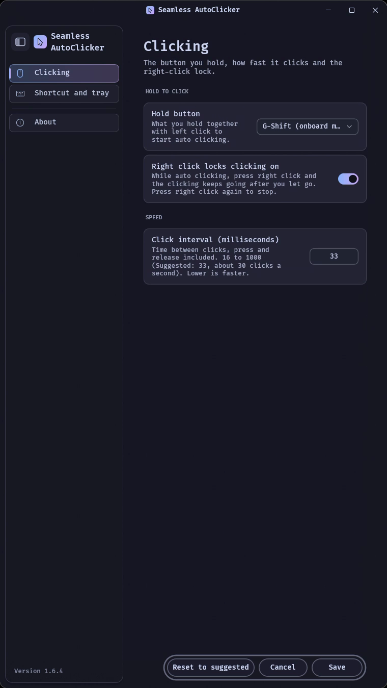

# Seamless AutoClicker

Hold a side mouse button and the left button together, and the left button
keeps clicking until you let go. It runs in the background on its own, so it
doesn't touch Explorer or the app you click in.

## Features
- **Hold to click.** Hold side button 1 or 2, then hold left click. Clicks
  repeat at the speed you set, each one a real press and release.
- **Lock it on.** Press right click while it clicks and it keeps going with
  nothing held. Right click again to stop.
- **Tray switch.** Left-click the tray icon to turn auto clicking on or off.
  A blue pointer means on, a grey pause sign means off. While off, every mouse
  button works as normal.
- **Its own settings window.** Right-click the tray icon for Settings: the
  same Catppuccin Mocha glass window as the other Seamless mods.
- **Keyboard shortcut.** An optional key to switch it on or off.
- **G-Shift on the mouse itself.** If a Logitech mouse has G-Shift set in its
  onboard memory, pick **G-Shift (onboard memory)** and G-Shift plus left click
  works as the hold.
- **Works over admin windows.** It runs as administrator, so it also clicks
  in apps opened as administrator.

## Install
1. In Windhawk, choose **Create a new mod**.
2. Paste [seamless-autoclicker.wh.cpp](seamless-autoclicker.wh.cpp) and click
   **Compile**.
3. If User Account Control is on, Windows asks to let it run as
   administrator when it starts.

## Credits
Made by [DavidHiFi](https://github.com/DavidHiFi). Original work, GPL-3.0.
Colours from [Catppuccin Mocha](https://github.com/catppuccin/catppuccin).
