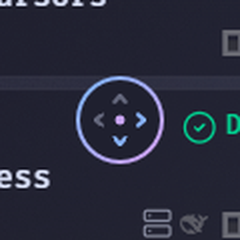

# Seamless Autoscroll

Hold the middle mouse button in File Explorer and move the mouse to scroll, the
way browsers do. A small frosted glass circle marks where you started and lights
up the way you are scrolling.

## Features
- **Browser-style scrolling.** The farther you move from the starting point,
  the faster it scrolls, up, down and sideways.
- **Frosted glass indicator.** Real blur drawn by the graphics card, with a
  Catppuccin Mocha tint and a blue to mauve ring.
- **Your colors.** Background, ring, arrows and center dot each have their own
  color, plus ring style, thickness, gradient angle, blur and opacity.
- **Smooth motion.** The circle fades and grows in, and the arrows fade as you
  change direction. Turn it off or set the speed.
- **Hold or toggle.** Hold the button to scroll, or click once to start and
  again to stop.
- **Works with Smooth Scroll.** It sends normal mouse wheel messages, so Smooth
  Scroll Win32 animates them like real wheel turns.

## Install
1. In Windhawk, choose **Create a new mod**.
2. Paste [seamless-autoscroll.wh.cpp](seamless-autoscroll.wh.cpp) and click
   **Compile**.
3. Turn off **AutoScroll Win32** if you have it. Both together scroll twice.

To use it in other apps, add them under **Advanced > Include processes**.

## Credits
Made by [DavidHiFi](https://github.com/DavidHiFi). Based on
[AutoScroll Win32](https://windhawk.net/mods/autoscroll-win32) by
[crazyboyybs](https://github.com/crazyboyybs). The scrolling engine is theirs;
the indicator was redrawn for this version.
