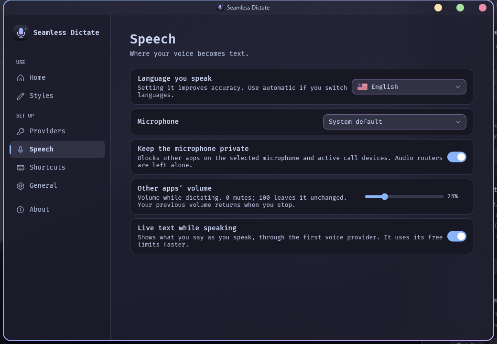
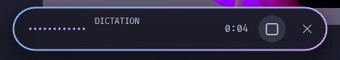

# Seamless Dictate

[☕ Support on Ko-fi](https://ko-fi.com/DavidHiFi)

Hold a shortcut, speak, and your words are typed where the cursor is, in any
app. An AI provider you set up with your own key (Groq is free and fast)
transcribes what you said and cleans it up in your style, or translates it.

## Features
- **Hold to dictate.** Hold Ctrl+Win, talk, let go. The text lands where you
  were typing and stays on the clipboard.
- **Mic privacy.** While you dictate, other apps (Discord and call apps) hear
  silence from your mic, and their volume drops. Both come back the moment you
  let go. Audio routers like VB-Audio Matrix and Voicemeeter are left alone.
- **Glass dictation bar.** A smooth, dark Catppuccin Mocha bar shows live text while
  you speak. The result card stays for 3 seconds, then fades.
- **Its own settings window and tray icon,** in Catppuccin Mocha with FiraCode
  Nerd Font.

## Install
1. In Windhawk, choose **Create a new mod**.
2. Paste [seamless-dictate.wh.cpp](seamless-dictate.wh.cpp) and click
   **Compile**.
3. Open the tray icon's settings and add a provider key.

## Credits
Made by [DavidHiFi](https://github.com/DavidHiFi). Built on
[AI Voice Typing](https://windhawk.net/mods/ai-voice-typing) by
[caliberda](https://github.com/cesarkali) (MIT).
