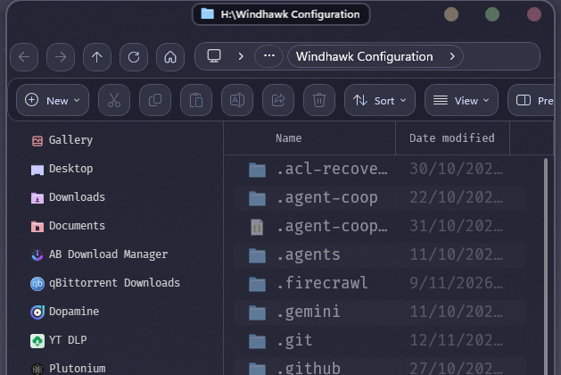

# Seamless Explorer View

Hardware rendering for Explorer's file lists and icon grids, with right-click
submenus that open fully populated instead of an empty box.

## Features

- **GPU rendering.** Details lists and icon grids draw smoothly, thumbnails included.
- **Smooth scrolling.** Mouse wheel, touchpad gestures and inertia feel natural.
- **Submenus that fill.** Cascades from shell extensions such as NanaZip open with all
  their items, instead of a blank pill.
- **Animated interactions.** Sorting, grouping, selecting and copying all animate.
- **Page animations.** Folders slide and fade in WinUI style when they open, and Back and
  Forward slide sideways.
- **Navigation pane styling.** Rounded hover and selection highlights, state colors, fonts,
  item height and icon size for the folder tree, painted with Direct2D. The tree can
  also move left and drop its expand arrows and connector lines.
- **Switch back anytime.** A toggle button in Explorer, or **Ctrl+Alt+F9**, returns to
  the native view.

## Credits

Based on [GPU-accelerated explorer.exe list and grid views](https://windhawk.net/mods/gpu-accelerated-explorer-view)
by [DarkionAvey](https://github.com/DarkionAvey/windhawk-gpu-accelerated-explorer-view).
GPL-2.0.

Page animations are based on
[File Explorer WinUI-Like Content Animation](https://windhawk.net/mods/file-explorer-content-animation)
by [crazyboyybs](https://github.com/crazyboyybs), MIT license.

The navigation pane styling is based on Explorer TreeItem Tweaker by
[Languster](https://github.com/Languster), with the pin-button hook technique from
[valinet](https://github.com/valinet).

Tree position, expand arrows and connector lines come from
[Explorer Navigation Tree Offset](https://github.com/Languster/ExplorerNavHook) 1.1 by
[Languster](https://github.com/Languster), MIT license.

## Install

1. Install [Windhawk](https://windhawk.net/).
2. Choose **Create a new mod**, paste [seamless-explorer-view.wh.cpp](seamless-explorer-view.wh.cpp) and click **Compile**.
3. Disable the original mod before enabling this one. Disable Explorer
   Navigation Tree Offset and File Explorer WinUI-Like Content Animation too:
   their features are built in now.

License: GPL-2.0.
