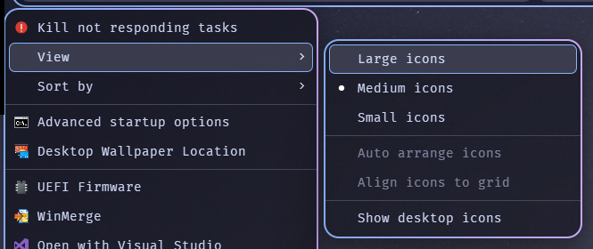

# Seamless Flyouts

[☕ Support on Ko-fi](https://ko-fi.com/DavidHiFi)

Seamless Flyouts gives classic menus the same look as the taskbar's own menus: a blurred
Catppuccin Mocha body, rounded corners, roomy rows, separators that run to the border, one soft
hover with a blue outline, and submenus that open beside their parent with a small gap.

It also brings acrylic, Mica and blur to Windows 11 apps, and keeps re-applying the effect to
Explorer folder windows that open hidden or late, so they never show up black.

Built on Translucent Windows by Undisputed00x.

### ⚠️ FAQ section below ⚠️
### ❗For any excluded process, if the global "New system colors" setting is enabled, please add the excluded processes to the process rules in the mod settings instead.❗

- ## Theme Customization
| **Default cleartype text** | **Greyscale text** |
|:---:|:---:|
|  |  |

| **Default text** | **Alpha blended text** |
|:---:|:---:|
|  |  |

| **Default themed controls** | **Custom themed controls** |
|:---:|:---:|
|  |  |

- ## Translucent effects
| **Blur (AccentBlurBehind)** | **Acrylic (SystemBackdrop)** |
|:---:|:---:|
|  |  |

| **Mica (SystemBackdrop)** | **MicaAlt (SystemBackdrop)** |
|:---:|:---:|
|  |  |

## Credits 
The custom theme is a close copy of the Rectify 11 theme created by [WinExperiments](https://github.com/WinExperiments).
#
The inspiration for this mod came from the awesome Windows effects customization projects of [Maplespe](https://github.com/Maplespe) and [ALTaleX531](https://github.com/ALTaleX531).
#
Thanks also to [m417z](https://github.com/m417z) for his help and input in completing the mod.

## FAQ

* ⚠️Use Windows 11 File Explorer Styler mod and select the Translucent Explorer11 theme
in order to get translucent WinUI parts of the new file explorer.⚠️

* ❗The new system colors setting option adjusts the [system colors](https://learn.microsoft.com/en-us/windows/win32/api/winuser/nf-winuser-getsyscolor) 
in order to blend with the background translucency / custom theme rendering. 
This setting option overrides any process exclusion as these colors are applied system-wide using 
the [SetSysColor](https://learn.microsoft.com/en-us/windows/win32/api/winuser/nf-winuser-setsyscolors) API.
Intercepting and changing the system colors in a proper way is quite difficult, more details
in another software project that faced the same problem: https://github.com/namazso/SecureUxTheme/issues/9#issuecomment-611897882 ❗

* ⚠️Set a process rule in the mod's settings with custom theme rendering disabled, in order to reset (if possible) the custom system colors to default for the target process.⚠️

* ❗The Windows custom theme rendering also fixes invisible text by restoring alpha and modifying text colors.
Extending effects to the entire window can result in text being barely readable or even invisible in some cases. 
Enabling HDR, 10bit color depth output, having a black color, or a white background behind the window can cause this. 
This is because most GDI rendering operations ignore or do not preserve alpha values.❗

* ⚠️Prerequisited windows settings to enable the background effects⚠️
    - Transparency effects enabled
    - Energy saver disabled
#
* ⚠️The background effects do not affect most modern windows (UWP/WinUI), 
apps with different front-end rendering (e.g Qt, Electron, Chromium etc.. programs) and native windows with hardcoded colors.⚠️

* ⚠️If parts of the Windows UI colors remain modified after disabling the modification, this is happening when new system colors are applied in a selected Windows custom theme.
Changing the theme to the default and vice versa fixes the problem. As a last resort, you can delete the registry key HKEY_CURRENT_USER\Control Panel\Colors and reboot.⚠️

* ⚠️ARM64 system is only partially supported.⚠️

* ❕The blur effect may show a bleeding effect at the edges of a window when maximized or snapped to the edge of the screen. 
This is caused by default by the AccentBlur API.❕

* ✨The mod works best on the default dark theme.✨

## Install

Open Windhawk, click "Create new mod", paste `seamless-flyouts.wh.cpp`, and hit Compile.
