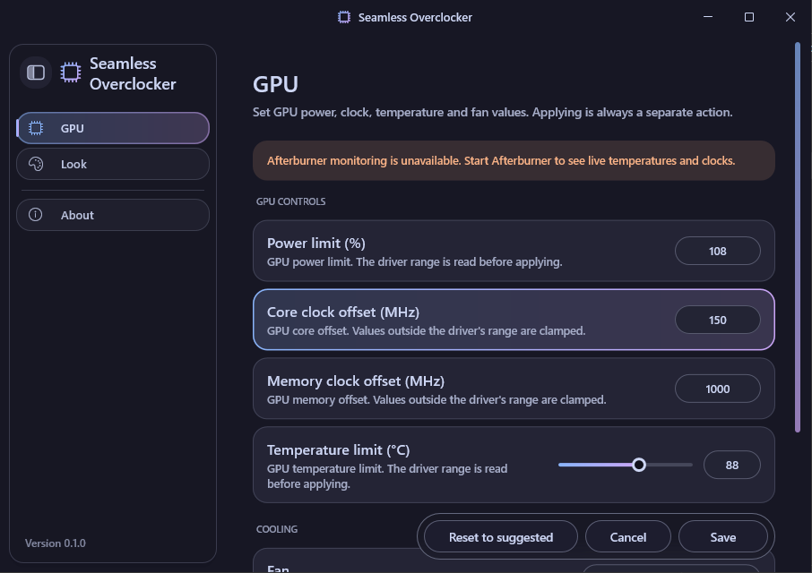

# Seamless Overclocker

Set your graphics card's power limit, core and memory clock offsets, temperature limit and fan mode from the system tray. The mod talks to MSI Afterburner, so Afterburner must be running.

## Use

1. Open Settings from the tray menu and pick the values you want.
2. Save. Saving alone changes nothing on the card.
3. Choose **Apply settings** in the tray menu. A notice says whether the card took the values.

**Stock settings** puts the card back on the driver's default values.

## What it does and doesn't do

- Values are kept inside the range Afterburner allows, then read back after every change to confirm the card took them.
- It never edits Afterburner's saved profiles.
- Processor details are shown but never changed.
- Afterburner runs with administrator rights, so the mod needs them too. When Windhawk starts it without them, Apply and Stock do nothing and the tray notice says why.

## Credits

Original work by DavidHiFi, under GPL-3.0. Card control uses MSI Afterburner's shared control memory. The status page reads Afterburner's monitoring memory. Colours follow Catppuccin Mocha.
