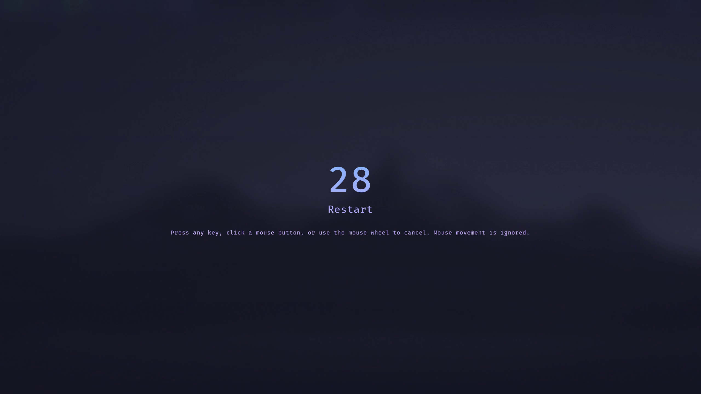

# Seamless Power Action Countdown

[☕ Support on Ko-fi](https://ko-fi.com/DavidHiFi)

Seamless Power Action Countdown shows a glassy countdown before Windows shuts down,
restarts, sleeps or hibernates, so one mis-click never sends the PC away at once. Any
key, click or scroll cancels it, and the cancelling press never reaches the app
underneath.

The overlay matches the Mocha rice: real acrylic glass with the dark Catppuccin Mocha
tint inside it, FiraCode Nerd Font at medium weight, and one blue to mauve gradient
flowing over the whole area and the text. It fades in with a soft zoom and fades out
again, and it shows on the primary monitor while the PC stays usable.

Separate countdowns cover shutdown, restart, sleep and hibernation, 0 to 30 seconds
each. Set an action to 0 to run it at once.

Based on [Power Action Countdown](https://windhawk.net/mods/power-action-countdown)
by Nerdworld.

## Notes

- Power actions from shutdown.exe, Task Manager or the Ctrl+Alt+Delete screen are not
  covered unless they call a hooked shell API.
- The countdown window has no title bar of its own; it is a full screen overlay that
  appears only while a power action waits.
