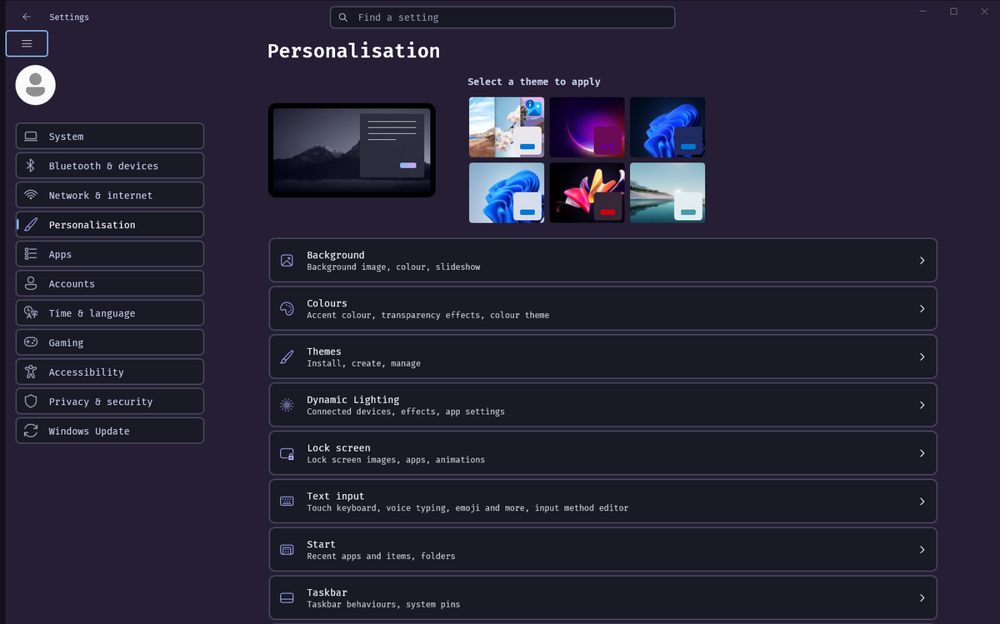

# Seamless Settings Styler

[☕ Support on Ko-fi](https://ko-fi.com/DavidHiFi)

A full Catppuccin Mocha look for the Windows 11 Settings app. The page glass
matches the title bar, every card and button gets the same clean edge, and the
side menu folds down to icons.

## Features
- **Glass that matches the title bar.** The page uses the same frosted glass
  and tint as Seamless Title Bars, so there is no seam between the bar and the
  page. It reads the title bar's own tint when that mod is on.
- **Edges on everything.** Cards, buttons, menus, fields and side menu items
  get a 2px grey edge at rest and a blue to mauve edge on hover.
- **Folding side menu.** A button folds the side menu down to its icons. It can
  start folded and remember how you left it.
- **Mocha line icons.** Plain line icons in the side menu instead of the
  coloured ones.
- **Your own colours.** Accent start and end, edge, text, background, card and
  hover colours, card see-through amount, edge width and corner size.
- **Stays frosted.** The glass can stay on when the window loses focus.

## How to install
1. In Windhawk, click **Create a new mod**.
2. Replace the code with [seamless-settings-styler.wh.cpp](seamless-settings-styler.wh.cpp).
3. Click **Compile Mod**, then **Exit Editing Mode**.
4. Turn off Windows 11 Settings Styler or Settings Styler Plus first so the two
   don't fight.

Looks best with [Seamless Title Bars](../seamless-title-bars) turned on. Needs
Windows 11 and Windhawk 2.0 or newer.

## Credits
Built on [Windows 11 Settings Styler](https://windhawk.net/mods/windows-settings-styler)
by [m417z](https://github.com/m417z), with the Catppuccin
[Mocha](https://catppuccin.com/palette) palette. Replaces Settings Styler Plus.

Plus changes by DavidHiFi. GPL 3.0 license, the same as the original.
