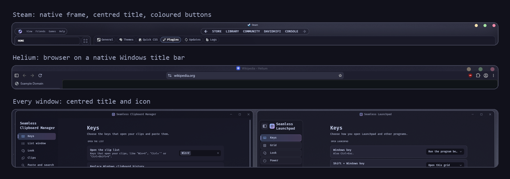

# Seamless Title Bars

[☕ Support on Ko-fi](https://ko-fi.com/DavidHiFi)

Every title bar mod I use, in one mod. It colours title bars, moves and
restyles the caption buttons, and gives Store apps, browsers, Office, Discord,
Spotify and Windows Terminal a proper Windows title bar. Each part has its own
switch, so you only turn on what you want.

## Features
- **Colours.** One colour for focused and unfocused title bars, plus dark mode
  title bars. Apps with their own blur or custom bar can be left alone.
- **Caption buttons.** Move the buttons left or right, change their order,
  space them closer, or paint them as macOS circles or your own images.
- **Icon and title.** Centre, left or right alignment, icon position, gaps,
  and hiding the icon or the title.
- **Store apps.** A normal Windows title bar in Settings, Calculator, Photos
  and other Store apps, with an optional blur.
- **Native frames.** The standard title bar in Chromium browsers, Office,
  Visual Studio, Teams, Discord and similar apps.
- **Spotify.** Native frames and a set of Spotify tweaks.
- **Terminal bar.** Gives the Windows Terminal title bar the same blur as its
  window.
- **Basic frames.** Correct caption text colours on classic and basic frames.
  Off by default, because some Windows builds lack the parts it needs.

## How to install
1. In Windhawk, click **Create a new mod**.
2. Replace the code with [seamless-title-bars.wh.cpp](seamless-title-bars.wh.cpp).
3. Click **Compile Mod**, then **Exit Editing Mode**.
4. If you used any of the mods listed under Credits, turn them off first so
   the two don't fight.

The caption buttons part runs inside dwm.exe, which Windhawk allows because
the mod names it directly. The Terminal bar needs Terminal's own title bar
(turn off "Show tabs in the title bar" in Terminal).

Needs Windows 11 and Windhawk 2.0 or newer.

## Credits
This mod merges, and keeps every option of:
- [Windows 11 Custom Title Bar Colours](https://windhawk.net/mods/win11-custom-title-bar-colours) by [Th3Fanbus](https://github.com/Th3Fanbus)
- [Caption Buttons Customizer](https://windhawk.net/mods/caption-buttons-customizer) by [grn15RenS](https://github.com/grn15RenS) (MIT)
- [Titlebar For Everyone](https://windhawk.net/mods/titlebar-for-everyone) and [CEF/Spotify Tweaks](https://windhawk.net/mods/cef-titlebar-enabler-universal) by [Ingan121](https://github.com/Ingan121) (MIT)
- [Fix Basic Caption Text](https://windhawk.net/mods/fix-basic-caption-text) by [aubymori](https://github.com/aubymori)
- Remove UWP Title Bars Plus by DavidHiFi, based on Remove UWP Title Bars by Anixx
- Terminal Titlebar Blur by DavidHiFi

Plus changes by DavidHiFi. MIT license.
