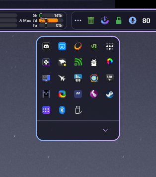

# Seamless Tray Drawer

[☕ Support on Ko-fi](https://ko-fi.com/DavidHiFi)

Adds a second drawer to the hidden tray icons panel and lets you restyle both.
The defaults follow Catppuccin Mocha: a dark acrylic blur with a blue to mauve
gradient border.

## Features

- Drag an icon onto the footer button to move it into the second drawer, then
  click the button to open that drawer.
- Use acrylic blur or a solid fill, in any color.
- Set the border's two gradient colors, its direction, width and corner radius.
- Choose the footer button's icon, side and colors, and show a count of the
  icons you moved.
- The second drawer opens on the side away from the taskbar, so a top or bottom
  taskbar both work. You can also pin it to one side.
- Open both drawers every time you open the panel, and give the right-click menu
  the same look, if you like.

## How to use

Open the hidden icons panel, drag an icon onto the footer button and let go.
Click the button to open the second drawer. To put everything back, right-click
the button and choose **Restore all collected icons**. Turn off Nested Tray
Drawer first, because only one of the two can run.

## Credits

Based on [Nested Tray Drawer](https://windhawk.net/mods/nested-tray-drawer) by
[MEI](https://github.com/Meidios), GPL-3.0. This mod stays GPL-3.0.
