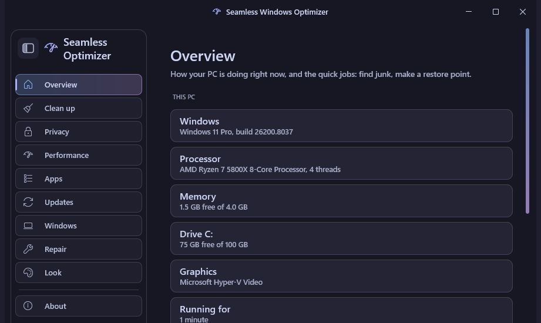

# Seamless Windows Optimizer

One window for storage cleanup, privacy switches, Windows settings, app removal and repair tools. It opens from the system tray and uses the same settings window as the other Seamless mods.

## Pages

- **Overview** shows Windows, processor, memory, drive space and undoable changes.
- **Clean up** scans files left by Windows, browsers, games and apps. Choose what to remove, then press Clean.
- **Privacy** holds switches for tracking, ads, suggestions, activity history and Windows AI features.
- **Performance** covers game and power settings, background services and startup items.
- **Apps** removes built-in apps or uninstalls other programs.
- **Updates** changes Windows Update behavior and can hide unwanted updates.
- **Windows** holds small File Explorer, taskbar and Start fixes.
- **Repair** includes system checks, Windows repair, network reset and icon rebuild tools.
- **Look** contains appearance settings.
- **About** has version and project details.

Each switch explains what it changes and what may stop working. Settings changes are recorded so you can undo them. The mod can make a restore point before changes when System Restore is available.

## How it works

The mod downloads a small helper from this project's GitHub releases the first time it runs, then checks its fingerprint before starting it. The helper performs cleanup and Windows changes without opening another window.

The mod needs administrator rights for changes to Windows settings.

Install it through Seamless Workshop. The helper source is in this repository's `swo-engine` folder.

## Credits

The cleaner catalog is based on BleachBit by Andrew Ziem and is licensed under GPL-3.0. The Rust helper source is in `swo-engine` under the same license.

The choice of privacy, performance, app-removal and Windows tools took ideas from Winhance and WTools. Their code and wording were not copied. WTools files were not opened or decompiled.
