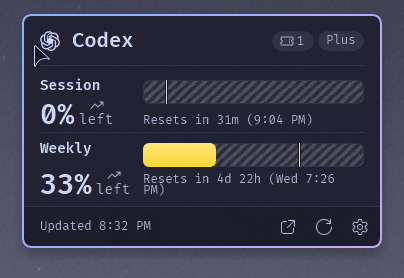

# Taskbar AI Usage Plus

[☕ Support on Ko-fi](https://ko-fi.com/DavidHiFi)

Shows your Claude, Codex, Antigravity and GitHub Copilot usage limits as ring
tiles on the Windows 11 taskbar, with a Fluent flyout for the details. Based on
[Taskbar AI Usage](https://github.com/Sof2245/taskbar-ai-usage) by Sof2245.

## Features

- **Supported services.** Claude (5-hour session, weekly, model and extra
  usage), ChatGPT/Codex (session, weekly, rate limits, credits), Antigravity
  (Gemini and other-model pools) and GitHub Copilot (monthly AI credits).
- **Dynamic rings.** Tiles fill as you spend, with a pace dot showing where an
  even burn would be and an estimate for the next reset.
- **Fluent flyout.** Per-quota rows with reset countdowns, banked free resets
  and a link to the provider dashboard. The Plus version drops the flyout from
  the taskbar's bottom edge, so it stays on screen when the taskbar sits at
  the top of the display.
- **Sign in your way.** With your permission the mod finds Claude Code, Codex,
  Visual Studio and GitHub CLI sign-ins already on the PC and adds an account
  for each, read-only. Sign-ins are stored locally with DPAPI and each token
  is sent only to the provider that issued it. No telemetry.
- **Own dock chrome.** The tile group draws its own 34 px dock island with a
  2 px surface border and Mocha acrylic, and tiles use the shared hover style
  (mantle fill, 1 px blue ring, radius 8). No styler mod needed.
- **Notifications.** A toast when usage crosses the red threshold, with the
  next reset time. Thresholds are configurable.
- **Languages.** English, Spanish and Simplified Chinese.

## How to install

1. In Windhawk, click **Create a new mod**.
2. Replace the code with
   [taskbar-ai-usage-plus.wh.cpp](taskbar-ai-usage-plus.wh.cpp).
3. Click **Compile Mod**, then **Exit Editing Mode**.
4. Enable the mod and follow the account prompt, or add accounts later from
   the Accounts page.

Needs Windows 11 22H2 or newer and Windhawk 2.0 or newer.

If you use Taskbar AI Quota Bars, disable it first: both mods would poll the
same accounts and they do not share sign-ins.

## Credits

Based on [Taskbar AI Usage](https://github.com/Sof2245/taskbar-ai-usage) by
[Sof2245](https://github.com/Sof2245) (MIT). The usage meters design follows
[Taskbar AI Quota Bars](https://github.com/Cleroth/windhawk-taskbar-ai-quota)
by Cleroth, the flyout shell follows [Taskbar Fluent Media
Player](https://github.com/Salyts/Taskbar-Fluent-Media-Player) by Salyts, and
provider logos come from [Simple Icons](https://github.com/simple-icons/simple-icons).
Plus changes by DavidHiFi. MIT license.
