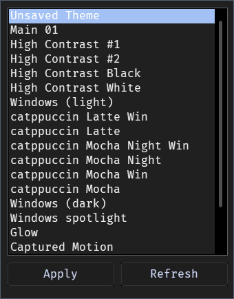

# Theme Tool Plus

[☕ Support on Ko-fi](https://ko-fi.com/DavidHiFi)

Apply and switch custom Windows themes from a hotkey picker. The theme
signature patch from UXTheme hook is built in, so unsigned themes load
without patching system files or running a separate theme tool.

## Features
- **Comes with a theme pack.** On first run the mod downloads Main 01 and the
  Catppuccin themes, with their cursors, sounds and wallpaper, into the
  Windows themes folder. They show up in the theme list and the picker next
  to your own themes. Nothing changes until you pick one.
- **Hotkey picker.** Press Ctrl+Alt+Y for a compact theme list; click or
  press Enter to apply. Works even without Explorer running (the picker lives
  in the Windhawk engine process).
- **Unsigned theme support.** Custom .msstyles load as-is; no system file is
  touched and Secure Boot stays happy.
- **Fine-grained apply options.** Ignore background, cursor, desktop icons,
  colors, sounds or the screensaver when applying.
- **Survives restarts.** Logon and lock screen colors are kept in sync so the
  theme survives a reboot.
- **No extra app.** Everything runs inside the mod; ThemeToolSharp and its
  process inclusion entry can go.
- **Settings blocker.** Optionally stop the Settings app from opening on
  every theme apply.

## How to use

| Key | Action |
| --- | --- |
| Ctrl+Alt+Y | Open or close the theme picker |
| Click / Enter | Apply the selected theme |
| Esc / click elsewhere | Close the picker |

To drive the mod without the picker, set **Theme to apply** and turn on
**Apply on settings save**; saving the mod's settings applies that theme.
**Keep my current theme** (the default) leaves your theme alone. Pick
**Main 01** and turn off the ignore options to get the full look: window
style, wallpaper, cursor and sounds. For a theme that isn't in the list,
choose **Another installed theme** and type its name.
The **Action on settings save** selector can also refresh the theme list or
re-initialize the theme manager.

## Notes
- The theme pack goes into `C:\Windows\Resources\Themes\Theme Tool Plus`,
  because Windows only loads a theme's window style from that folder. The
  download is checked against a fixed checksum before it is unpacked. A theme
  you already have under the same file name is never overwritten. Turn off
  **Install the theme pack** to skip it.
- The active custom theme, named **Unsaved Theme**, can't be re-applied from the
  picker or from settings. Applying it rewrites your saved `Custom.theme`, so the
  mod skips it and logs the skip.
- Pick themes made for your Windows version. The picker lists the same themes
  Windows shows, from `C:\Windows\Resources\Themes`.
- Before uninstalling the mod, switch to a stock theme; otherwise the next
  logon re-verifies theme signatures and a custom theme may fail to load.
- ARM64 is not supported (Windhawk does not hook ARM64EC).

## Credits
Catppuccin window styles and cursors from [niivu](https://www.deviantart.com/niivu) and
the [Catppuccin](https://github.com/catppuccin) palette.
Based on [UXTheme hook](https://windhawk.net/mods/uxtheme-hook) by rounk-ctrl.
Theme engine research from [SecureUxTheme](https://github.com/namazso/SecureUxTheme)
and [ThemeToolSharp](https://github.com/namazso/ThemeToolSharp) by namazso,
LGPL-2.1.
