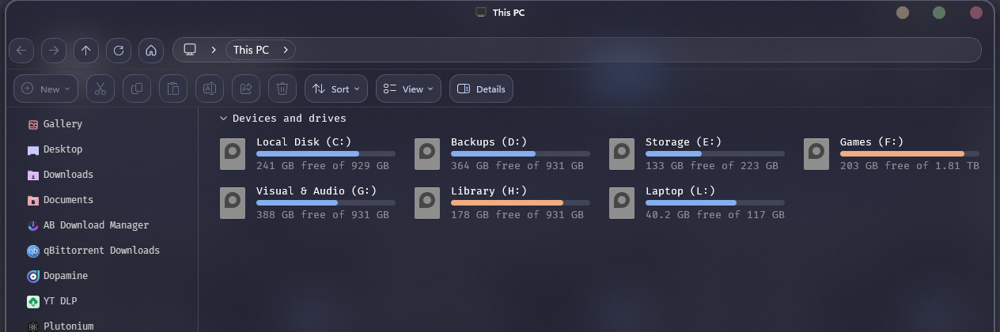

# File Explorer Styler Plus

Themes for Windows 11 File Explorer, based on Windows 11 File Explorer Styler
by m417z. This version adds a styled status bar at the bottom of the window.

## Features
- **Every theme and setting from the original.** Pick a theme or write your
  own styles, same as before.
- **Status bar dock.** The status bar sits on a rounded Catppuccin Mocha dock
  with a soft grey border that turns into a blue to mauve gradient while the
  cursor is over it. On by default; turn off **Status bar dock** to get the
  stock bar back.
- **Mocha view buttons.** The two view buttons get a blue ring on the current
  view and a gradient ring on hover. Their icons are redrawn in Mocha colours
  instead of Explorer's light grey tiles.
- **GPU switch button.** If you use GPU Accelerated Explorer View Plus, its
  view switch button gets the same dock face and hover.

## How to install
1. Turn off Windows 11 File Explorer Styler if you have it, so the two don't
   fight.
2. In Windhawk, click **Create a new mod**.
3. Replace the code with
   [windows-11-file-explorer-styler-plus.wh.cpp](windows-11-file-explorer-styler-plus.wh.cpp).
4. Click **Compile Mod**, then **Exit Editing Mode**.
5. Open a new File Explorer window.

## Credits
Based on [Windows 11 File Explorer Styler](https://windhawk.net/mods/windows-11-file-explorer-styler)
by [m417z](https://github.com/m417z). Plus changes by DavidHiFi. GPL-3.0
license.
