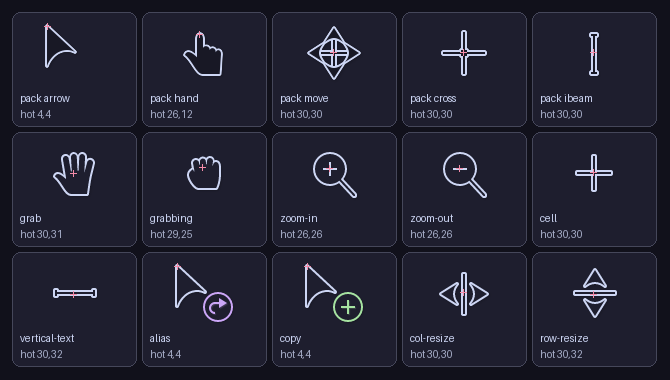

# Chromium Cursors Mocha

Catppuccin Mocha cursors for the ten cursors Chrome, Edge and Electron apps draw themselves: grab, grabbing, zoom in, zoom out, cell, vertical text, alias, copy, column resize and row resize. Windows cursor themes don't reach these, so most themes leave them as Chromium's stock art.



They pair with the [Catppuccin Mocha Dark](https://github.com/catppuccin/cursors) Windows cursor pack and use its dark style: a base fill, a text outline, mauve for alias and green for copy.

## Install

1. Copy the `cursors` folder to `C:\Windows\Cursors\Catppuccin-Mocha-Dark-Cursors\chromium`.
2. Install [Chromium Cursor Remap](https://windhawk.net/mods/chromium-cursor-remap) in Windhawk.
3. Set each cursor's **Custom cursor source** to its file, or import the `chromium-cursor-remap` block from [settings/mods-settings.json](../../settings/mods-settings.json).

Open Chrome and drag a map or hover a table's column edge to see them.

## Rebuild

`build.py` renders the cursors from the upstream SVGs and keeps their hotspots. It needs Python with `resvg-py==0.2.6` and `pillow==11.3.0`:

```
python build.py cursors
```

## License

The art comes from [catppuccin/cursors](https://github.com/catppuccin/cursors), so this folder is GPL-2.0. See [LICENSE](LICENSE).
